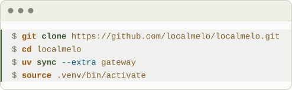
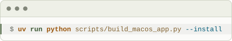
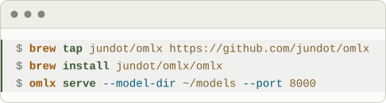
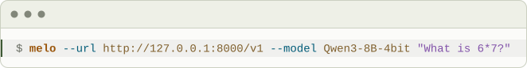
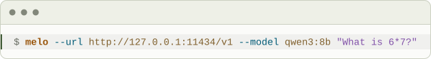

<p align="center">
  
</p>

# localmelo

<p align="center">
  <a href="https://localmelo.github.io/localmelo/"></a>
  <a href="https://localmelo.github.io/localmelo/en/quickstart.html"></a>
  <a href="https://localmelo.github.io/localmelo/en/index.html#features"></a>
  <a href="https://localmelo.github.io/localmelo/en/developers.html"></a>
  <a href="README.zh-CN.md"></a>
  <br>
  <a href="https://localmelo.github.io/localmelo/en/updates.html#roadmap"></a>
  <a href="pyproject.toml"></a>
  <a href="LICENSE"></a>
  <a href="docs/llms.txt"></a>
</p>

A personal agent that runs on your own computer. It works with tools,
remembers across chats and talks to your own model server or a cloud API.

**Status:** pre-alpha; commands and APIs may change before v0.1.0 (due 2026-12-20).

<p align="center">
  
  
</p>

## What you can do

- Talk to one main chat in the terminal (`melo`), the web console (`melo serve`) or the Mac app: it answers, or hands bigger work to a task by priority, and a card says what happened.
- Let melo remember across chats: the newer fact wins, and the Memory tab lets you read, edit or forget each note.
- Say a chore once, like `every weekday at 8:30, brief me on my calendar`: it runs on time, and a check-in tells you what finished. Ask for a reminder, like `remind me to send the report on Friday at 9`, and it shows the date it understood, then tells you at that time.
- Approve what matters: melo asks before commands and file writes, and shows the change.
- Use oMLX, Ollama, vLLM, SGLang or MLC LLM on your computer, or a cloud API; run one task from a script and get one JSON line.

## Install

<!-- usage:install -->
<picture><source media="(prefers-color-scheme: dark)" srcset="docs/assets/usage/install.dark.svg"></picture>

```bash
git clone https://github.com/localmelo/localmelo.git
cd localmelo
uv sync --extra gateway
source .venv/bin/activate
```
<!-- /usage -->

Keep the directory name `localmelo`: the package is built from it. Without
uv, see [Install with pip](https://localmelo.github.io/localmelo/en/quickstart.html#install-with-pip).

## On a Mac: the app

On a Mac with Apple silicon, one command, run in the clone, builds the app and
installs it in `~/Applications` without admin rights:

<!-- usage:app-install -->
<picture><source media="(prefers-color-scheme: dark)" srcset="docs/assets/usage/app-install.dark.svg"></picture>

```bash
uv run python scripts/build_macos_app.py --install
```
<!-- /usage -->

- Open localmelo from Spotlight: a native window around the web console.
- The menu bar shows how many chats and tasks run, and when one waits for you; with the window put away, a small pill says what Melo is doing.
- It is a development build, signed ad hoc; it needs a Swift compiler ([macOS app guide](docs/guides/macos-app.md)).

## Quick start

On a Mac with Apple silicon (macOS 15 or later), [oMLX](https://github.com/jundot/omlx)
is the recommended model server. Put each model in its own folder of `~/models`
([how](docs/guides/model-servers.md#serve-a-model-with-omlx)), then serve the folder:

<!-- usage:omlx-serve-readme -->
<picture><source media="(prefers-color-scheme: dark)" srcset="docs/assets/usage/omlx-serve-readme.dark.svg"></picture>

```bash
brew tap jundot/omlx https://github.com/jundot/omlx
brew install jundot/omlx/omlx
omlx serve --model-dir ~/models --port 8000
```
<!-- /usage -->

In a second terminal, run a task:

<!-- usage:readme-run-omlx -->
<picture><source media="(prefers-color-scheme: dark)" srcset="docs/assets/usage/readme-run-omlx.dark.svg"></picture>

```bash
melo --url http://127.0.0.1:8000/v1 --model Qwen3-8B-4bit "What is 6*7?"
```
<!-- /usage -->

With [Ollama](https://ollama.com), pull a model with `ollama pull qwen3:8b` and run:

<!-- usage:readme-run-ollama -->
<picture><source media="(prefers-color-scheme: dark)" srcset="docs/assets/usage/readme-run-ollama.dark.svg"></picture>

```bash
melo --url http://127.0.0.1:11434/v1 --model qwen3:8b "What is 6*7?"
```
<!-- /usage -->

- Run `melo` alone to chat; the first run finds a running server and saves a configuration.
- `melo serve` starts the gateway and opens the web console in your browser.
- `-u` and `-m` are short for `--url` and `--model`; [old spellings](docs/reference/cli.md#old-spelling-to-new) still work.
- [`melo-task`](docs/reference/scheduler.md#task-command) creates and controls the gateway's background tasks.

## Learn more

| Page | What it has |
|---|---|
| [Website](https://localmelo.github.io/localmelo/) | What localmelo does, the roadmap and what's new |
| [Quickstart](https://localmelo.github.io/localmelo/en/quickstart.html) | Install, a first task, a saved configuration and the gateway |
| [Architecture](https://localmelo.github.io/localmelo/en/architecture.html) | How the parts fit together, and the [memory design](https://localmelo.github.io/localmelo/en/memory-design.html) |
| [Developer guide](https://localmelo.github.io/localmelo/en/developers.html) | Setup, tests, checks and how to send a change |
| [Reference documentation](docs/README.md) | Every guide and reference page |

## Security

> [!WARNING]
> Tools run with your account's permissions, and there is no sandbox.

- The model can run shell commands and Python, and read or write any file you can.
- On macOS, a worker run (`melo worker`) and a saved task can write only in their workspace.
- The gateway requires authentication and refuses non-loopback binds.
- Its token does not protect against malicious processes under your own OS user.
- Read [SECURITY.md](SECURITY.md) and [what the checks do](docs/guides/tools-mcp.md#what-the-checks-do).

## Contributing

Bug reports, documentation fixes and small pull requests are welcome; the
[developer guide](https://localmelo.github.io/localmelo/en/developers.html)
has the setup, the tests and the checks to run.

## License

MIT © The localmelo Authors. See [LICENSE](LICENSE).
