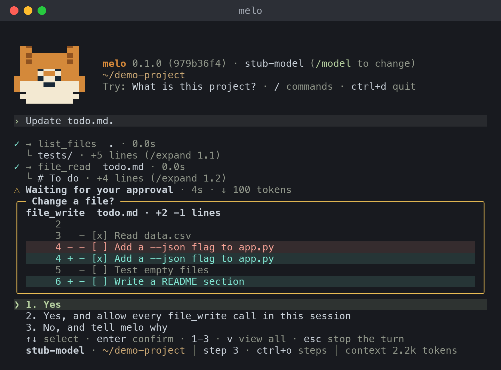

<p align="center">
  
</p>

# localmelo

<p align="center">
  <a href="https://localmelo.github.io/localmelo/zh-CN/index.html"></a>
  <a href="https://localmelo.github.io/localmelo/zh-CN/quickstart.html"></a>
  <a href="https://localmelo.github.io/localmelo/zh-CN/index.html#features"></a>
  <a href="https://localmelo.github.io/localmelo/zh-CN/developers.html"></a>
  <a href="README.md"></a>
  <br>
  <a href="https://localmelo.github.io/localmelo/zh-CN/updates.html#roadmap"></a>
  <a href="pyproject.toml"></a>
  <a href="LICENSE"></a>
  <a href="docs/llms.txt"></a>
</p>

一个本地个人智能体：在你自己的模型服务器或云端 API 上，借助工具和记忆完成任务。你可以在命令行中使用它，也可以在脚本和基准测试中使用（每次运行输出一行 JSON 和固定的退出码），或者通过 HTTP 调用它。

**状态**：早期预览版（pre-alpha）。直接模式、终端里的交互式命令行和网关现在已经可以使用；在 v0.1.0（计划于 2026-12-20）之前，命令和 API 都可能变化。

## 安装

```bash
git clone https://github.com/localmelo/localmelo.git
cd localmelo
uv sync --extra gateway
source .venv/bin/activate
```

请保留目录名 `localmelo`：软件包就是从这个目录构建的。不使用 uv 时，请看[用 pip 安装](https://localmelo.github.io/localmelo/zh-CN/quickstart.html#install-with-pip)。

## 在 Mac 上：应用

在搭载 Apple 芯片的 Mac 上，在克隆下来的目录里运行一条命令，就能构建 macOS 应用并安装到 `~/Applications`，不需要管理员权限：

```bash
uv run python scripts/build_macos_app.py --install
```

从 Spotlight 打开 localmelo。应用是网页控制台外面的一个原生窗口，它的菜单栏图标显示有多少聊天和任务在运行，以及何时有一个在等你批准。这是开发版本，使用临时签名（ad hoc），在使用它的这台 Mac 上构建，不是经过公证的下载。构建需要 Swift 编译器：正式版 Xcode，或者 Command Line Tools（`xcode-select --install`）；见 [macOS 应用指南](docs/zh-CN/guides/macos-app.md)。

## 快速开始

启动一个模型服务器，然后运行一个任务。在搭载 Apple 芯片、macOS 15 或更高版本的 Mac 上，推荐使用本地服务器 [oMLX](https://github.com/jundot/omlx)。把每个模型放进 `~/models` 下各自的文件夹（文件夹名就是模型 ID；[模型服务器指南](docs/zh-CN/guides/model-servers.md#serve-a-model-with-omlx)说明了如何下载模型），然后安装 oMLX 并提供这个文件夹：

```bash
brew tap jundot/omlx https://github.com/jundot/omlx
brew install jundot/omlx/omlx
omlx serve --model-dir ~/models --port 8000
```

在第二个终端里运行一个任务：

```bash
melo --url http://127.0.0.1:8000/v1 --model Qwen3-8B-4bit "What is 6*7?"
```

在其他系统上，或者你更喜欢 [Ollama](https://ollama.com) 时，先运行 `ollama pull qwen3:8b` 下载模型，然后运行：

```bash
melo --url http://127.0.0.1:11434/v1 --model qwen3:8b "What is 6*7?"
```

在终端里运行 `melo` 可以对话。第一次运行时，它会找到正在运行的服务器（oMLX 在 8000 端口，Ollama 在 11434 端口），自动选择模型或询问你要用哪一个，并保存配置；`melo serve` 启动网关并在浏览器中打开网页控制台（`melo console` 可再次打开）。网关在 `http://127.0.0.1:8401/` 上提供 HTTP API 和网页工作区。`-u` 和 `-m` 是 `--url` 和 `--model` 的字母写法；旧写法（`--base-url`、`--chat-model`、`--serve`、`--reconfigure`、`--gateway-login`）仍然可用，完整对照见[旧写法对应的新写法](docs/reference/cli.md#old-spelling-to-new)。

<p align="center">
  
</p>

## 了解更多

- [网站](https://localmelo.github.io/localmelo/zh-CN/index.html)：localmelo 是什么，以及你能用它做什么。
- [快速开始](https://localmelo.github.io/localmelo/zh-CN/quickstart.html)：一步步安装、运行第一个任务、保存配置和启动网关。
- [架构](https://localmelo.github.io/localmelo/zh-CN/architecture.html)：智能体、检查、记忆和工具如何组合在一起。
- [路线图和更新](https://localmelo.github.io/localmelo/zh-CN/updates.html)：v0.1.0 的计划和按日期排列的变更。
- [记忆设计](https://localmelo.github.io/localmelo/zh-CN/memory-design.html)：记忆的设计，其中一部分尚未实现。
- [开发者说明](https://localmelo.github.io/localmelo/zh-CN/developers.html)：开发环境、测试、检查，以及如何提交改动。
- [文档索引](docs/zh-CN/README.md)：所有指南和参考页面，从命令行到记忆和网关。

## 安全

> [!WARNING]
> 工具以你的账户权限运行，并且没有沙箱：模型可以运行 shell 命令和 Python 代码，也可以读写你能访问的任何文件。网关要求身份验证并拒绝非回环监听，但令牌无法防御同一操作系统用户下的恶意进程。在 macOS 上，worker 运行（`melo worker`）和保存的任务只能在自己的工作区内写文件；读取和网络不受限制。详见 [SECURITY.md（英文）](SECURITY.md)和[检查能做什么（英文）](docs/guides/tools-mcp.md#what-the-checks-do)。

## 参与贡献

欢迎提交问题报告、文档修正和小而聚焦的 pull request。[开发者说明](https://localmelo.github.io/localmelo/zh-CN/developers.html)里有开发环境、测试和需要运行的检查。

## 许可证

MIT © The localmelo Authors。详见 [LICENSE](LICENSE)。
