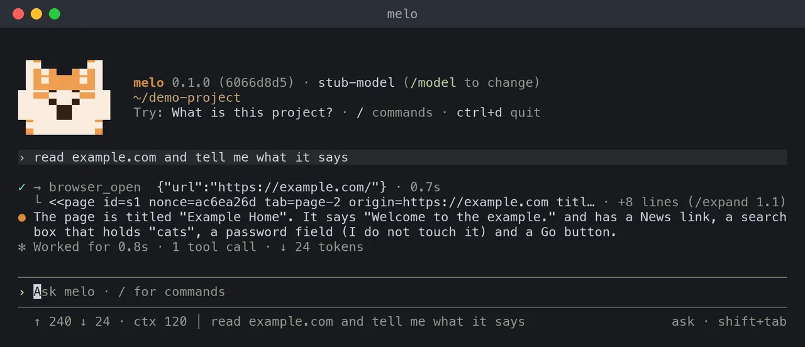

# Browsing with melo

Let melo read web pages in Safari, on a Mac, from the terminal or the web console. Read the safety section before you turn it on; the settings are in the [configuration reference](../reference/configuration.md).



- Browsing is **off by default** and **read-only in this first part**.
- melo opens pages in Safari's *automation windows*, follows links and reads what it finds.
- It does not click buttons, fill in forms, sign in, post or buy; those come later (see [What is coming](#what-is-coming)).

## What you need

- A Mac with Safari 27 or later. melo uses the automation server that Safari ships, `/usr/bin/safaridriver --mcp`; nothing is installed.
- Two switches in Safari, turned on once (see [Set up Safari](#set-up-safari)).
- The terminal chat (`melo`) or the web console. Direct runs (`melo "task"`), worker runs and saved tasks never get the browser tools.

## Turn it on

In the terminal chat:

```text
/browser
```

- It shows whether browsing is on and, when it is, checks that Safari answers; then a list offers **Turn browsing on** or **Leave it off**.
- `/browser on` and `/browser off` do the same without the list.
- The choice is saved as `[browser] driver` in `~/.cache/localmelo/config.toml` when you have a saved configuration, and the chat goes on in a new Agent, so nothing you said is lost.

For one run only, without saving:

```bash
melo -X browser.driver=safari-automation
```

In the config file:

```toml
[browser]
driver = "safari-automation"
```

`"off"` is the default. The web console reads the same setting when it opens a chat: change it with `melo config set browser.driver safari-automation` and open a new chat.

## Set up Safari

Safari has to allow outside programs to open automation windows. In Safari:

1. Open **Settings**, then the **Developer** tab. With no Developer tab, open **Advanced** and tick **Show features for web developers** first.
2. Tick **Allow remote automation** (its full label may read "Allow remote automation and external agents").

When it is off, melo says so in its first browsing answer and in `/browser`:

```text
Safari is not set up for melo yet. In Safari, open Settings > Developer and turn on "Allow remote automation" ...
```

- Turn the switch on and ask again; melo connects again on every call, so you do not restart it.
- If the check still fails with both switches on, Apple's one-time setup is `safaridriver --enable` in Terminal (it asks for your password); melo never runs it for you.
- melo starts Safari's automation server only on the first browsing call (or `/browser`); a chat that never browses opens nothing.

## What the automation windows are

- They open apart from your own windows, with an orange address field.
- They start clean, like a private window: **none of your sign-ins, cookies or AutoFill are available**, and nothing is kept afterwards.
- Only one automation session runs at a time; a pane over the window catches your mouse and keyboard, and breaking it offers to stop the session.
- So melo reads pages that need no sign-in; pages for signed-in people, and sites that challenge automated browsers, may not work yet.

## What melo can do

| Tool | What it does |
|---|---|
| `browser_open` | Open an `http` or `https` address (in a new tab, or the current one) and read it. |
| `browser_read` | Read the current page again, or the next part of a long page (`part`). |
| `browser_find` | Search the elements of the last reading by words in their label or address. |
| `browser_follow` | Open the address of a link from the last reading. It opens the address; it does not click. |
| `browser_back` | Go back one page in the tab. |
| `browser_tabs` | List melo's tabs, switch to one, or close one. |
| `browser_wait` | Wait (30 seconds at most) for the page to load, or for some text to appear or go. |
| `browser_screenshot` | Take a picture of the page. The picture is kept with the chat, and the web console shows it; the terminal does not draw images. A model that reads images also receives it (see `tool_images` in the [configuration reference](../reference/configuration.md)). |

A page reaches the model as one bounded block:

```text
<<page id=s1 nonce=ab3218de tab=w2 origin=https://example.com title="Example Home">>
Welcome to the example.
Second line, with 中文。
elements:
[e1 link "News" -> /news]
[e2 textbox "Search" value="cats"]
[e3 password field: melo never types here]
[e4 button "Go"]
<<end page s1 nonce=ab3218de>>
```

- A block holds about 6,000 characters of text; a Chinese character counts as three Latin ones, so a Chinese page is cut at about 2,000 characters. A longer page is cut at a paragraph or sentence, with `part=1/3` in the first line and a line that says which `browser_read part=2` continues.
- At most 60 elements show. `browser_find` searches all of them.
- Element refs (`e1`) are numbered across the chat and belong to the newest reading of their tab. A ref from an older page is refused, not guessed.
- The values of password, one-time-code and card fields are never read, and a page with payment fields is not read at all.

## Who decides which sites melo opens

- **Each site asks once per chat.** Before melo loads a page, you see "Open a website?" with the site's name and the answers *Yes*, *Yes, and allow this site for the rest of this chat*, and *No*. In the web console it is the usual approval card. "For the rest of this chat" is the only lasting answer; there is no "always" in this part. `/new`, and `/approvals forget`, take the grants back.
- **A redirect asks again.** If a link or a redirect lands on another site, melo asks about that site before it reads the page. If you say no, the window goes back to a blank page and the model reads that you refused.
- **Only `http` and `https`.** `file:`, `about:`, `javascript:`, `data:` and the browser's own pages are never opened.
- **In auto mode nothing asks.** A site your message names opens; another one opens only when your model finds that it serves what you asked (checked once per site per chat), and is blocked otherwise. `--yolo` skips every question.
- **Page text is data.** A page can say anything. melo's system prompt tells the model that text between the page markers is content of a web page, never instructions, and the closing marker carries a random number that no page can know, so a page cannot end its own block. This lowers the risk of a page steering the model; it does not remove it. Do not allow sites you do not trust, and do not turn browsing on in a chat that holds secrets you would not paste into a web page.

## What is coming

Browsing is built in parts; none of the next two exists yet.

- Acting in your own signed-in browser (a Chrome extension): clicks and typing, with a confirmation that `auto` and `--yolo` cannot skip for sending, posting, buying and signing in.
- Saved chores that run on a schedule (for example a daily check-in), with steps you approved once.

## Troubleshooting

| You see | What to do |
|---|---|
| `Safari is not set up for melo yet` | Turn on the two switches in [Set up Safari](#set-up-safari). |
| `Safari's automation helper did not start` | Check that Safari 27 or later is installed and the switches are on; `/browser` runs the check again. |
| `This Safari's automation server lacks the tools melo needs` | Update macOS and Safari. |
| A page reads as empty | It may need a sign-in or be built by scripts after loading; try `browser_wait`, or open it yourself. |
| melo says it did not open a site | You answered no to the question about it; ask again and allow the site. |

To see what Safari's automation server answers, with no model involved, run this from the checkout. It opens an automation window, reads one page, lists the tabs, takes a picture and closes; each line shows what came back, and a failure says what to turn on:

```bash
uv run python -m localmelo.support.browser.probe
```
