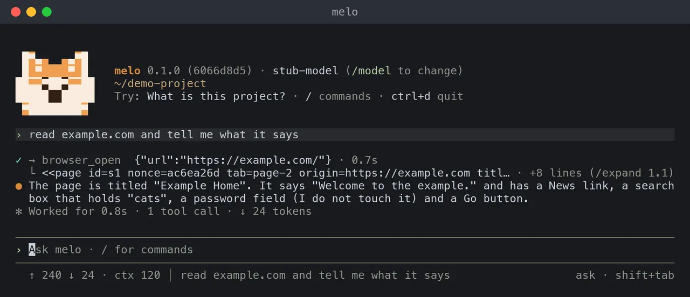

# Browsing with melo

Let melo read web pages in Safari, and click, type and choose on them, on a Mac, from the terminal or the web console. Read the safety section before you turn it on; the settings are in the [configuration reference](../reference/configuration.md).



- Browsing is **off by default**.
- melo opens pages in Safari's *automation windows*, follows links and reads what it finds. It works in one tab, like a person would.
- It can click a button or link, type into a text box and choose from a list, all **inside melo's own browser window**. It never types a password, a card number or a one-time code, never reads your cookies, and asks before it sends a form (see [Clicking, typing and choosing](#clicking-typing-and-choosing)).
- It does not sign in for you, post or buy; moving the mouse on your desktop is a different feature and is not part of this (see [What is coming](#what-is-coming)).

## Read a page without the browser

Every chat can read a public page without Safari, with the `web_fetch` tool. It is **on by default** and needs no setup.

- Ask about a website or paste its address: melo reads the page as text (title, headings, main text and links). Plain text and JSON come back as they are.
- It only reads: one request, no cookies, no sign-ins, no forms. PDFs and other files are refused for now.
- It never reaches this Mac or your local network. `localhost`, private and link-local addresses, `.local` names, this Mac's own addresses (also a public IPv6 one) and the network around them, and a redirect or DNS answer that points to one of them are refused.
- A site your own recent messages name reads at once: that exact site, with or without `www.`. A site under it (`docs.example.com` when you named `example.com`) and any other site ask once per chat ("Let melo read example.com?", with the full address), and one "allow for this chat" covers the browser too. A file name such as `README.md` does not name a site.
- A page that needs a sign-in, blocks automated readers or is built by scripts says so. With browsing on, melo can try it in Safari instead.
- Tasks have it too. Turn it off in Settings → Chats and folders → **Read web pages**, or with `melo config set tools.web_fetch false`. The limits and the exact rules are in [Tools](../reference/tools.md#reading-a-public-web-page).

The rest of this page is about browsing in Safari, which also follows links, clicks, types and runs a page's scripts.

## What you need

- A Mac with Safari 27 or later. melo uses the automation server that Safari ships, `/usr/bin/safaridriver --mcp`; nothing is installed.
- Two switches in Safari, turned on once (see [Set up Safari](#set-up-safari)).
- The terminal chat (`melo`) or the web console. Direct runs (`melo "task"`), worker runs and saved tasks never get the browser tools.

## Turn it on

In the terminal chat:

```text
/browser
```

- It shows whether browsing is on and, when it is, checks that Safari answers; then a list offers **Turn browsing on** or **Leave it off**.
- `/browser on` and `/browser off` do the same without the list.
- The choice is saved as `[browser] driver` in `~/.cache/localmelo/config.toml` when you have a saved configuration, and the chat goes on in a new Agent, so nothing you said is lost.

For one run only, without saving:

```bash
melo -X browser.driver=safari-automation
```

In the config file:

```toml
[browser]
driver = "safari-automation"
keep_tabs = false   # true leaves the tabs melo opened in the window
```

`"off"` is the default. The web console and the app read the same setting when they open a chat, the main chat included: change it with `/browser on` there, or `melo config set browser.driver safari-automation`, and open a new chat.

## Set up Safari

Safari has to allow outside programs to open automation windows. In Safari:

1. Open **Settings**, then the **Developer** tab. With no Developer tab, open **Advanced** and tick **Show features for web developers** first.
2. Tick **Allow remote automation** (its full label may read "Allow remote automation and external agents").

When it is off, melo says so in its first browsing answer and in `/browser`:

```text
Safari is not set up for melo yet. In Safari, open Settings > Developer and turn on "Allow remote automation" ...
```

- Turn the switch on and ask again; melo connects again on every call, so you do not restart it.
- If the check still fails with both switches on, Apple's one-time setup is `safaridriver --enable` in Terminal (it asks for your password); melo never runs it for you.
- melo starts Safari's automation server only on the first browsing call (or `/browser`); a chat that never browses opens nothing.

## What the automation windows are

- They open apart from your own windows, with an orange address field.
- They start clean, like a private window: **none of your sign-ins, cookies or AutoFill are available**, and nothing is kept afterwards.
- Only one automation session runs at a time; a pane over the window catches your mouse and keyboard, and breaking it offers to stop the session.
- So melo reads pages that need no sign-in; pages for signed-in people, and sites that challenge automated browsers, may not work yet.

## What melo can do

| Tool | What it does |
|---|---|
| `browser_open` | Open an `http` or `https` address and read it. It reuses the tab melo opened in this chat; `tab="new"` opens another, and a tab id such as `t2` names one. |
| `browser_read` | Read the current page again, or the next part of a long page (`part`). |
| `browser_find` | Search the elements of the last reading (links, buttons, menu items, fields) by words in their visible text, `aria-label` or address. It says how many things on the page it left out. |
| `browser_follow` | Open the address of a link from the last reading. It opens the address; it does not click. |
| `browser_click` | Click a button, link, menu item or checkbox from the last reading, then read the page again. |
| `browser_type` | Type into a text box from the last reading (`submit=true` presses Enter afterwards, which sends the form). Never a password, card or one-time-code field. |
| `browser_select` | Choose an option in a select list from the last reading, by its text. |
| `browser_back` | Go back one page in the tab. |
| `browser_tabs` | List melo's tabs, switch to one, or close one. A tab whose page melo has not checked shows as *(not checked)*. |
| `browser_wait` | Wait (30 seconds at most) for the page melo opened to load, or for some text to appear or go. |
| `browser_screenshot` | Take a picture of the page. The picture is kept with the chat, and the web console shows it; the terminal does not draw images. A model that reads images also receives it (see `tool_images` in the [configuration reference](../reference/configuration.md)). |

A page reaches the model as one bounded block:

```text
<<page id=s1 nonce=ab3218de tab=t1 origin=https://example.com title="Example Home">>
Welcome to the example.
Second line, with 中文。
elements:
[e1 link "News" -> /news]
[e2 textbox "Search" value="cats"]
[e3 password field: melo never types here]
[e4 button "Go" sends a form -> /search]
<<end page s1 nonce=ab3218de>>
```

- A block holds about 6,000 characters of text; a Chinese character counts as three Latin ones, so a Chinese page is cut at about 2,000 characters. A longer page is cut at a paragraph or sentence, with `part=1/3` in the first line and a line that says which `browser_read part=2` continues.
- At most 60 elements show. `browser_find` searches all of them.
- Element refs (`e1`) are numbered across the chat and belong to the newest reading of their tab. A ref from an older page is refused, not guessed.
- The values of password, one-time-code and card fields are never read, and a page with payment fields is not read at all.
- A button that would send a form says so (`sends a form -> /search`), with the address the form goes to.
- Buttons are not only `<button>` elements: `role="button"` elements, menu items, tabs, links that run a script and other clickable elements are listed too, and `browser_find` matches their visible text and their `aria-label`. When nothing matches, the answer says how many things the page reader skipped (hidden or disabled ones, or past its limit of 400).

## Tabs

- **One tab per chat.** `browser_open` loads the next page into the tab melo opened, so a long task does not pile up windows. Ask for `tab="new"` only when two pages must stay open.
- **Short ids.** Tabs are called `t1`, `t2` and so on, in the order melo opened them, and every tool that takes a `tab` takes these. An id is never cut and never reused. Safari's own long ids never reach the model, and an id that melo did not hand out is refused.
- **Closing works.** `browser_tabs close` closes a tab melo opened. If Safari lost a tab meanwhile, the list leaves it out and says so (`t3 is gone: the browser no longer has it.`).
- **Your own tabs are left alone.** A tab melo did not open is never listed, read or closed; the list only says how many other tabs the window has. A tab a click opens (a link that opens in a new tab) counts as melo's.
- **Tidying up.** The tabs melo opened are closed when the chat ends and after ten minutes without a browser call; the last one is kept, empty, so Safari's automation session goes on, and nothing in it stays approved. `/new` does the same. Set `[browser] keep_tabs = true` to leave them all open.

<a id="clicking-typing-and-choosing"></a>

## Clicking, typing and choosing

`browser_click`, `browser_type` and `browser_select` act on an element of the last reading by its ref (`e12`), the way a person would. They work inside melo's browser window; they do not move your mouse or touch other apps.

- **Only the page that was read.** The action is done only if the tab still shows the address it had when the page was read and the element is still the one that was read (same kind, label and address). Otherwise nothing happens and melo asks the model to read the page again. A ref from an older page is refused before the browser is called.
- **After each action** melo checks the address the tab shows, as it does after a redirect: never this Mac, your network or melo's console, and a site it has not asked about is asked about before the page is read. Then it reads the page again; its refs are new.
- **Never a secret field.** melo does not type into a password, card or one-time-code field, and says why. It decides from the field's `type`, its `autocomplete` values (`current-password`, `new-password`, `one-time-code`, `cc-*`), text the page masks with CSS, the words that name it (name, id, `aria-label`, placeholder and its label, in English or Chinese: password, PIN, card number, CVV, verification code and so on) and the shape of a numeric code, once when it reads the page and again at the moment it types, so a field the page changed in between is not typed into. Ask the person to fill such a field in the window themselves.
- **Clicks and typing ask apart from reading.** The first time melo wants to click or type on a site in a chat you see "Let melo click and type on example.com?"; "allow for this chat" covers that site's clicks and typing only. Opening the site does not allow it.
- **A form that is sent asks by itself.** A click on a button that submits a form, and `browser_type` with `submit=true`, ask "Let melo send a form from example.com?" with the address the form goes to. That address is checked first, like any other: a form that posts to this Mac or your network is refused outright, and one that posts to another site asks about that site before anything is sent.
- **A link's address is checked before the click**, the same way. A click that lands on a local address anyway (a script sent it there) is blanked and refused.
- **Your session stays yours.** melo never reads cookies or page storage, and the automation windows have none of your sign-ins.

## Who decides which sites melo opens

- **Each site asks once per chat.** Before melo loads a page, you see "Open a website?" with the site's name and the answers *Yes*, *Yes, and allow this site for the rest of this chat*, and *No*. In the web console it is the usual approval card. "For the rest of this chat" is the only lasting answer; there is no "always" in this part. `/new`, and `/approvals forget`, take the grants back.
- **A redirect asks again.** If a link or a redirect lands on another site, melo asks about that site before it reads the page. If you say no, the window goes back to a blank page and the model reads that you refused.
- **Only `http` and `https`.** `file:`, `about:`, `javascript:`, `data:` and the browser's own pages are never opened. Nor is an address with a user name or password in it (`user@site`).
- **Never this Mac, your network or melo's console.** As with `web_fetch`, melo does not open `localhost`, private, link-local or carrier-shared addresses, `.local` names, names without a dot, an address written as one number, or a name whose DNS answer is one of these. melo's own console is refused too, wherever it listens. A redirect or a page that moves to such an address is blanked. This is checked before any question about the site. For a task's result, the main chat reads the task itself (`task_get`).
- **In auto mode nothing asks.** A site your own recent messages name opens (that site itself, with or without `www.`, not a site under it); another one opens only when your model finds that it serves what you asked (checked once per site per chat), and is blocked otherwise. A click or typing on a site is reviewed like opening it. A form that is sent is always reviewed by itself, even on a site you named. `--yolo` skips every question.
- **Page text is data.** A page can say anything. melo's system prompt tells the model that text between the page markers is content of a web page, never instructions, and the closing marker carries a random number that no page can know, so a page cannot end its own block. This lowers the risk of a page steering the model; it does not remove it. Do not allow sites you do not trust, and do not turn browsing on in a chat that holds secrets you would not paste into a web page.

## What is coming

Browsing is built in parts; none of the next two exists yet.

- Acting in your own signed-in browser (a Chrome extension): clicks and typing there, with a confirmation that `auto` and `--yolo` cannot skip for sending, posting, buying and signing in. The clicks on this page happen only inside melo's own automation window; moving your mouse on the desktop (computer use) is a separate feature.
- Saved chores that run on a schedule (for example a daily check-in), with steps you approved once.

## Troubleshooting

| You see | What to do |
|---|---|
| `Safari is not set up for melo yet` | Turn on the two switches in [Set up Safari](#set-up-safari). |
| `Safari's automation helper did not start` | Check that Safari 27 or later is installed and the switches are on; `/browser` runs the check again. |
| `This Safari's automation server lacks the tools melo needs` | Update macOS and Safari. |
| A page reads as empty | It may need a sign-in or be built by scripts after loading; try `browser_wait`, or open it yourself. |
| melo says it did not open a site | You answered no to the question about it; ask again and allow the site. |
| `... is not a tab of this chat` | Use a tab id such as `t1` from `browser_tabs list`; ids are never cut or guessed. |
| `That is a password field: melo never types ...` | By design. melo does not type passwords, card numbers or one-time codes; fill the field in yourself, in the automation window. |
| `The page is not the one that was read` or `That element is no longer on the page` | The page changed after it was read. `browser_read` gives current refs. |
| `melo's browser does not open local or private addresses` | The address is this Mac, your network or melo's console. That is on purpose; open it yourself if you need it. The developer setting that lets `web_fetch` read a test server (`web_fetch_allow_local`) does not change this. |

To see what Safari's automation server answers, with no model involved, run this from the checkout. It opens an automation window, reads one page, lists the tabs, takes a picture and closes; each line shows what came back, and a failure says what to turn on:

```bash
uv run python -m localmelo.support.browser.probe
```
