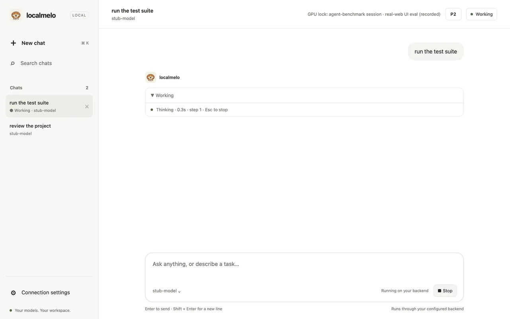

# Gateway and HTTP API

The gateway serves the agent over HTTP: an API for your own programs and a web workspace in your browser. Start it, keep it private, and run it at login on macOS.

## Start the gateway



```bash
melo serve
```

The old spellings (`melo --serve`, `--daemon`, `--gateway-login`, `--gateway-rotate-token`, `--enable-playground`, `--allow-unconfigured`) still work, for the macOS app and for launchers; [Old spelling to new](../reference/cli.md#old-spelling-to-new) lists them.

- With no config file yet, `melo serve` asks first, as `melo setup` does (`Found a model server at …`, `Use this model server?`; see [Configuration](configure.md#set-up-with-the-wizard)); without a terminal it prints `melo: no backend is configured; run melo setup in a terminal` and exits with code 1.
- `melo serve --force` starts the gateway without the wizard even when no backend is configured or the config file has validation errors, so a client or the web console can inspect `GET /api/health` and save a configuration through `PUT /api/settings`.
- `--url` and `--model` are usage errors with `melo serve`: the gateway uses the config file.
- It listens on `127.0.0.1:8401`, the `[gateway]` defaults of the config file; `--host` and `--port` change them for one run, as in `melo serve --port 9401`.
- Starting does not contact the model server: run a task to check it. Press Ctrl+C to stop the gateway.

It prints the model, the embedding and its addresses:

```text
  Starting localmelo gateway ...
  Model: qwen3:8b on Ollama
  Embedding: none
  Gateway: http://127.0.0.1:8401
  Web console: opened in your browser (melo console opens it again).
```

- The last line appears once the gateway listens. At a terminal on this computer, `melo serve` opens the web console in your default browser, signed in (`BROWSER` picks another browser).
- Over SSH, in a pipe, as a login service and in the macOS app's gateway it opens none; it prints `Web UI:  http://127.0.0.1:8401/` and `Sign in: run melo console -p 8401 in another terminal` instead.
- If no browser starts, it prints the one-use link, as `melo console` does.

## Keep the gateway private

> [!WARNING]
> The gateway accepts only loopback binds and requires a bearer token or browser session cookie for protected APIs. A token holder can act with your permissions. The private token file does not protect against malicious processes running as the same OS user, browser extensions, or compromised same-origin code. Browser cookies are not isolated by port: a port-specific name is not a security boundary against another service on the same host. Do not expose the gateway through a proxy.

- At a terminal on this computer `melo serve` opens the web console in your browser, signed in; `melo console` opens it again.
- Over SSH, or when no browser starts, `melo console` prints a single-use link to open within 60 seconds (do not share it) and exits 1 when no gateway listens on the port; for a nondefault port add `--port PORT`.
- The page exchanges the link's fragment for an HttpOnly, SameSite=Strict cookie valid for up to 30 days, and removes the fragment.
- `melo console --reset` replaces the private token file: all gateways using it reject old credentials, and open event streams are cut within about 250 ms (one event already being sent may still complete).
- The bearer token is generated on first use at `~/.cache/localmelo/gateway/auth/token` (directory 0700, file 0600); non-browser clients send `Authorization: Bearer <token>` on every `/api/` and `/v1/` request, including health, streams and blobs, and a missing or invalid credential returns 401.

The page and static assets are public bootstrap only. Keep tokens out of URLs, logs and shell history (a header on a command line can be read by local process inspection); this token is separate from model-server credentials.

On the default host, only programs on your computer can reach the gateway.
Web pages can still send it requests through your browser, so the gateway
refuses requests that are not addressed to it:

| HTTP status | `code` | When |
|---|---|---|
| 421 | `misdirected_request` | The `Host` header is not `127.0.0.1:<port>`, `localhost:<port>` or `[::1]:<port>`. This stops a page on another site that reaches the gateway under its own domain name (DNS rebinding). A gateway started by the macOS app also refuses `/api/auth/login` without the app's matching `X-LocalMelo-Instance`, and a login code is bound to that instance. |
| 403 | `foreign_origin` | A supplied `Origin` does not match the request Host exactly, or a request under `/v1/` or `/api/` has disallowed `Sec-Fetch-Site`. The login exchange requires an Origin. |
| 413 | `too_large` | The request body exceeds 1 MiB (1,048,576 bytes). |
| 415 | `unsupported_media_type` | A request under `/api/` has a non-empty body without `Content-Type: application/json`. |

The body is the usual error with a `code`:

```json
{"error":"Host header must be 127.0.0.1:8401, localhost:8401 or [::1]:8401","code":"misdirected_request"}
```

A refused request under `/api/` uses [API v2](../reference/api-v2.md)'s envelope instead:
`{"error": {"code": "misdirected_request", "message": "...", "details": {}}}`.

- Open the web workspace as `http://127.0.0.1:8401/` or
  `http://localhost:8401/`, with your port; with `host = "::1"`, use
  `http://localhost:8401/` or `http://[::1]:8401/`. Other addresses that
  reach the gateway, such as `http://0.0.0.0:8401/`, get 421.
- curl and scripts normally send no `Origin` header; Host and authentication
  checks still apply.
- Every response tells the browser not to show it in a frame (`X-Frame-Options: DENY` and a `Content-Security-Policy` that ends `frame-ancestors 'none'`), so a page on another site cannot embed the web workspace; a response with a policy of its own, such as a blob's `default-src 'none'; sandbox`, keeps one header with both.
- Every response also carries `X-Content-Type-Options: nosniff`, `Referrer-Policy: no-referrer`, `Cross-Origin-Opener-Policy: same-origin`, `Cross-Origin-Resource-Policy: same-origin` and `Permissions-Policy: camera=(), microphone=(), geolocation=()`.
- The checks are on when the host is `localhost` or a loopback IP address:
  `127.0.0.1`, `::1` or another address in `127.0.0.0/8`. Requests must
  still name the gateway as `127.0.0.1`, `localhost` or `[::1]`, so use one
  of these three as the host: on `127.0.0.2`, for example, your browser gets
  421 too.
- Non-loopback binds, including `0.0.0.0`, are refused at startup.
- Remote access through a reverse proxy or Tailscale Serve is not supported.

## Sessions

A session is one agent with its own working memory, so a task sees the
earlier tasks of its session and their answers. Each answer is kept without
its `<think>` block and cut to 8,000 characters, but a long session still
makes larger requests: leave out `session_id` for an unrelated task.

- Without a `session_id`, each request gets a new session with a generated
  id of 12 hex characters.
- A session runs one task at a time. A second request for a busy session
  waits until the first one finishes.
- The gateway keeps up to 50 sessions. Creating one more closes the least
  recently used idle session; if no session is idle, the new one is created
  anyway.
- Creating a session also closes the sessions that have been idle for more
  than 1 hour.
- Each session's agent uses the config file's backends and the default run
  options (four built-in tools, `file_read`, `file_write`, `list_files` and
  `python_exec`, and no MCP tools), except that it keeps its answers
  (`AgentOptions(record_answers=True, mode="gateway")`). A session does not
  offer `shell_exec`: legacy `/v1` has no approval policy, so there is no one
  to ask.
- When `LOCALMELO_PERSIST_MEMORY` is set for the gateway, all sessions save
  to the same SQLite files; see [Memory](memory.md#keep-memory-between-runs).

## Run the gateway at login (macOS)

```bash
melo serve install
melo serve status
melo serve uninstall
```

- `install` writes `~/Library/LaunchAgents/ai.localmelo.gateway.plist` and
  loads it. launchd then runs `<python> -m localmelo --serve --port 8401`
  with the Python of your environment, starts it at login, and restarts it
  whenever it exits (at most once every 3 seconds).
- `install --port N` uses another port. The address is `[gateway] host` from
  the config file; `--host` is ignored.
- Logs go to `~/.localmelo/logs/gateway.stdout.log` and
  `~/.localmelo/logs/gateway.stderr.log`.
- `status` prints whether the service is `installed` and `running`, and its
  `pid`.
- Save a configuration before `install`, with `melo` or the setup wizard in
  a terminal. The service cannot answer questions: without a config file it
  writes `melo: no backend is configured; run melo setup in a terminal`
  to `gateway.stderr.log` each time launchd starts it.
- launchd starts the service without your shell's environment variables, so
  cloud API keys and `LOCALMELO_PERSIST_MEMORY` are missing. Use a local
  backend with the service.
- The service needs macOS; on other systems `install` fails.

## Stop the gateway

- In its terminal, press Ctrl+C.
- One running in the background (the one `melo` starts for the main chat, say): `melo serve stop`. It prints `Stopped the gateway on port N.`, or `No gateway is running.`
- For the background service, run `melo serve uninstall`. A plain `kill`
  or `melo serve stop` does not help: launchd starts the gateway again.

- Stopping closes every session; a session still running a task has its agent closed, and the task ends as `crashed`.
- SIGTERM first waits up to 3 seconds for runs in flight, then cancels the ones left: the client's request fails and the run ends `crashed`.
- A `DELETE` request does not close a busy session: it returns 409 until the task ends.
