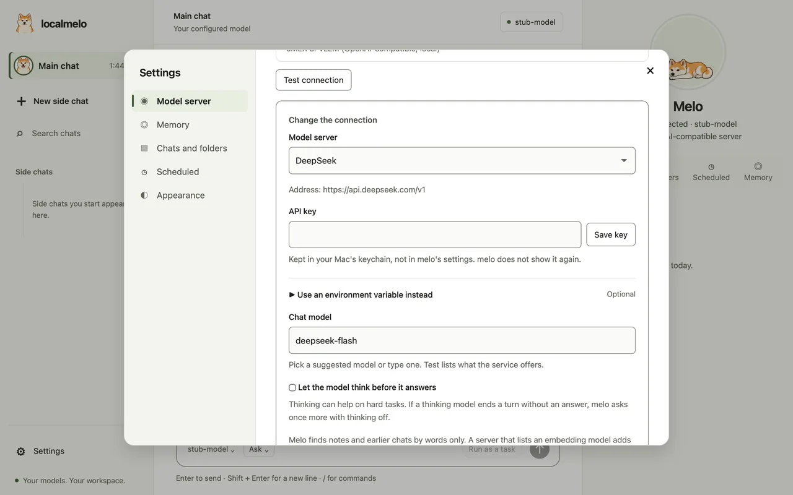
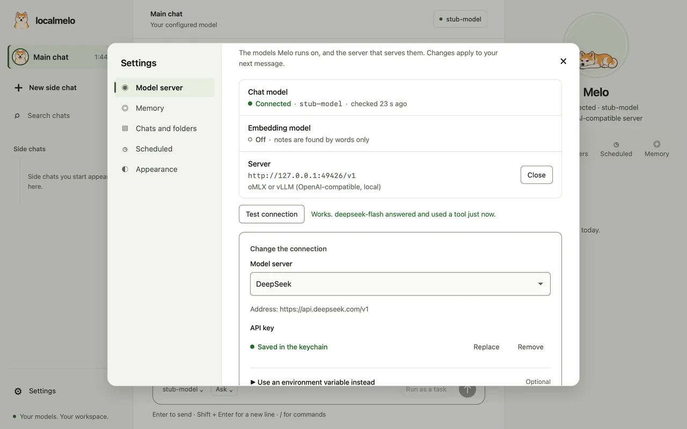

# Guide: Hosted models

Use a model from a hosted service (OpenAI, Google Gemini, Anthropic, NVIDIA, DeepSeek or any service that speaks the OpenAI format) when the model on your Mac is not enough. You set it up in Settings, with no shell work. For a model server you run yourself, see [Model servers](model-servers.md).

- Choose a service, paste your key once, press **Test connection**, save.
- The key is kept in your Mac's keychain, never in melo's settings.
- If a thinking model leaves its answer only in its thinking, melo recovers it.

## Set up a service



- Open **Settings**, then **Model server**, then **Change…**.
- In the **Model server** list, under **Hosted services**, choose the service. Its address and suggested models fill in.
- Paste your key and choose **Save key**.
- Pick a model from the list or type one, then choose **Test connection**.
- Choose **Save connection**. Your next message uses the service.

## The services

| Service | Address | Suggested models |
|---|---|---|
| OpenAI | `https://api.openai.com/v1` | `gpt-4o`, `gpt-4o-mini` |
| Google Gemini | `https://generativelanguage.googleapis.com/v1beta/openai` | `gemini-2.0-flash` |
| Anthropic | `https://api.anthropic.com/v1` | `claude-sonnet-4-20250514` |
| NVIDIA | `https://integrate.api.nvidia.com/v1` | `nvidia/llama-3.1-nemotron-70b-instruct` |
| DeepSeek | `https://api.deepseek.com/v1` | `deepseek-flash`, `deepseek-v4-pro` |
| Other (OpenAI format) | the address you type, up to `/v1` | the model you type |

- **Test connection** lists the models the service offers, so you can pick one from the list.
- OpenAI, DeepSeek and Other share the `[openai]` section of the config file; Gemini, Anthropic and NVIDIA have their own.
- Use **Other** for a service not in the list, such as a company gateway.

## Your key

- **Save key** writes the key to your Mac's keychain, under the name `localmelo.<service>` (for example `localmelo.deepseek`).
- The config file keeps only a pointer to it, `api_key = "keychain:localmelo.deepseek"`. melo does not show the key again, and it never reaches the config, the logs or the page.
- **Replace** saves a new key; **Remove** deletes it from the keychain.
- An environment variable still works: if `api_key_env` is set and the variable has a value, it is used before the keychain.
- The macOS app does not see variables from your shell. Paste the key in Settings instead of exporting it.

If melo cannot read the key, it says what to do:

| What you see | What to do |
|---|---|
| The saved key is not in the keychain | Paste the key again in Settings, or run `melo setup`. |
| The keychain is locked | Unlock it (open Keychain Access, or sign in to your Mac again), then try again. |
| No keychain on this computer | Set the key in an environment variable and name it in `api_key_env`. |
| That does not look like an API key | Paste only the key: no spaces, quotes or line breaks. |

## Test the connection



- **Test connection** asks the service for its model list, then sends one short chat that offers one tool.
- It tells you in plain words what is wrong, and what to do.
- The key is sent to the service only, in a header.

| Result | What it means |
|---|---|
| Works | The model answered and used the tool. |
| The service did not accept the key (401) | Paste the key again. |
| The service refused this account (402, 403) | Check the plan, balance and access on the service's website. |
| The service has no model called ... | Choose one from the list. |
| The service is busy (429) | Wait a moment, then test again. |
| The service did not answer in time | Try again, or choose a faster model. |
| Cannot reach the service | Check your internet connection and the address. |
| Connected, but the model did not use the test tool | melo needs a model that can use tools. |

## From the terminal

```shell
melo setup
```

- `melo setup` lists the servers on this computer and the same hosted services as Settings.
- The key is typed hidden and saved to the keychain; Enter keeps a key melo already has.
- **Use an environment variable instead** sets `api_key_env`.
- With no model server found, the first run offers **Use a hosted service**.

## Thinking models

- Some models think before they answer. Some services have a switch for it; Settings shows the checkbox **Let the model think before it answers** for them.
- A thinking model can end a turn with its answer only in its thinking. melo then asks once more with thinking off.
- If the reply is still empty, melo shows the last lines of the thinking as the answer, marked `(from melo's thinking)`, and the run finishes.
- A reply with no thinking at all still fails, as before.
- A run's result says when either happened (`empty_reply` in the JSON record, and a notice in the chat). To count them, or to run without them, set `[agent] empty_reply_fallback = "off"` (`-X agent.empty_reply_fallback=off` for one run); a turn that ends with only thinking then fails as it did before.
- DeepSeek: `deepseek-flash` starts with thinking off; `deepseek-v4-pro` keeps its own default. Change either with the checkbox or with `thinking` in the config.

## Pictures

- Some tools return pictures, such as a browser screenshot. With `[agent] tool_images = "auto"`, melo sends them to the model when it is known to read images.
- A service's model list does not say, so each service names the models: GPT-4o, GPT-4.1 and GPT-5 (OpenAI), every Gemini model, the Claude models and `deepseek-flash` read images; `deepseek-v4-pro` and NVIDIA's `nemotron` do not.
- Any other model counts as unknown and gets no pictures; its tool messages say it cannot see them. If yours reads images, set `tool_images = "on"`.

## The config file

Settings writes these lines; you can also write them yourself.

```toml
chat_backend = "openai"
embedding_backend = "none"

[openai]
base_url = "https://api.deepseek.com/v1"
api_key = "keychain:localmelo.deepseek"
chat_model = "deepseek-flash"
thinking = "off"             # "on", "off", or leave out to follow the service
```

- `base_url` tells the presets apart: OpenAI has none (its address is built in), DeepSeek has the address above, and any other address is Other.
- `api_key_env` still works. See the [configuration reference](../reference/configuration.md#cloud-api-keys) for every key.
- An `extra_body` field of your own wins over the thinking switch.

## Troubleshooting

| Symptom | Fix |
|---|---|
| The test says wrong key (401) after you pasted one | The key may have a space or a line break in it, or belong to another service. Paste it again. |
| The app cannot find a key you exported | The app starts without your shell's variables. Paste the key in Settings. |
| A run stops with "melo did not finish an answer" | The model replied with nothing and had no thinking to use. Try another model. |
| The answer ends with `(from melo's thinking)` | The model answered only in its thinking. Turn thinking off for that model, or choose another. |

Next: [Configure melo](configure.md), [The web console](web-console.md).
