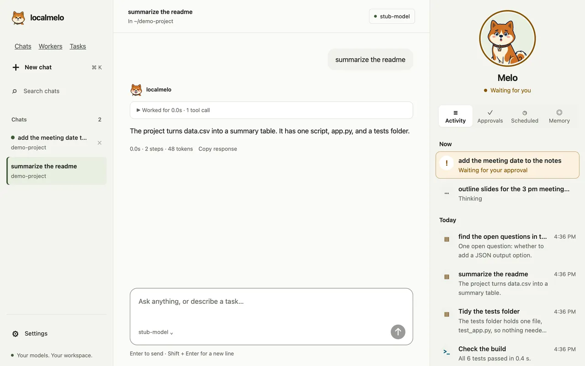
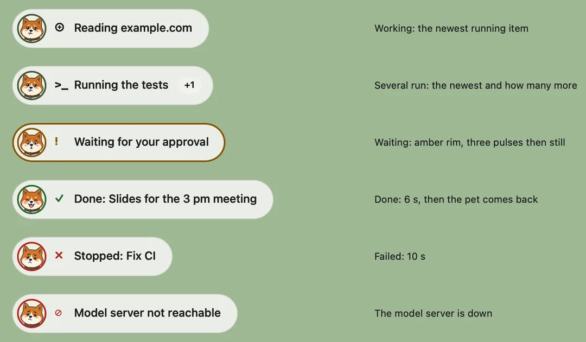

<a id="macos-development-app"></a>

# The macOS app (development build)

A native window around the web console, a menu-bar item and Melo on your desktop. It is a local prototype for the Mac that builds it: signed ad hoc, so no Apple developer account, and neither notarized nor a Homebrew cask.



## Install

- You need macOS, `uv`, network access at build time and a Swift compiler: the release Xcode at `/Applications/Xcode.app`, else the Command Line Tools (`xcode-select --install`).
- With neither compiler the build stops at once and prints one line that says so; a `DEVELOPER_DIR` in the environment picks another developer folder.
- The build starts, installs and downloads no model server, and changes no signing identity or Xcode setting.

From a checkout named `localmelo`, one command builds the app and installs it for your user, with no admin rights:

```bash
uv run python scripts/build_macos_app.py --install
```

- Open localmelo from Spotlight or `~/Applications`: the app is `~/Applications/LocalMelo.app`, and an earlier copy is replaced only when its bundle id is `org.localmelo.app`.
- `~/.local/bin/melo` links to the app's launcher only when no other `melo` is on `PATH` (the checkout's own `.venv/bin/melo` does not count); an existing `melo` is never replaced.
- To upgrade, quit localmelo and run the same command again; the pinned Python is cached in `~/Library/Caches/LocalMelo`.

To remove the app and the link, and nothing else (settings and chats stay in `~/.cache/localmelo`):

```bash
uv run python scripts/build_macos_app.py --uninstall
```

To build without installing, give a new path; the builder never overwrites an existing one:

```bash
uv run python scripts/build_macos_app.py --output /tmp/LocalMelo.app
```

The pinned Python archive and the wheels are checked against their hashes. The build leaves out parts of the Python runtime that nothing needs (36 MB; the app is about 147 MB). Code on the bundled interpreter, such as the `python_exec` tool, cannot import them, and `python -m venv` needs `--without-pip`.

## The window

- A starting view shows Melo, `Starting localmelo…` and the step: `Starting the local server`, `Signing in`, `Opening your workspace`.
- If the gateway does not start within 20 seconds, or stops later, the view says why and offers **Try Again**, **Open Log** and **Quit**.
- The log is `~/Library/Logs/LocalMelo/gateway.log`; a problem never shows a dialog or closes the app.
- The first-run setup is the console's settings dialog; the app uses the usual config and chats in `~/.cache/localmelo`.

<a id="language"></a>

## Language

- The window, the menus, the pill, the pet's menu and the quit dialog speak the console's language: English or Simplified Chinese, chosen from your Mac's preferred languages.
- `melo config set console.language zh-Hans` (or `en`, or `auto`) chooses one for the app and the console; the app reads it when it starts.
- The console in the app picks its language the same way, from the Mac's languages; see [Web console: language](web-console.md#language).

## The menu-bar item

| You see | It means |
|---|---|
| The logo alone | Nothing runs. |
| A number beside the logo | That many chats, tasks, direct runs and terminal chats run. |
| A red dot with a ring | A chat or task waits for your answer to an approval. |

- The menu lists what runs, **Waiting for your approval** (it opens that chat or task), **Open localmelo**, **Settings…** and **Quit localmelo**.
- **Sign In Again** appears only when it can help: after four failed sign-ins, on the Locked screen, and always in developer mode.
- The app checks every 2 seconds, so an approval shows within one poll; VoiceOver and the tooltip say the same in words.

## Melo on your desktop


Close the window, minimize it or hide the app (Command-H) and a small Melo lies at the bottom right of the screen, above the Dock. It goes away when the window comes back.

| Melo | Meaning |
|---|---|
| Flopped on its belly, half-closed eyes | Resting: nothing runs. |
| Glancing up, tongue out | Working: a chat, task, run or terminal chat runs. |
| Wide sparkling eyes, a small hop | Waiting for your approval. |
| Happy closed eyes, tail wagging | Done: a run just ended well (6 seconds). |
| Sad brows | The last run did not finish (10 seconds), or localmelo stopped. |
| Asleep, a small "z" drifting up | Nothing has happened for a minute; touching Melo wakes it. |

- Click Melo to open the window, or the chat or task that waits for you; drag it anywhere, and it remembers its place on each screen.
- Right-click (or Control-click) for **Open localmelo**, **Hide Melo**, **On the desktop** and **Quit localmelo**; **Show Melo** in the menu-bar menu brings it back.
- It stays above other windows and on every Space, is not in the Dock or Command-Tab, and never takes the keyboard.
- Its state is in `~/Library/Application Support/LocalMelo/pet.json`.
- Under Reduce Motion, in Low Power Mode, when the Mac runs hot or while Melo is hidden, it stops moving and shows still pictures.

## The activity pill



While the window is put away and something runs or waits, a small pill takes Melo's place and says in one line what Melo is doing.

- It says what runs in plain words ("Reading example.com", "Running the tests"); **+1** counts the others that run. While an approval waits it turns amber and says "Waiting for your approval".
- It shows "Done: …" for 6 seconds and "Stopped: …" for 10, and "Model server not reachable" while the model server is down. Then Melo comes back, wagging after a "Done".
- Click it to open the chat or task it names (the one that waits, for an approval). Drag it like Melo: it takes Melo's place and saves it. Point at it and press **×** to hide it until the next task starts.
- **On the desktop** in the menu-bar menu and in Melo's menu chooses **Melo and the activity pill** (the default), **Melo only** or **Nothing**. **Hide Melo** is the same as **Nothing**, and **Show Melo** brings back what you had.
- It breathes only while it works, and stands still under Reduce Motion, in Low Power Mode, when the Mac runs hot or while it is covered. VoiceOver reads one button: "Melo is reading example.com. Opens the chat."

## Quit and the gateway

- Opening the app starts its own gateway with `melo --serve --port 0`: a free port, never one that other work reserves, and an unknown listener is not adopted.
- When a gateway already runs (one `melo` started in a terminal, say), the app uses it instead, signed in the same way; it finds it through `~/.cache/localmelo/gateway/endpoint.json`.
- Quitting leaves a gateway the app did not start running, and the menu says so: **Quit localmelo (the gateway keeps running)**. `melo serve stop` stops it.
- Closing the window leaves the gateway running; quitting asks only when something would stop, for example `Quitting stops what is running: 2 tasks and 1 chat.`
- Direct runs and terminal chats belong to other processes and go on: `Not affected: 1 run and 1 terminal chat.`
- If another gateway holds the console's store, stop it first; a background service is checked with `melo serve status` and removed with `melo serve uninstall`.
- Quit the app before removing its bundle; for isolated manual tests, use a temporary `HOME`.

## Safety

- The launch identifier the app sends to its gateway is an instance check, **not authentication**: any local process can read it and replay it.
- The gateway still requires sign-in: the app gets short-lived, single-use login codes, never logs them and never puts the bearer token in a URL.
- Same-user processes and other localhost services are outside the boundary, and tools run as you; do not expose the gateway on a network or use it with untrusted tasks.
- The console's folder chip talks to the app through one handler, `localmeloFolder`, for pages from the gateway's own address only; **Show in Finder** shows only a folder the gateway lists or you picked.

## For developers

The app icon, the menu-bar logo and the desktop pictures are committed files (`macos/assets`, `macos/art/akita`) that the build copies; make them again on a Mac when a source picture changes:

```bash
uv run --with pillow python scripts/make_app_icons.py
```

```bash
uv run --with pillow python scripts/build_pet_assets.py --picks /path/to/picks.json
```

- `picks.json` is `{"root": "DIR", "picks": {"lie-idle": "path/below/DIR.png", ...}}` for the 14 states named in the script; Pillow is fetched for that run only.
- The web console shows the same pictures: `--console-only` copies them again into `support/gateway/static/akita`, without the art masters (see [Melo in the page](web-console.md#melo-in-the-page)).
- `GET /api/health` also says how the last run ended, in `status.recent` (see the [API reference](../reference/api-v2.md)); Melo reads it.

The WebKit integration tests open native windows and need a graphical macOS session, so they are opt-in; run them with a temporary HOME:

```bash
HOME="$(mktemp -d)" LOCALMELO_MACOS_UI_TESTS=1 nice -n 19 uv run pytest -q tests/test_macos_webview_integration.py
```
