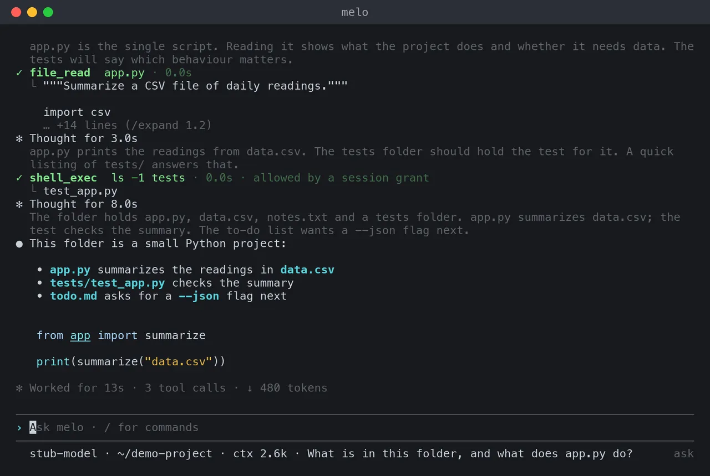
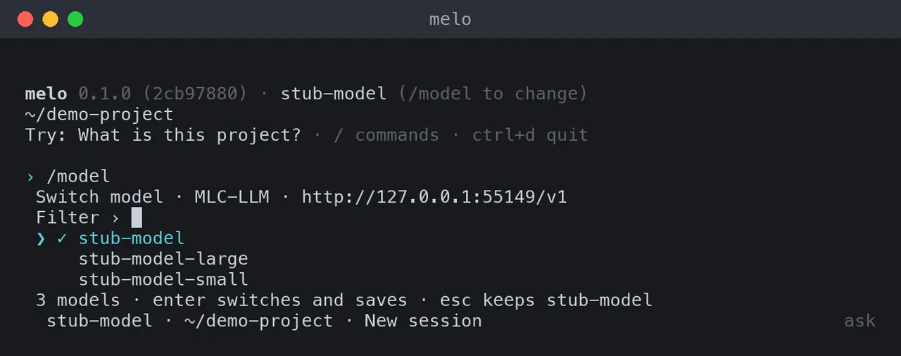
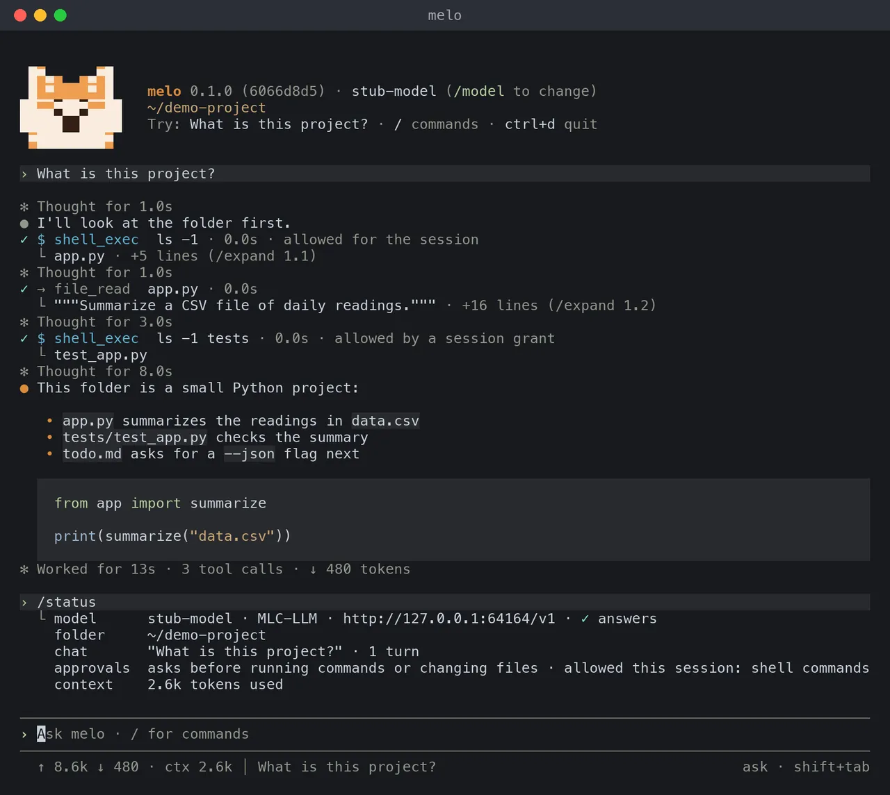
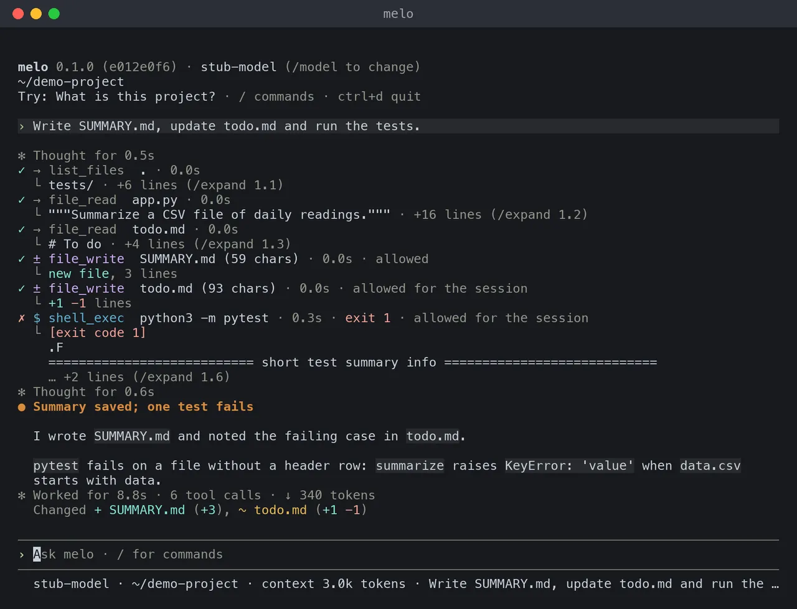
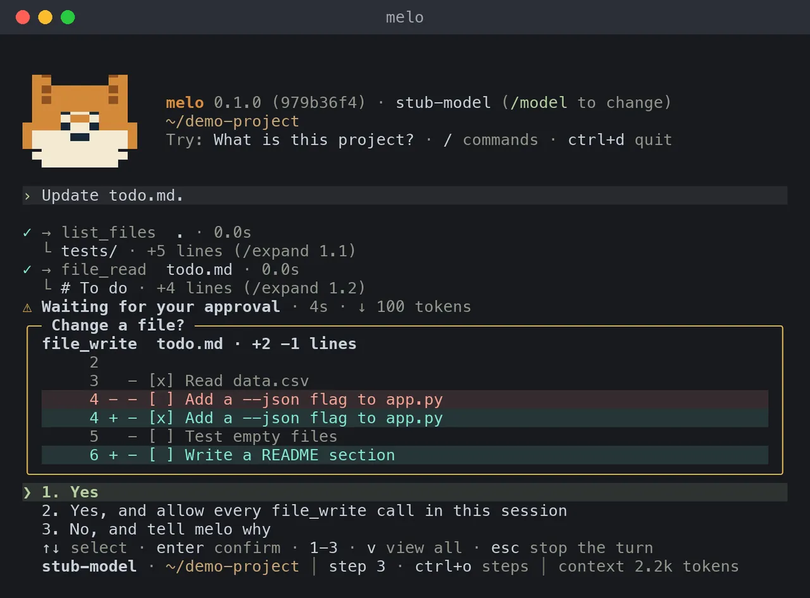

# Guide: Terminal

Chat with melo in your terminal: its keys, commands, approvals and workspace. Read it when you run `melo` without a task; the command-line options are in the [command-line reference](../reference/cli.md).

## The interactive UI



- `melo` without a task, in a terminal, opens a chat that keeps a quiet record of its work and makes the answer the loudest thing on screen.
- Each thought is one line and each tool call one row with the first line of its output; the answer prints as Markdown.
- What it prints stays in the terminal's scrollback; the input box and a status bar stay at the bottom.
- Developer mode keeps the whole record (see [A turn's output](#a-turns-output)).

```text
melo 0.1.0 · Qwen3-8B (/model to change)
~/demo-project
Try: What is this project? · / commands · ctrl+d quit

› What is in this folder?

✓ shell_exec  ls -1 · 0.1s · allowed
  └ app.py · +3 lines (/expand 1.1)
● The folder holds app.py, notes.txt, tests and todo.md.
✻ Worked for 6.2s · 1 tool call · ↓ 412 tokens

────────────────────────────────────────────────────────────────────────────
› Ask melo · / for commands
────────────────────────────────────────────────────────────────────────────
  Qwen3-8B · ~/demo-project · context 2.1k tokens · What is in this folder?
```

- The welcome is three rows: the version and the model, the folder melo works in, and one thing to try with the keys for commands and for quitting.
- Warnings follow it; `/status` checks that the model answers and shows the folder, session, approvals and context use.
- In developer mode (`--developer`, or `[ui] mode = "developer"`) the welcome is a box of every row.
- It needs a terminal: stdin and stdout must both be terminals and `TERM` must not be `dumb`. Otherwise `melo` prints this on stderr and exits with code 2:

```text
melo: the interactive UI needs a terminal (stdin and stdout must be TTYs).
  Run one task:      melo "your task"
  Start the gateway: melo serve
```

### The main chat

- `melo` opens the main chat: the same conversation, cards and tasks as the web console and the app.
- melo finds the running gateway through `~/.cache/localmelo/gateway/endpoint.json`, which every gateway writes as it starts, whoever started it.
- When no gateway runs, melo starts one in the background on the configured port and says so in one line. It keeps running after melo quits, so its tasks go on, until `melo serve stop`; its log is `~/.cache/localmelo/logs/gateway.log`.

```text
Started the gateway in the background on port 8401; it keeps running until melo serve stop.
```

- melo never starts a second gateway: when the app's gateway holds the main chat on a port of its own, melo talks to that one. The app does the same with a gateway melo started.
- When the gateway cannot be reached, one line says why and the terminal keeps its own chat:

```text
⚠ No main chat (port 8401 is used by another program); this is the terminal's own chat.
```

- `/chats` lists the main chat and its side chats (arrow keys and Enter), `/side [title]` starts a side chat in this folder, and `/main` goes back. The status bar names the open chat.
- An approval that a turn asks for is the usual list, answered through the gateway; one answered in the console closes here.
- A card is one coloured line: a side chat or a task that finished, did not finish or waits for you, and how to open it. `/task …` starts a task in the open chat, as in the console; an echo about another chat's task ends with `from` and that chat's name.
- When a task asks the chat for help, a muted line reads `Task “Fix tests” asks: <problem>` and melo's answer follows, with no message of yours above it. Then `→ melo answered “Fix tests” · <answer>`, or `! “Fix tests” needs your answer: <question>`: when only that task waits, answer it in a message here (`→ Sent to “Fix tests” as your answer`; **Undo** is in `melo console` for 10 seconds); when several wait, the line says `several wait: /answer Fix tests …`.
- `/model`, `/backend`, `/undo`, `/copy`, `/sessions`, `/resume`, `/title`, `/usage`, `/attach`, `/approvals`, `/browser` and `/mcp` work in the terminal's own chat. `melo -X cli.chat=local` (or `[cli] chat = "local"`) opens it, as `-u URL`, `-c`, `-r` and `--yolo` do.

### Which model server



The first of these that applies:

| | Source | What happens |
|---|---|---|
| 1 | `melo setup` | The setup wizard, then the backend it saved. Default mode first offers the server it finds (`Found a model server at …`, `Use this model server?`); the full menu follows `Use another server`, developer mode, or a saved backend with no server found. Not with `--url` and no task. |
| 2 | `--url URL` | That server, without the config file. The model is `--model`, else the only chat model that `GET URL/models` lists (ids with `embed` or `rerank` are not chat models), else the one the server says is loaded; with several and none known loaded it exits 2, lists them and asks for `--model <id>`. |
| 3 | The saved backend | `--model` replaces its model for this session. Nothing is checked before the UI opens; afterwards melo lists the server's models once and warns when it does not answer or does not list the model. |
| 4 | No saved backend | The [first-run](#first-run) questions, then the UI. |

- A task, `melo worker` and `melo ""` choose the model the same way before their first request (see the [command-line reference](../reference/cli.md#general)).
- A URL without `/v1` is listed at `URL/v1/models`, and when that answers the UI uses `URL/v1` too.
- With no config file, `--url` asks once, as a [list](#questions-are-lists), `Save URL · MODEL as the default backend?`; `Save it` is selected, `Not now` or Esc saves nothing.
- When the server does not answer the list, or lists no model, the model is `default` and a warning under the banner says why.
- `/status` calls the server `oMLX` when the config file says `omlx` or a model listing did, and otherwise `OpenAI-compatible server` (Ollama, MLC LLM and SGLang keep their names).

When the model is not the saved default, a row after the folder gives the server's URL and where it comes from (`from --url (not saved)`, `not saved; melo asks again next time`). The first row shows the package version, and on a git checkout the short commit; `melo --version` prints the same line.

### What melo says about itself

- Every chat tells its model who it is, so that "who are you?" is answered as melo: melo from localmelo, an open-source agent that works in your folder with tools and asks before it changes anything.
- It names the model it runs on when asked, does not present itself as the model's own assistant, and replies in the language and script you write in.
- It names the server as the banner does (`oMLX`, `Ollama`, an `OpenAI-compatible server`, or a cloud provider) and says whether it is on this computer; `/model` and `/backend` start the next turn on the new choice.
- It says what the chat remembers: by default the recent messages of this chat and nothing from other chats; with memory kept between runs (see [Memory](memory.md#keep-memory-between-runs)), also the short notes localmelo keeps on this computer that match your question. Files in your folder are not memory.
- The web console and the macOS app do the same; direct runs (`melo "task"`), workers and the benchmark send no such paragraph.

### Keys

| Key | What it does |
|---|---|
| Enter | Send the message. During a turn, queue it: it is sent when the turn completes. |
| Alt+Enter, Ctrl+J, or `\` then Enter | A new line in the message. |
| Esc | Close the completion menu; otherwise stop the turn. |
| Ctrl+C | Close the menu, else clear the draft, else clear a queued message, else stop the turn; a second Ctrl+C within 2 seconds quits. |
| Ctrl+D | Quit, when no turn runs and the draft is empty; with text, delete the character under the cursor. |
| ↑ ↓ | Move between lines, then through earlier messages. On an empty draft during a turn, ↑ takes back the queued message. |
| Ctrl+R | Search earlier messages. |
| Ctrl+O | List the turn's steps (during a turn, or the last one after it); Esc closes the list. |
| Ctrl+T | List the tasks beside the chat (the gateway's); Enter on one lists its actions. |
| Tab | Complete a command or a listed model; ↑ ↓ pick in the menu, and Enter takes the one picked. |
| Ctrl+L | Clear the screen. |
| Ctrl+Z | Nothing (melo does not suspend in this version). |

- **The queue.** One message waits at a time, shown as `↳ Queued for the next turn: …`; when the turn ends any other way than `completed`, it goes back into the input box unsent.
- **Stopping.** Esc stops the turn at once (`■ Stopped`); after the answer has printed, melo spends up to 2 seconds recording the run's steps (see [Procedural memory](../concepts/procedures.md)), and the next message waits for it.
- **History.** Messages and commands are kept in `~/.cache/localmelo/cli_history` (mode 0600, the newest 1,000 once it passes 1 MB), never the files' text; if the file cannot be opened, the session keeps its history in memory and says so.

### Commands



- Type `/` and the commands show under the input box with what each does; type more letters to narrow them, Tab or Enter takes one, Esc closes the list until your next edit.
- The same goes for the file names after an `@` and for a command's argument (`/model NAME`).
- The everyday commands come first: `/model`, `/new`, `/status`, `/help`, `/exit`, `/undo`, `/copy` and `/retry`.
- A message that starts with `/` and a lowercase name is a command; an unknown name prints `Unknown command /NAME. /help lists the commands.` and keeps the draft, and `/etc/hosts is broken` is a message.
- To send a message that starts like a command, start it with a space.

| Command | What it does |
|---|---|
| `/help [command]` | The everyday commands in three groups; `/help all` (and `/help` in developer mode) lists every command and the keys; `/help NAME` gives one command's details. |
| `/model [name\|number]` | Alone: a list of the server's chat models, the current one marked `✓`, the loaded ones `(loaded)`; Enter switches and saves the model as the default, Esc keeps the current one. With a listed id or number: switch from the next message. A name the server does not list is refused. |
| `/backend [url]` | Switch to another model server: asks for its URL and a model from its list, checks it with `GET /models`, switches and saves both as the default. |
| `/new` | Start a new chat: the model forgets the conversation and this chat's grants end; a `── New chat ──` rule marks the start. |
| `/clear` | `/new` on an empty screen: the screen and its scrollback are wiped and the welcome is drawn again. |
| `/sessions [filter]` | Pick a saved chat in this folder; type to filter, Tab for all folders, Enter to resume, Esc to close. |
| `/resume [id\|title]` | Resume by ID, ID prefix (at least four characters) or exact title; no argument opens the picker. |
| `/title [text]` | Show or set a 1–200-character title. |
| `/undo` | Forget the newest finished turn and put its typed message in ↑ history. Files the tools changed stay changed. |
| `/retry` | Re-run the newest finished turn with its stored typed text. |
| `/copy [turn]` | Copy a stored answer's Markdown; without a number, the latest finished, non-undone turn. |
| `/usage` | Recorded steps, tool calls, tokens and time per turn, including undone work, with totals; `?` means not recorded. |
| `/status [all]` | Five rows that say whether melo is ready: the model and its server (`✓ answers`, or why not), the folder, the session, what the approvals do, and how full the context is. `/status all`, and `/status` in developer mode, print every row. |
| `/memory` | The notes melo keeps about you, as a list: Enter on a note offers `Back`, `Edit it` and `Delete it`; `Forget everything…` asks first. `/memory import` offers the notes other assistants keep (see [First run](#first-run)). `/memory window` inspects the model's working window with no model call. |
| `/attach PATH` | Stage one workspace text file; `/attachments` lists them and `/detach N\|all` removes them. |
| `/verbose [on\|off]` | Verbose rendering: 40 thinking rows, a tool call's arguments, 20 output lines, the reflection's whole rationale. |
| `/thinking [on\|off]` | The thinking excerpt on, or off (the default, except in developer mode). |
| `/stream [on\|off]` | Live streamed replies for later turns; see [Streamed replies](#streamed-replies). |
| `/expand [turn.call]` | A tool call's whole output or error: the latest call, call N of the latest turn, or turn T's call C. |
| `/progress` | The latest progress facts of this turn: level, step, attempt, phase, tests and the past runs. |
| `/approvals [ask\|auto\|deny\|forget [tool]]` | The approval mode and this session's grants; switch it, or forget one tool's grant (all with `forget`). |
| `/browser [on\|off]` | Whether melo may read web pages in Safari (see [Browsing with melo](browsing.md)). |
| `/mcp` | The MCP servers, their tools and the file they came from, and why MCP is off after a failure. |
| `/chats` | In the main chat: the main chat and its side chats as a list; Enter opens one, `New side chat` starts one. |
| `/side [title]` | In the main chat: a side chat in this folder, made by its first message. `/new` and `/clear` do the same there. |
| `/main` | Back to the main chat from a side chat. |
| `/task TEXT` | Start a task in the open chat, the main chat or a side chat, as `/task` does in the console; the task belongs to that chat. A side chat starts with its first message, so `/task` waits for it. |
| `/answer TASK TEXT` | Answer a task that waits for you in the open chat, by its title (`/answer Fix tests: B`); with only one waiting, `/answer B` is enough. |
| `/exit` (also `/quit`) | Quit; a running turn is stopped first. |

- `/new`, `/clear`, `/sessions`, `/resume`, `/undo`, `/retry`, `/model` and `/backend` are refused while a turn runs: the draft stays and the hint says `/model is not available while a turn runs (esc stops it).`
- `/model` keeps the configured backend and changes its model; `/backend` saves the server as `ollama` when it answers `GET /api/version`, as `omlx` when its model listing names oMLX, else as `vllm`, and keeps the rest of the config.
- A model that does not start leaves the current one in place (`✗ Could not start NAME: …`); a server that does not answer leaves the current server (`✗ Could not reach URL: connection refused. Still using URL.`).
- In a `melo --url URL` session the choices last for this session only, unless you answered yes to `Save URL · MODEL as the default backend?`.

### Attach text files

In an idle chat, stage a file before sending your message:

```text
/attach "notes/my file.txt"
/attachments
/detach 1
/detach all
```

- Typing `@` and a workspace-relative prefix and picking a file from the menu attaches it too; merely typing `@file` in prose does not.
- Send a non-empty message to include the staged files; attachment commands cannot run during a turn.
- Only regular UTF-8 text files inside the workspace are accepted: no URLs, `..`, symlinks, recognized secret files, binary data or images.
- Limits: 8 files, 256 KiB per file and 512 KiB in total; the composed message must also fit the agent's prompt limit.
- The model gets a snapshot, read once, in a block marked as untrusted data; secret redaction is best effort, so inspect files before attaching, and melo asks before staging a snapshot that redaction or cleaning changed.

Snapshots are saved with the session in `~/.cache/localmelo/cli/sessions.db` (plain text, not encrypted) and `/retry` uses them. A `pairs` resume has a 32,000-character budget for user text and answers and can omit an attachment turn; reattach and send again if the model needs it. Attachments are not supported in `melo ""` or direct mode.

### Run a shell command

At an idle prompt, a message that starts with `! ` runs the rest as a command in your own shell, as you, in the workspace folder:

```text
! echo from-the-child; exit 3
```

```text
! user shell · ~/demo-project
$ echo from-the-child; exit 3
from-the-child
  └ exit 3 · 0.0s
  └ /attach ! shows this output (redacted, 15 bytes) and asks before attaching it
```

- **Not a sandbox.** The command is not a model tool: no approval, checker or workspace policy applies, and it has your account's full permissions.
- **The terminal is the command's** while it runs: programs that read input or draw a screen work, and Ctrl+C and Esc go to the command; the block ends with the exit code or the signal and the time.
- **Output stays in the terminal.** It never reaches the model, and the command is not saved in the input history; `/attach !` attaches a redacted snapshot of the last output, after a [list](#questions-are-lists) that starts on `Don't attach it`.
- **Refused when busy** (`! runs only when melo is idle`); `!` alone prints this help, and `\! text` sends a message that starts with `! `.
- When melo exits, the command's process group gets SIGTERM (SIGHUP when the terminal closes), then SIGKILL after 2 seconds. Not available in direct mode or the plain loop.

### Inspect, undo or copy a conversation

- `/title` can name a chat before any message is sent; the title is applied when the first turn creates the session.
- `/undo` removes the newest finished turn from the model's restored working window and keeps the typed message in ↑ history; it does not reverse shell commands, Python code or file edits.
- `/retry` re-runs the newest finished turn; if `/undo` already removed it, the previous live turn is left alone.
- `/usage` includes undone rows because that work was performed; a running turn or missing counter is `?`, not zero.
- `/copy` reads the stored, redacted answer without its thinking, so Markdown and code are not copied from the wrapped display; on macOS outside SSH it uses `/usr/bin/pbcopy`, elsewhere an OSC 52 request that the terminal must allow, and nothing is copied without the explicit command.

### A turn's output



| Part | What you see |
|---|---|
| The live area | The first row names what melo does (`Starting`, `Thinking`, `Replying`, `Running`, `Waiting for your approval`, `Retrying in 4s`, `Reflecting`, `Wrapping up`, `Stopping`), then the time, the output tokens and `esc to stop`. The second row is the running tool with its own clock and, for `shell_exec` and `python_exec`, its limit. For a task melo has run before, a third row shows the past runs with their steps. Developer mode adds the step, attempt, phase and tests. |
| Thinking | `✻ Thought for 1.2s`, one line; `/thinking on` and developer mode add the first 3 rows, `/verbose` 40. An intermediate message prints as Markdown after `●`. |
| A tool call | One block when it finishes: `✓` ran, `✗` failed, `⊘` blocked or denied, `◌` stopped or not run; the kind (`→` read, `±` write, `$` run, `@` network) and name; the duration; `exit N` when a command exited with another code than 0; how its approval ended; the first line of its output with `+N lines (/expand T.C)`. A failed call shows up to 3 lines; escape sequences in the output are removed. |
| A file write | A `file_write` over an existing file shows a diff in the approval (removed lines in red, added in green, with the counts). |
| Notices | `↻` a retry, `·` an empty reply or one that ended inside its thinking, `⚠` a stuck or spent-budget notice. A reflection prints as `✻ Reflected after attempt 1: continue · Read the test before editing. (2.3s)`. |
| The answer | Markdown after `●`. A run that did not complete prints its best effort, then what happened and what to do in plain words (`✗ Could not reach the model server at URL.`, `Start it, then /retry.`); the footer reads `✻ Stopped after 14s`. Direct mode keeps its `melo: run ended with status …` line on stderr. |
| Changed files | A turn that wrote files with `file_write` ends with one quiet line under its footer (below). |

```text
✓ ± file_write  hello.py (15 chars) · 0.0s · allowed
  └ new file, 1 line
● I saved hello.py. Run it with python hello.py.
✻ Worked for 4.7s · 1 tool call · ↓ 50 tokens
  Changed + hello.py (+1)
```

- Several files read `Changed + hello.py (+1), ~ README.md (+3 −1)`: `+` a new file and `~` a modified one, with the lines the turn added and removed; at most three names show, then `and 2 more`.
- The line comes from the turn's own `file_write` calls: a denied or refused write is not listed, and neither is a file that a shell command or a script changed.
- Nothing prints when the turn changed no file or you stopped it; developer mode shows the same line.

### The status bar

The bar under the input box answers "how much has this used" and "what runs beside it", in zones with a rule between them: usage, the work beside the chat, and the run (the chat's title when no turn runs). On a local server:

```text
  ↑ 3.0k ↓ 15 · ctx 2.6k/32k ▮▯▯▯▯ · cache 61% (avg 72%) · idle 2m │ Fix the parser
```

| Part | Meaning |
|---|---|
| `↑ 3.0k ↓ 15` | The tokens this session sent and received. |
| `ctx 2.6k/32k ▮▯▯▯▯` | The last measured prompt over the input limit, as a meter in fifths: amber from 70%, red from 90%. Without a limit, the tokens alone. |
| `cache 61% (avg 72%)` | The share of the last prompt the server reported as cached, then the session's average. Teal from 50%, amber under 20% after the first request; a server that reports none shows no figure, never 0%. |
| `idle 2m` | The time since the last request, from one minute on. |
| `$0.13 · ctx 100k · limit 42% ▮▮▯▯▯ ↻3m` | On a cloud API: the session's cost from the prices you configured (see [`[pricing]`](../reference/configuration.md#pricing)) and the tightest rate limit the last response reported, with the time until it resets. melo bundles no prices. |
| `2/~4 · ctrl+o steps` | While a turn runs: step 2 of about 4 (the task took 4 steps before; `~` marks an estimate), and the key that lists the steps. |
| `2 running · 1 queued · P1 · ctrl+t tasks` | When the gateway has unfinished tasks: their counts by state, the top priority (P0 runs first, P1 is today, P2 normal, down to P5 on hold) and the key that lists them. |

- Ctrl+T lists the tasks; Enter on one offers Pause or Resume, Raise to, Lower to and Stop (which asks first), exactly as `melo task pause|resume|level|stop` do.
- melo asks the gateway for its tasks every 5 seconds, and only when a gateway token exists (`~/.cache/localmelo/gateway/auth`).
- On a narrow terminal the details go first, then the figures; the bar never wraps. The mode shows at the right edge only when it is not `ask`.
- The figures come from events melo already received; nothing asks the model server. `[cli] status_line = "off"` keeps only the run zone, the title and the last request's context.
- With `NO_COLOR` or `LOCALMELO_ASCII=1` the zones are still apart (`│` or `|`) and ASCII says `in 3.0k out 15`.

### Streamed replies

- The interactive UI streams a reply as it is written, by default, drawing only text the release filter has already redacted.
- `/stream off` turns it off for later turns, `melo -X cli.stream=false` for one run and `melo config set cli.stream false` for good.
- A server that does not stream needs no setting: melo shows the reply when it is complete and says so once (`This server sends replies whole; melo shows them when they are complete.`).
- A stream that breaks after part of a reply is still an error.
- Direct mode, workers and the gateway never stream.

Whether a reply shows as it is written depends on how its model frames reasoning, which a per-model hint in `config.toml` declares:

```toml
[cli.reasoning_tags]
"Qwen3-8B" = "closing_only"
```

- The hint is `explicit` (a leading `<think>` starts reasoning), `closing_only` (everything before `</think>` is reasoning) or `none` (tags are literal text).
- A model with no hint keeps the conservative rule: content is held until the reply ends, and the live area shows `Thinking…`; a server that sends reasoning in a field of its own streams without a hint.
- With `closing_only`, a reply without `</think>` is unfinished thinking: melo asks once more, and a second such reply ends the turn with `melo did not finish an answer.`
- Streamed text is provisional: if the reply becomes a tool call, a retry, a failure or a stop, melo prints it once, and developer mode labels it `↳ partial reply (tool call)`.

### Approvals



`shell_exec`, `python_exec` and `file_write` run only once you answer, and so do MCP tools marked for approval; `file_read` and `list_files` only read, so they never ask. The panel takes the place of the input box, and your draft stays:

```text
╭─ Run a shell command? ───────────────────────────────────────────────────╮
│ shell_exec · in ~/demo-project                                           │
│   ls -1                                                                  │
╰──────────────────────────────────────────────────────────────────────────╯
❯ 1. Yes
  2. Yes, and allow every shell_exec call in this session
  3. No, and tell melo why
  "Allow every" lets routine shell commands run without asking for the rest of this session.
  Installs, downloads and changes outside ~/demo-project still ask.
  ↑↓ select · enter confirm · 1-3 · v view all · esc stop the turn
```

A call that installs software, downloads files, changes files outside the folder or does anything else [high-impact](tools-mcp.md#high-impact-calls) gets a panel with the question that names it, the reasons above the code, no session choice, and No selected, so that Enter alone never allows it:

```text
╭─ Install software? ────────────────────────────────────────────────────────╮
│ shell_exec · in ~/demo-project                                             │
│ ⚠ melo asks because this call installs playwright with pip (downloads      │
│   about 42 MB).                                                            │
│   pip install playwright                                                   │
╰────────────────────────────────────────────────────────────────────────────╯
  1. Yes
❯ 2. No, and tell melo why
  Session grants never cover installs, downloads or changes outside the
  folder.
  ↑↓ select · enter confirm · 1-2 · v view all · esc stop the turn
```

- `1` allows this call, `2` allows the tool's routine calls for the rest of the session, and `3` opens a field for a reason (at most 500 characters) that the model reads; ↑ ↓ and Enter choose too.
- For 0.4 seconds after the panel opens only Esc and Ctrl+C act, so a message you were typing cannot answer it; Esc or Ctrl+C stops the turn.
- The command, code or file content shows exactly as it will run, wrapped and never cut; control characters and text-reordering characters show escaped with a warning line.
- The panel shows at most 8 lines of the body, then `… +N lines (v views all)`.
- `--yolo` runs every tool without asking, and the status bar says `⚠ YOLO: no approvals`; developer mode adds the tool's permission tier (see [Permission tiers](tools-mcp.md#permission-tiers)).
### Auto mode

In auto mode nothing asks: routine steps run, and a risky step or one you did not ask for is blocked and explained.

- **Switch:** `/approvals auto` turns it on for this chat, `/approvals ask` turns it off. `[approvals] mode` (the console's **New chats start in**, or `-X approvals.mode=auto` for one run) starts the terminal's own chat in it.
- **What runs:** steps inside the folder that install, download, send or delete nothing; a step melo cannot judge goes to your model first. Its `shell_exec` and `python_exec` calls run in the write sandbox, so a write outside the folder fails even when no rule caught it, and they can neither read melo's sign-in token nor reach melo's own API. Auto is a reviewer, not a wall: a step that hands work to another app or program is judged by the review (blocked, or checked by your model), not walled off by the sandbox.
- **What is blocked:** installs, downloads, changes outside the folder, deletes, passwords and keys, system settings and code from the internet, unless your own words ask for them; a change to localmelo itself never runs. The row says why (`⊘ … · blocked: installs software`), and melo explains in its answer what it wanted and the other ways.
- **Allow it:** say "go ahead" and melo tries again; your model checks that your words ask for it. A step only a click can allow (passwords or keys, system settings, something that runs later, code from the internet or code melo cannot check) needs the console's **Allow once**.

### The workspace

- melo works in the current folder, or in `--workspace DIR`.
- File tools (`file_read`, `file_write`, `list_files`) stay in this folder; commands and Python can reach other files, so melo asks first.
- The banner warns when the workspace is your home folder or `/`.
- `shell_exec` and `python_exec` stop after 10 minutes in the UI (30 and 60 seconds for a task).

### Chinese and other wide characters

The input box edits by character and places text by terminal cell: Chinese and other wide characters type, delete and wrap whole. Known limits:

- A character built from several code points (an accent typed as a combining mark, an emoji sequence such as 👩‍💻) takes one Backspace per code point.
- Ctrl+W deletes back to the last space, which in Chinese text without spaces is the whole run.
- Text that an input method (such as macOS Pinyin) is still composing is drawn by the terminal, not by melo.

### Terminal colours

Colour sorts what a turn prints, so the answer, a failure and the files that changed stand out while reads fade. Every colour has a glyph or a place that says the same without it, so `NO_COLOR` and `LOCALMELO_ASCII=1` lose nothing.

| What | Glyph (ASCII) | Colour |
|---|---|---|
| Your message | `›` (`>`) | moss mark, on a raised band across the row |
| The answer | `●` (`*`) | Melo's orange, the only orange |
| A message that is not the answer; thinking | `●` (`*`); `✻` (`*`) | muted |
| A tool that reads | `→` (`>`) | muted, so reads fade |
| A tool that writes | `±` (`~`) | violet |
| A tool that runs a command or code | `$` | blue |
| A tool that reaches the network | `@` | indigo |
| Ran; failed or exited with another code than 0; refused; not run | `✓` (`+`); `✗` (`x`); `⊘` (`!`); `◌` (`-`) | teal; red, with `exit N`; amber; the whole row dim |
| A changed file: new; modified | `+`; `~` | teal; amber |

- Panels, lists and bars use the same colours: the chosen row sits on a moss band with one `❯`, an approval panel has an amber frame, and a diff's added rows are teal and removed rows red.
- At 256 colours or more, in a Unicode terminal of 80 columns or more, Melo's head stands beside the welcome; otherwise the welcome is its three rows alone.
- **How many colours.** `NO_COLOR` (any value but empty) or `TERM=dumb`: none, only bold, dim and underline. Otherwise the `[cli] colors` setting, then `COLORTERM=truecolor` (or `24bit`), then a `TERM` that ends in `256color`, else the 16 named colours of your terminal's theme.
- **The background.** The `[cli] background` setting, then the terminal's own answer (melo asks once, waiting at most 100 ms), then `COLORFGBG`; with the exact colours melo draws bands and chips only where your text keeps a contrast of 4.5:1.
- **When colours look wrong.** Some terminals, and tmux, screen or ssh, answer nothing: say which background yours has with `-X cli.background=light` (or `dark`) for one run, or `melo config set cli.background light` to keep it; `-X cli.colors=16`, `256` or `truecolor` sets the number of colours.

### Terminal settings

- Colours: see [Terminal colours](#terminal-colours); a sentence you must read or act on is never muted.
- On a terminal whose encoding is not UTF-8, or with `LOCALMELO_ASCII=1`, melo draws ASCII stand-ins for its symbols (`>` for `›`, `...` for `…`).
- melo rings the terminal's bell when an approval panel opens and when a turn of 30 seconds or more ends; `LOCALMELO_BELL=0` turns it off.

### Sessions and files

- Bare `melo` starts a new chat; only the first message saves it. `melo -c` (`--continue`) resumes the newest chat with a finished turn in the current workspace, and `melo -r` (`--resume`) picks one.
- `melo -r REF` resolves an ID, a prefix of at least four characters, or an exact case-insensitive title; several matches open the picker, and an unknown reference exits 2. `-c` and `-r` cannot be combined, or used with a task or `melo serve`.
- The picker lists at most 50 chats with finished, non-undone turns, newest first; Tab toggles this folder and all folders, Enter resumes, Esc closes it. `/sessions FILTER` and `/resume REF` use the same picker.
- A resume keeps the current model and workspace and clears approval grants; the recap shows the last three turns as plain text. `[sessions] resume_mode = "pairs"` (the default) restores recent user and answer pairs, `"window"` a saved working-memory checkpoint plus later pairs.
- On exit, a chat with turns says how to come back to it: `◆ Saved "What is this project?". Continue it with: melo -c`, or `Resume it with: melo -r ID`.

Where things live:

- Sessions are kept in `~/.cache/localmelo/cli/sessions.db`: every turn, with your message, the answer and each tool call with its output; `~/.cache/localmelo/cli_history` keeps your messages. Both are plain text (mode 0600), not encrypted.
- The web console's Workers view shows your chats read-only under **Terminal chats**, redacted as it reads them; it cannot change or send to them.
- The UI writes its log to `~/.cache/localmelo/logs/cli.log` and never prints a traceback; a config file that is not valid TOML stops `melo` with one `melo: …` line and exit code 1.
- Procedural memory follows [memory persistence](memory.md#keep-memory-between-runs), as for a task.

### First run

In a terminal with no config file, `melo` offers the model server it finds, asks for a model, saves them, and opens the UI. Later runs go straight in.

```text
$ melo
melo uses a model server on this computer (oMLX, Ollama, LM Studio…).
Found a model server at http://127.0.0.1:8000/v1 (1 model).
✓ http://127.0.0.1:8000/v1 lists 1 model; using Qwen3-8B-4bit.
melo remembers across chats by words only; melo setup adds search by meaning.
Saved to ~/.cache/localmelo/config.toml (melo setup changes it).
```

- melo looks for a server on this computer with `GET /v1/models` on `127.0.0.1` ports 8000 (vLLM, oMLX), 8400 (MLC), 11434 (Ollama) and 30000 (SGLang), and offers the first that lists a model (one with a chat model comes first); no chat request is sent, so the server loads nothing.
- Between the second and third lines melo asks `Use this model server?` as a list; with several models it shows the picker, and with an embedding model one more list asks `Remember across chats with nomic-embed-text?` (`Yes, with it`, `No, by words only`).
- With no server running, it prints the commands that start one (oMLX on a Mac, Ollama elsewhere; see the [model servers guide](model-servers.md)) and asks `No model server found. What now?` (`Check again`, `Enter an address`, `Quit`).
- A server that cannot be used is named with its reason (`connection refused`, `no answer in 5 s`, `HTTP 401` or `HTTP 403` with `the server requires an API key; localmelo sends none to local servers (oMLX: "Allow inference without API key")`, `it lists no models`), and you can try again, start without saving or quit.
- An Ollama server is saved as `chat_backend = "ollama"`, an oMLX server as `chat_backend = "omlx"` and any other as `"vllm"`; the embedding model choice is described in [Set up an embedding model](embedding.md).
- `LOCALMELO_DETECT_URLS` replaces the four URLs with a comma-separated list; an empty value turns the search off.

When no server is found, melo prints:

```text
No model server is running yet. To start one with oMLX:

  brew tap jundot/omlx https://github.com/jundot/omlx
  brew install jundot/omlx/omlx
  omlx serve --model-dir ~/models --port 8000

Put a model in its own folder of ~/models first. The guide shows how:
https://github.com/localmelo/localmelo/blob/main/docs/guides/model-servers.md
```

After the questions, and only on a terminal, the first run also offers the notes other assistants on this computer keep about you, once:

```text
 melo found notes on this Mac from other assistants
 ❯ 1. Bring in 21 notes from 8 files
   2. Show what they say
   3. Not now
 ↑↓ select · enter confirm · esc cancel
```

`Show what they say` prints each file as a path (`~/.claude/CLAUDE.md · 9 notes`) with a few sample lines and what was left out (`9 left out: secrets, other people's details`), then asks again. The list starts on `Show what they say`, so a bare Enter never brings anything in; once the files were shown it starts on `Bring in`. Nothing is brought in until you choose the first row, and only `Not now` ends the offer for good. Esc, ctrl+c and end of input leave without bringing anything in and without recording an answer, so the offer is made again: at the first run melo ends as a cancelled setup does (`Setup cancelled.`, exit 130 for Esc and ctrl+c), in `melo memory import` it says `Nothing brought in.`, and in `/memory import` Esc just closes the list. A file whose lines were all left out says `Nothing to bring in: the lines were left out (secrets)` instead of `Nothing new`. `melo memory import --undo BATCH` keeps a note you edited since and says so (`Took back 20 notes. Kept 1 note you edited.`). `/memory import` in a chat and `melo memory import` ask the same list later; a task run (`melo "task"`) never asks. With piped input the list is a numbered question read from stdin. The notes are the ones the console's Memory tab lists, and each import has a batch you can take back with `melo memory import --undo BATCH`.

#### Questions are lists

On a terminal every question with a fixed set of answers is a list, as the tool approval and `/model` are:

```text
 Use this model server?
 ❯ 1. Use it
   2. Use another server
 ↑↓ select · enter confirm · esc cancel
```

- ↑ ↓ move, Enter confirms the selected row, and a number key (1 to 9) chooses that row at once.
- The safe or recommended answer is selected first, and Esc gives the answer named at the end of the key line (`esc cancel` ends the setup; `esc not now`, `esc no, by words only` and `esc don't attach it` decline).
- There is no filter field: the lists are short, and letters typed in them do nothing.
- Ctrl+C prints `Setup cancelled.` and exits with 130, Ctrl+D exits with 0.
- Without a terminal (answers piped in, a script, a test) no list is drawn and each question reads the typed answer it always did (`Use it? [Y/n]:`, a number for a backend, Enter for the default); a direct run (`melo "task"`) never asks a question.
