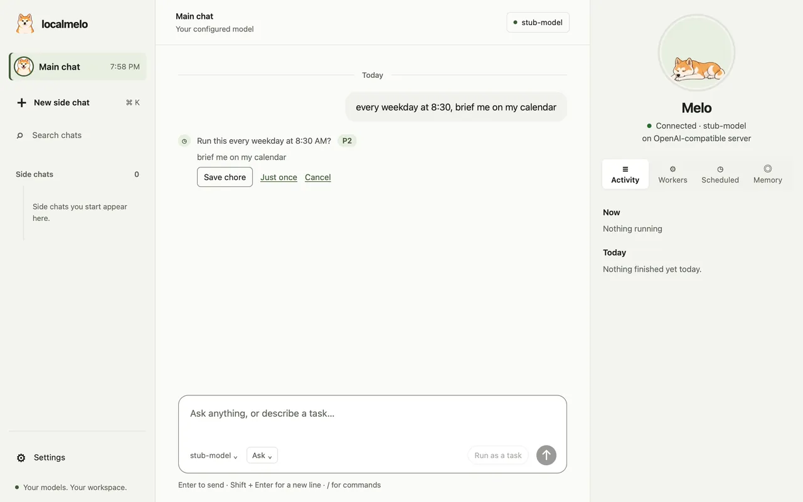
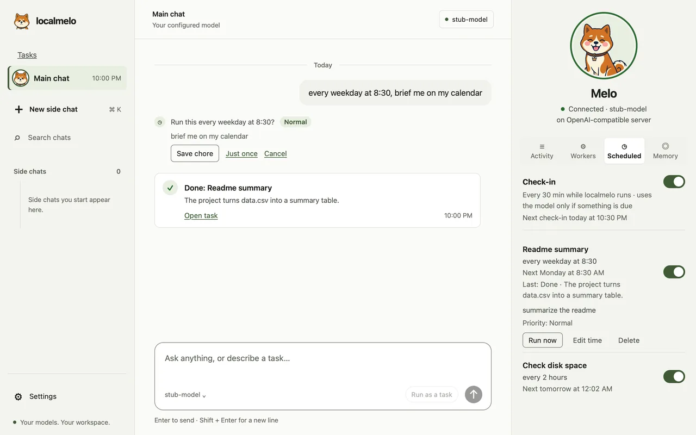
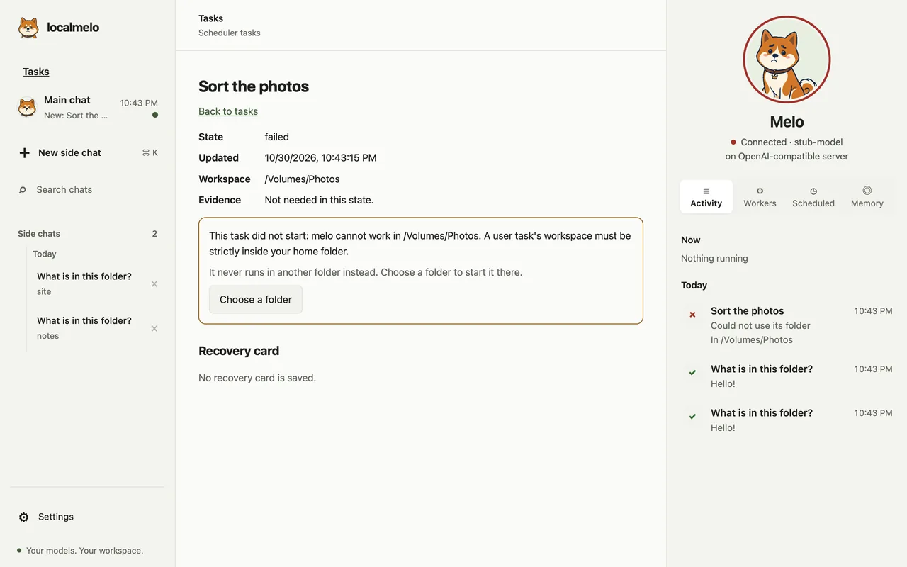

# Guide: Web console

Use the web console to configure a localmelo gateway, work in chats, and inspect
saved worker runs. This guide is for someone using the console in a browser.

Before you start, install the gateway extra and have a model server ready; see
[Start the gateway](gateway.md#start-the-gateway). The gateway requires
authentication and only binds to loopback. Tools run with your
permissions and are not sandboxed; review a task before approving a tool call.

## Web workspace

Open `http://127.0.0.1:8401/` in a browser for the web workspace. It is the
console's page and talks only to `/api` ([API v2](../reference/api-v2.md)), so the gateway
must be running to serve it: `melo serve` opens it in your browser, signed in.
A page opened without a link says *Sign in to localmelo*: run `melo console`
in a terminal and it opens the page signed in (add `--port PORT` for a
nondefault port). Over SSH, or when no browser starts, it prints a single-use
link to open within 60 seconds instead. Keep the link private; see [gateway security](gateway.md#keep-the-gateway-private).

On a first run, with no model set up, the welcome shows one card in place of the
starters. It looks for a model server on this Mac, as the terminal's first run
does, and shows what it found: **Found oMLX on this Mac** (or Ollama, or a model
server) with its model, **A model server needs an API key**, or **No model server
is running on this Mac**. **Use this model** saves the server, tests it and makes
the welcome ready without opening settings. With several chat models and none
known to be loaded, the card lists them, marks the loaded one and waits for you to
choose; it never picks one for you. With no server running, the
card shows the commands that start one (oMLX on a Mac, Ollama elsewhere, as in the
[model servers guide](model-servers.md)) in a block that one click selects, with a
**Copy commands** button for the keyboard, and asks
again every three seconds while it is on screen and the tab is visible, so the model
appears once the server answers. **Check again** asks at once, **Enter a server
address…** opens connection settings, and the composer
reads `Connect a model to start` until a model is set up. The card also shows when
the configured server stops answering, and it looks for a server only while it is
on screen ([`GET /api/setup/detect`](../reference/api-v2.md#get-apisetupdetect)).

The page opens in default mode, which leaves out what only a developer needs: the chat's
level chip, **Details**, the GPU-lock line, the **LOCAL** badge, the cache, step, phase and queue segments of the
status row, the running chip (the [panel beside the chat](#the-panel-beside-a-chat) shows what runs), and the
scheduler priority in Tasks. It says things plainly too: a running chat reads
`Working…` beside **Stop**, and the settings call the server **Model server** and its address
**Server address**. The header shows a
model chip (the model's name, `Model offline` or `No model`) that opens settings.
**Tasks** joins the sidebar once there is a task to see in it; worker runs are in the
panel's **Workers** tab and a link in the empty [main chat](#the-main-chat-and-side-chats). [Developer mode](#developer-mode) shows all of it. Everything stays in the
page, hidden.

A new chat shows where melo will work before you send anything. The chip in the composer reads
`In localmelo-workspace` and opens a panel with the default folder (`[gateway] workspace`, else
`~/localmelo-workspace`), the folders of your recent chats (newest first, four at most),
**Choose a folder…** and, in the [macOS app](macos-app.md), **Show in Finder**. In a browser
**Choose a folder…** opens a path field (a full path, or one that starts with `~/`), and in the app
the system's folder panel. File tools stay inside the folder; shell commands and Python start there.
The pick goes out with the first message as `workspace` in `POST /api/sessions` (a chat in the
default folder sends none), stays for the next new chat, and shows in the chat's header (`In ~/notes`;
developer mode adds it after the model). Three one-line starters under the composer (**Summarize
the files in this folder**, **Plan a small project with me**, **Explain a piece of code**) fill it
for you to send or change, and step aside once there is text.

1. Open **Settings** to connect a model server. It lists its sections on the left and shows
   the chosen one beside them; on a phone the list comes first and a section opens as a sheet
   (**‹ Settings** goes back). With nothing saved it opens on **Model server** with the form
   open on a blank **Choose a server…**. You can also use `melo setup`.
   [More on Settings](#settings).
2. Type a message and send. The page opens on the [main chat](#the-main-chat-and-side-chats),
   which is always there; in a new side chat the first message creates the chat: the page
   answers your draft with the chat's first turn, and never creates a chat on
   its own. Answers are rendered as Markdown, with code blocks.
3. A turn reads like the terminal's: your message, a work group with the
   tool cards it ran, its reasoning, its notices and reflections, the live
   row while it runs, and the final answer with `Copy response`. Output that
   a tool printed is cleaned of escape sequences, and its images (PNG, JPEG,
   GIF, WebP) show inline, and the pictures the turn made show under the answer
   (see [Pictures in the answer](#pictures-in-the-answer)). A turn that answers without tool calls shows its
   time once, in the line under the answer; its reasoning, when it has some,
   opens under a `Thought` line. Chats tell the model that it is melo from
   localmelo, which model and server it runs on and what it remembers, so asking
   "who are you?" or "what do you remember?" is answered plainly (see [What melo says about itself](terminal.md#what-melo-says-about-itself)).
4. A status row sits above the composer: the same segments as the terminal's
   developer-mode status bar (its default mode says them in words), `cache 67% idle 3m`, `ctx 1.0k/8.0k`, `step 3`, `tasks 1 running
   2 queued`, read from `GET /api/sessions/{id}/status` so both agree. Default mode draws the context
   segment, and a sentence such as `1 task waits for you` while a task waits for your approval. The cache
   share reads `cache --` when the model server reports no cached tokens, never
   0%; a local server shows its idle time, not a countdown. The row is read at
   most once a second while events arrive and on the page's polls; on a narrow
   screen it drops segments from the right. An open worker run shows the same
   row.
5. In developer mode, a **N running** chip in the header counts what runs now: this console's
   chats with a turn in flight, tasks, direct runs and terminal chats (a run or
   terminal chat counts only while its process holds a live lease). It is
   hidden at 0 and stays on a narrow screen. Select it for a short list, each
   row naming the kind and the title and opening that chat, the task's card or
   the Workers detail; Esc or a click elsewhere closes it. The numbers come
   from `status` of `GET /api/health`, read with the page's 4-second poll; the
   list shows 20 rows at most and says how many more run.

The sidebar pins the main chat on top and lists its side chats under it, newest
first under a line for each day (`Today`, `Yesterday`, `Oct 28`), with search and
switching, and closes a side chat. Under each title it names the chat's folder (developer mode puts the model
first), and a dot in the accent colour before the title marks a chat that waits
for your approval. Up and Down move through the list, the main chat first, and Home
and End go to its ends. Drafts stay with each chat in the current browser tab. The open chat's
turns arrive on its event stream (SSE); after a page reload the page restores
the chat, reads its last ten turns, and replays the stored events from there,
so nothing is lost or drawn twice. **Show earlier turns** loads older turns
without moving the current view. A stream the browser gives up on reopens
after 1, 2, 4, 8, 16 and then 30 seconds from the page's own cursor, and only
after the chat is read again: one that is gone leaves the page on a new chat
rather than retrying for ever. The list is re-read every 4 seconds while the
tab is visible, for changes from another browser. **Reconnect now** checks the
chat before reopening its stream. Independent banners show store, model and
connection problems without replacing other notices.

On a phone, or in a window 700 px wide or less, the page leaves out what a small
touch screen does not need. The header drops the model chip while it only names the
model, since the composer shows it, and keeps the chip when it warns (`Model offline`,
`No model`). The keyboard hints (`Enter to send · Shift + Enter for a new line` and
`⌘ K`) go, on touch screens and in narrow windows alike. The next steps of a failed
turn are buttons at least 44 px tall.

## The main chat and side chats

The console has one **main chat**, always there and first in the sidebar: Melo's face,
the time of its last message, and a dot while something new has come back to it (amber
when it waits for you). It cannot be closed. The page opens on it, and a tab that had a
side chat open goes back to that one.

The main chat always works in the default folder: `[gateway] workspace`, else
`~/localmelo-workspace`, made on first start. Change the default in Settings and its next
turn works there; it has no folder chip of its own.

**New side chat** (`⌘ K`) starts a focused conversation with its own folder: the chip offers
the default, your recent folders and **Choose a folder…**, and the chat keeps its pick. It is listed
under the main chat. A side chat's header begins with **Main chat ›**, which goes back,
and closing the open side chat goes back to the main chat too. Chats made before the main
chat existed are its side chats, as they were.

When a side chat's run ends, the main chat shows a card under the day it happened. So does a
task of the main chat that finishes, fails or waits for your approval; a side chat's own tasks
come back to that side chat ([below](#side-chats-start-tasks-too)). A card reads:

- `Done: Fix the list_files test` with the first two lines of the answer: what changed, the tests, the commit.
- `Did not finish: Fix CI` with why it ended.
- `Stopped: Fix CI` for a task that used all its steps before it was done. It shows the sentence of its answer that says what is left (`Remaining: run the tests and commit.`) and offers **Continue**, which picks the task up where it stopped, with what it did before. The same task reads Stopped on its page and in the panel's Activity and Workers rows, each with **Continue**. A task that failed for another reason stays `Did not finish`.
- `Needs your approval: Fix CI` with what it asks. Once you answer, the same card says how ("Allowed once", "Allowed for this task", "Denied") and no longer offers **Review**.
- A title is the one the main chat gave the task, or the first part of your request, cut at a word.
- **Open side chat**, **Open task** or **Review** goes to the source. A card is not a message: the model never reads it.

Between two of your messages a busy side chat keeps only its newest card. A stop of your own, a shutdown or an approval answered before the main chat was looked at makes no card.

The panel's **Workers** tab lists the workers of the open chat: a side chat's own, and in
the main chat all of today's. For runs of earlier days, an empty main chat links **See what
worker runs did** (once a run or a terminal chat exists, and always in developer mode).

## Hand work to the main chat

- **Ask, or ask for work.** The main chat answers a quick question itself, and searches your folder for "which file defines X?". A question that says `briefly`, `in short`, `one line`, `简单说一下` or `一句话` is always answered here, after a quick look: it is never offered as a task. Bigger work (several steps, files, research, writing) it starts as a task, with one line: `Started: Plan the trip · P2`. Its result comes back as a card. It never answers with only what it is about to do: a reply like "I'll start by looking at the test file" starts the work as a task instead.
- **Say it in code's words.** `/task …`, or **Run as a task** beside the send button, starts the message as a task at once; no model reads it to decide. So does a request to change files it names (`Fix tests/cli/test_e2e_pty.py and commit`). A task the main chat starts this way begins at once under the first words of your message, and is renamed in 3 to 8 words in the language of your message (`Hide the recovery card in default mode`) when the model answers one short request, made at the lowest priority so it never waits ahead of real work; a short message is its own title, a name you gave the task meanwhile stays, and the first words stay when the model does not answer in 6 seconds. `stop`, `pause`, `resume` or `first` with a task's name (`pause the slides`, `暂停 Fix CI`, `先做 slides`) changes that task at once, with **Undo**. A request you forbid or only quote is never read as work: `don't delete a.md` and `不要删除 a.md` start nothing.
- **Priorities as P0 to P5.** A line shows the code (`P1`); hover it for what it means. Your words choose: "urgent", "asap", a deadline today (`by 5pm`, `今天下午三点前`) or "today" anywhere in the request (not "not today", "今天不用") make it P1 (today), "no rush" makes it P3 (when there is time), anything else is P2 (normal). **Change** on the line opens the list (`P0 · runs first; others wait`, `P1 · today`, `P2 · normal`, `P3 · when there is time`, `P4 · only when the computer is idle`, `P5 · on hold until you start it`) and sets your own priority, which stays.
- **Follow up on a task.** `finish it`, `commit it` or `继续那个任务` goes to the task you mean: a running task reads it at its next step, and a done or stopped one continues in its own session, with what it did before. The line says where it went: `Sent to: Slides`, `Continued: Fix CI`.
- **Continue a stopped task by name.** `Continue the recovery card task where it stopped: run the tests` or `继续恢复卡片任务` continues the one stopped task whose title those words name, at once and with no suggestion to tap; the whole message is its next turn. When several stopped tasks match, each is offered as a one-tap `Suggested: send your message to …`. A task that is done or still working says so (`Fix CI is done. There is nothing to continue.`).
- **What got done.** The main chat reads each task's state and the first lines of its answer, so it can name the commits tasks made.
- **Only your own words change a task.** What you type counts; an attached file, a web page or a task's report that says "stop the slides" changes nothing: the line reads `Suggested: stop Slides`, and one tap applies it.
- **Long questions.** A message the main chat cannot settle in 4 steps becomes a task (`This needs more than a quick answer, so I started it as a task.`); a question (a `?` anywhere, or "quick question") asks **Start this as a task?** first. It answers in the language of your message. While you type, finished results wait until you send or pause for 10 seconds; one that needs your approval shows at once.

## Side chats start tasks too

- **Same words, same priorities.** In a side chat, `/task …`, **Run as a task**, `pause the slides` and the model's own judgment work as in the main chat, at the same P0 to P5 levels and under the same scheduler. The first message of a new side chat goes to the model, which can start a task itself; the code words work from the second message on.
- **A task comes back to the chat that started it.** Its line (`Started: Find hotels · P2`, with **Change** and **Undo**), its card, its approvals and its result appear in that side chat, which reads the tasks that ended before its next answer. The main chat gets no card for them.
- **The main chat still sees everything.** Activity and Workers list every task; one a side chat started reads `From Trip plan`.
- **Your own chat first.** `pause the slides` means this chat's slides task before another chat's. Words that fit several tasks of this chat show a one-tap `Suggested: pause …` for each, and never reach another chat's task. A task of another chat can still be named, by its id, its chat or words that fit none of this chat's own: its line reads `From Main chat` or `From Trip plan`. The same holds when the model picks the task.
- **Only your words start a task.** A task starts from the model only when your message is a request for work (it changes files it names, or says the whole job), and then your own message is the task. When your message is anything else (a question, or a file or a page gave the model the idea), the chat shows `Start this as a task?` with your own message and starts nothing until you tap. The main chat does the same.
- **Deleting a side chat** hands its unfinished tasks, chores and waiting approvals to the main chat in one step, including tasks that end while it goes. The main chat then shows their cards and reads their results; finished tasks keep their record.
- **A task that waits for you shows on the list.** The side chat's row gets the dot and reads `A task waits for you`; the main chat's row reads `1 waiting in a side chat`.
- **The main chat hears when a side chat finishes work.** With your next message it reads one line, the side chat's name and a short summary, when that chat answered or one of its tasks finished. It is information, not a message.
- **Chores and reminders belong to the chat that made them.** One saved in a side chat runs as that chat's task and reports there, not in the main chat's check-in.
- The terminal's `/task …` starts a task in a side chat too, once the chat has its first message.

## When a task is stuck, it asks its chat

- **The task asks the chat that started it, not you.** A row appears there: `Task “Fix tests” asks…`. **Show the question** opens what the task wrote: the background, where it stands, the problem, the likely causes, its options, the help it needs, and what to tell you if nobody can solve it. Its card and Activity read `Waiting on Main chat` (or the side chat's name).
- **melo answers when the chat is free.** It never interrupts your own message. It reads the question as information, can look things up with the chat's tools and its memory, and answers: `melo answered “Fix tests”`, with the answer quoted. Several questions to one chat are answered one at a time, oldest first.
- **Or it asks you.** When only you can decide, a row reads `“Fix tests” needs your answer`: what the task is doing, what happened, what was tried, the choices with their trade-offs, and the question. Type in its box and **Send answer**, or, when only this task waits for you in the chat, just send your answer as a message: it shows `Sent to “Fix tests” as your answer` with **Undo** for 10 seconds, then reaches the task (a question, a request for new work, a command or a control phrase stays the chat's). When several wait, use each box, or `/answer Fix tests: B`. The task waits for you as long as you take; its card reads `Waiting on you`.
- **A message you send meanwhile waits its turn.** While melo answers a task, you can still type and send: your message shows as `Queued: this runs once melo has answered “Fix tests”` and runs right after, before the next question, even if the gateway restarts first.
- **No answer in 10 minutes.** If melo neither answers nor asks you within 10 minutes of starting on the question, the task goes on with its best option and says so in its report (`No answer for “Fix tests”; it goes on with its best option`). Stopping the task ends the wait at once and stops melo's work on it; a restart marks the question expired.
- **Answers never approve.** melo's answer is information for the task. A step that needs your approval still asks you (or Auto's review), as before. The task's words never count as yours: in Auto they allow no step melo blocked, melo never remembers them as something you said, and melo's turn on the question has no Retry.
- A task asks at most 3 times per run. A side chat that was deleted hands its tasks' questions to the main chat, marked `From <task title>`, a question that waits for your answer included.

## Chores that repeat

- **Say it once.** A message such as `every weekday at 8:30, brief me on my calendar` or `每天早上九点 总结我的邮件` makes a card, `Run this every weekday at 8:30?`, with **Save chore**, **Just once** and **Cancel**. Nothing is saved or started until you tap, and no model reads the schedule.
- **Three schedules.** Every day at a time, every weekday at a time, or every 1 to 24 hours. With no time, a day part sets it (`every morning` is 8:00, `every evening` 18:00), else 9:00. `every Monday` or `every 30 minutes` is not read: it goes to the main chat as any message does.
- **Runs on time.** While the gateway runs, a chore starts as a task in its own folder of your workspace, within three minutes after its time and never before. A run missed while the computer slept happens once when it wakes, and a chore whose last run has not ended skips its next turn.
- **The Scheduled tab.** The check-in on top, then each chore: its title, when it runs, the next run, how the last run went, and a switch. A row opens to its priority (`Priority: P2 · normal`), **Run now**, **Edit time** and **Delete**, which asks first. The main chat lists every chore, a side chat its own; `#/scheduled` opens the tab.
- **Reminders.** A reminder is a chore that runs once. `remind me to send the report on Friday at 9`, `in 2 hours` or `提醒我明天九点给导师发邮件` makes a card, `Remind you on Fri Oct 30 at 9:00?`, with **Remind me** and **Cancel**; it always shows the date and time it understood. Relative words (`tomorrow`, `Friday`, `in 2 hours`, `下周一`, `两小时后`) become that date and time on your computer's clock. A day with no time is 9:00, a bare hour from 1 to 6 is the afternoon, and a time already past today is tomorrow unless you said `today`. `Friday` on a Friday is next week. With no usable time, the main chat asks `When should I remind you?` and never guesses: reply with just a time (`Friday at 9`). At its time, melo says the reminder in a card, `Reminder: send the report`, also when the run did not finish. A reminder missed while the computer slept or the gateway was down runs when melo starts again and says how late it ran (`ran 2 h late`). On the Scheduled tab it shows its date and time, then `Reminded today at 9:01 AM`; **Edit time** takes a date and time and sets a done reminder again. A reminder is at most a year ahead; `every …` still makes a repeating chore.
- **The check-in.** Every 30 minutes it looks for something to tell you: a chore's finished run, or a task that has waited for you a whole beat. With nothing, it does nothing and uses no model; otherwise one model call writes a short note, posted as one card in the main chat. Its switch turns it off.

## Pictures in the answer

When a turn makes a picture it shows under the answer, in the browser and in the
[macOS app](macos-app.md) alike, so a chart you asked for is there without opening the
folder.

- **Which pictures.** The PNG, JPEG, GIF, WebP and SVG files the turn created or changed in
  the chat's folder, and the picture files its answer names by a path inside that folder.
  The gateway looks at the folder when the turn starts and when it ends, so a file written by
  `python_exec` counts although no tool listed it. The look skips hidden folders,
  `node_modules`, links and folders more than three levels down, stops after 4,000 entries,
  and a turn keeps 24 pictures at most.
- **The row.** Each preview shows the picture, its file name and its size (`updated` when the
  turn changed an existing file). Four show; `+N more` shows the rest and **Show fewer** folds
  them. A click, Enter or Space on a preview opens it at full size; Esc, **Close** or a click
  outside closes it. The previews work in both themes and at phone width.
- **Reopened chats.** The list is stored with the turn (the
  [`turn.pictures` event](../reference/events.md#session-events)), so a chat you reopen shows its
  pictures for as long as the files are in the folder. A preview whose file is gone says
  `No longer in the folder`; one that is no longer a picture says `Not a picture file`.
- **What the gateway serves.** `GET /api/sessions/{id}/pictures?path=` returns a file only
  when its real path, links followed, is inside that chat's folder, its name and its content
  are a PNG, JPEG, GIF, WebP or SVG, and it is at most 20 MB. A path with `..`, an absolute
  path outside the folder, a link that leads out and another chat's folder are refused (403);
  a text file named `chart.png` is refused (415); nothing is written or listed. The route
  needs the console's sign-in like every `/api` route. An SVG is sent with a policy that stops
  scripts and keeps it from opening as a page
  ([API v2](../reference/api-v2.md#get-apisessionsidpictures)).

## The panel beside a chat

On the right of the chat is Melo's panel. At the top is Melo's portrait, with a ring in the colour of what it is
doing (green while it works, amber while something waits for you), the name, and one status line: `Connected ·
<model> on <server>`, `Working on 2 things`, `Waiting for you`, or `Model server not reachable` with **Open
settings**. Under it are four tabs: **Activity**, **Workers**, **Scheduled** and **Memory**. Arrow keys, Home and
End move between them, and the panel opens the tab you used last.

The panel shows what belongs to the chat that is open. A side chat's panel lists that chat's own activity and the
workers it started; the main chat's panel, and the panel with no chat open, list everything of the day. Melo's status
line follows the chat too: in a side chat it says what that chat is doing. Opening another chat reads the lists again.

**Activity** has two parts, read from [`GET /api/activity`](../reference/api-v2.md#get-apiactivity) at the page's
health poll whenever what runs changes, and every 30 seconds:

- **Now** lists what runs or waits: this console's chats, tasks, worker runs and terminal chats. Each row says what
  it is doing in plain words (`Reading notes.md`, `Running the tests`, `Waiting for your approval`), with an icon for
  the kind of work. A row that waits for you is amber. With nothing running it reads `Nothing running`, and the
  portrait rests and blinks.
- **Today** lists what finished today, newest first: the title, a one-line result (`All 412 tests passed.`) and the
  time. The first eight show; **Earlier today (n)** shows the rest.

A result line is always plain words. A run stopped before it answered reads `Stopped before answering`, a picture
reads `Made a picture`, a file the file's name, and an answer that is code the first sentence around the code (`Wrote
some code` when there is none).

A row that asked you for approvals carries them folded under its result line: `1 approval`, or `2 approvals, 1
waiting`. Select it to list each request in plain words (`Write slides.md`, `Run the tests`, `Run a command`; never
the command itself), how it was answered (`Allowed once`, `Allowed for this chat`, `Denied`, `No answer in time`) and
when it was asked. A request that waits for you has **Allow once** and **Deny** right there, the same answers as the
approval card in the chat, and **Review**, which opens the chat or task with the card and the exact content. There is
no separate Approvals tab.

Select a row to open it in place. A running row shows its steps as they happen (a mark, the step in words and its
time), the last lines of the latest output, and, for a task, **Pause** or **Resume**, **Stop** and its priority in
codes (`P0` to `P4`, each with its meaning; P5 is Pause), as the terminal's
task list offers them. **Open task**, **Open chat** or **Open run** goes to the whole view; a row that waits offers
**Review**, which opens the chat or task with the approval card. One row is open at a time, and its steps follow the
session's event stream while it runs.

**Workers** lists the workers of the scope above: the tasks the open chat started, running ones first, then those
that finished today. Each row has the title, its state in words (`Working`, `Waiting for your approval`, `Waiting to
start`, `Paused`, `Done`, `Failed`, `Stopped`), the time and, for a finished worker, its result line. Select a worker
to open its steps as they happen, or its history once it is done, with **Pause** or **Resume**, **Stop** and its
priority, as in Activity. The main chat's Workers also lists the worker runs recorded as sessions, such as `melo
worker`. With none, the tab says when they appear (`This chat has not started any workers. When it hands a task to
one, the worker is listed here, running first.`). **All tasks** and **All worker runs** at its foot open those views.

The panel is 340 px wide from a 1180 px window up. From 700 to 1180 px the chat list becomes a rail of initials
(hover a circle for the chat's title), and the panel stays. Below 900 px the panel becomes a sheet: the face chip in
the header (`2 · !` when two things run and one waits) opens it from the bottom; Esc, the backdrop or a drag down on
its handle closes it. The [macOS app](macos-app.md) now opens at 1280 × 800 so the three columns fit.

**Memory** lists what melo remembers about you: the notes it kept from what you typed
(see [Memory across chats](../concepts/memory.md#memory-across-chats)).

- The switch **Remember across chats** turns memory on or off, and a line under it says how melo searches: `Searching
  by meaning with Qwen3-Embedding-0.6B, and by words.` or `Searching by words only.` Settings asks `Remember across chats
  with <model>?` once **Discover models** finds an embedding model on your server.
- The notes come newest first, each with its topic (About you, Preferences, People, Projects, Decisions) and where it
  came from: `From chat “Planning”, Oct 30`, or `From a deleted chat, Oct 30`, since a note outlives its chat. The search
  box filters them.
- **Edit** opens the note to reword; **Save** keeps the new wording (a wording that looks like a password or key is
  refused with the reason). **Delete** asks `Forget this note?` with **Keep it** and **Forget it**.
- **Forget everything…** says what goes before it goes: `This removes 12 notes and melo's search index of 48 chat turns.
  Your chats stay. It cannot be undone.` **Keep everything** comes first. In developer mode **Rebuild search index** reads
  the chats again.
- With nothing remembered, the tab says how memory starts: tell melo something about yourself in a chat, such as `I
  prefer short answers`, or ask it to remember something.

**From other assistants** (the foot of the Memory tab) brings in what other assistants on this Mac know about you.
**Look for notes** lists the files that hold notes, as in the first-run card below; **Bring them in** writes the checked
ones and the tab says `Brought in 4 notes.` Each batch stays listed as `4 notes brought in · Oct 31` with its own
**Undo**, and an imported note says `From the file CLAUDE.md, Oct 31`.

The first time the main chat opens with a model connected and memory on, it shows one card, `melo found notes on this Mac
from other assistants`, with a row per file: its path (`~/.claude/CLAUDE.md`), `3 notes`, a checkbox (checked), and
**See what is in it**, which shows the sample lines and what was left out (`2 left out: secrets, other people’s
details`). **Bring them in** writes the checked files and the card says `Brought in 6 notes · Undo`; **Undo** takes the
batch back and keeps any note you have edited since (`Taken back. Kept 1 note you edited.`). **Not now** closes the card, and it does not come back; if melo cannot save that answer, the card says so, and may ask again next time. Nothing is written until you press **Bring them
in**, and a search that finds nothing shows no card.

Closing a chat that made notes asks `Also forget the 2 notes from this chat?`: **Keep the notes** (first),
**Forget the 2 notes too**, or **Don’t delete the chat**.

In developer mode, **Details** opens in the panel, in place of the tabs, until you close it.

## Melo in the page

The page shows Melo, the Akita puppy, where it already had a picture, in the
app and in a browser alike. The pictures are still images, except that the calm
portrait and the calm (idle) face blink: an eyes-closed patch, laid over the
picture, fades in twice every 11 seconds. It is CSS only, with no script, and
under `prefers-reduced-motion: reduce` the page shows the still picture.

- **Empty chat.** Melo sits above *What would you like to work on?* with its calm
  face, and blinks.
- **The panel.** Melo's portrait sits at the top of the [panel](#the-panel-beside-a-chat): resting (and blinking)
  when nothing runs, working, wide-eyed while something waits for you, happy for a few seconds after a run ends
  well, and with a drooping ear when the model server cannot be reached or a run just failed.
- **Replies.** Beside `localmelo` on each reply is Melo's face. On the newest
  reply it shows that turn's state: working (tongue out) while it runs, wide-eyed
  while an approval waits, happy when it is done, and with a drooping ear when
  it ended with a warning or an error. A turn you stopped is not a failure and
  keeps the calm face, and so does every older reply; the calm face blinks.
- **Approval bar.** The bar that reads "melo is waiting for your answer" shows the
  wide-eyed face.
- **Brand and tab.** The sidebar and the sign-in screen show the calm face, and
  the browser tab uses it at 16, 32 and 64 px.

The faces are decoration where words already say the state (the live row, the
work box, the failure card, the approval bar), so they have empty alt text. A
finished answer with no work box above it has nothing else saying it is done, so
its face reads `Done` to a screen reader. The portrait keeps the alt text
`Melo, the localmelo Akita mascot`.

The pictures are transparent PNGs with a thin cream rim. On the light canvas the
navy outline sets Melo off (at least 12:1 against the console's light surfaces);
on the dark canvas the rim does (at least 5.6:1 against the dark ones, 3:1 is the
bar for a picture). They are served from `/assets/akita/` (`sit-idle.png`,
`sit-idle-blink.png`, `sit-working.png`, `sit-waiting.png`, `sit-done.png`, `sit-error.png`, `face-idle.png`,
`face-idle-blink.png`, `face-working.png`, `face-waiting.png`, `face-done.png`,
`face-error.png` and `favicon-16.png`, `-32` and `-64`): 430 KB in all, of which a page loads the portrait and
the face its state shows. They are copies of
the app's own pictures in `macos/art/akita` made by the same script (see the
[macOS app guide](macos-app.md)).

## Inspect workers

**Workers** (in the sidebar in developer mode; in default mode **See what worker runs did**
in the empty main chat, or the panel's **All worker runs**) opens
read-only worker history from the CLI sessions file. Filter
by status, source or exact parent run, load more with the server's cursor, and
open a run to inspect its recorded brief, metadata, work and answer. Every
direct `melo` run is recorded there by default (`--no-save-session` or
`[sessions] record_direct = false` opts out; see
[Worker histories](../reference/cli.md#worker-histories)). The list shows runs
that are still going, and the list is read again every three seconds. An open
unfinished run is read once, then followed on its event stream: new steps, tool
calls and text appear within about a second, without reading the earlier work
again, and the stream stops when the run finishes. A hidden tab stops
following and catches up from the last event when shown. **Refresh** reads the
run again at once. A run that holds notes, accepted messages, memory
decisions or recalls shows each as one muted line. The view cannot send messages, approve calls or change grants; chat
close and level controls are disabled while Workers is open. Connection
settings remain available separately. A chat's row in the sidebar returns to it.
Records are redacted by patterns, not guaranteed secret-free; review before sharing.

The **Terminal chats** chip beside **Worker runs** lists the chats of
interactive `melo` sessions from the same file, newest activity first. The
status filter stays; source and parent run are left out because a chat has
neither. A chat opens read-only, one section per turn, and is followed on its event
stream while a turn runs in its terminal; when that turn ends the page keeps
checking the chat and follows the next one. These chats never appear in the
sidebar's chat list, and the console cannot send to them. The terminal saves a
chat unredacted, so the console redacts each text of it as it reads: keys,
bearer tokens and private key blocks show as `[redacted]`, and the output of a
read of a secret file such as `.env` is replaced by a note. Images are not
redacted.

## Tasks

**Tasks** (`#/tasks`; in default mode, in the sidebar once a task exists) lists the
scheduler's tasks, newest update first, with state, priority (developer mode only) and
title. Open one (`#/tasks/<id>`) to see its state, the saved
recovery card (shown as plain text), the evidence status when there is some and the actions its
state allows, and the same status row as a chat (a task has no row until it has
run). Like Workers, the view replaces the chat while it is open. The header says
**Tasks**; developer mode adds "Scheduler tasks".

- A task that ended opens with its answer, set as in a chat, above its facts. A task that
  did not complete says why in the same place. Its steps are folded under **Steps**.

- **Resume** appears for a parked or interrupted task. The page asks the
  server and confirms only when the server requires it: then a dialog says "A
  process from before the restart may still be running. Resuming may repeat
  effects. Confirmation does not prove the process stopped or effects happened
  only once." with **Resume anyway** and **Cancel**. Escape cancels. Nothing is
  recorded until you choose **Resume anyway**, and the confirmation lasts five
  minutes and does not survive a gateway restart.
- A task that asks to run a tool shows the state "Waiting for your approval"
  and the same approval card as a chat, with **Allow once**, **Allow for this
  task** and **Deny** (with an optional note). It is
  also where a `melo-task` task waits: nothing else shows it. The card
  disappears when you answer, and the task goes on (Allow) or gets the denial
  (Deny); pausing or stopping the task withdraws the card. While it is open,
  the view reads the task (or the list) again every 3 seconds and redraws only
  what changed, so a request that arrives later appears by itself.
- A started task shows its steps below its approval card, under **Live** while it runs
  and under **Steps** otherwise: its steps, tool calls and model text, drawn as the
  Workers view draws a run. A `python_exec` step names the command its code runs
  (`grep -rn DEFAULT_WORKSPACE .`) rather than its first import. The card
  reads the task's session once (`GET /api/sessions/<task id>/turns?events=true`)
  and, while the task runs or waits for approval, follows
  `GET /api/sessions/<task id>/events?after=<last id>`. New events are folded in
  and drawn together at most every 150 ms, without reading the earlier work
  again, and only the Live section is redrawn, so a reason being typed in the
  approval card keeps its focus. A hidden tab closes the stream and a shown one
  resumes after the last event. When the task is done, failed, cancelled,
  expired, interrupted or parked, the stream closes after one last read; a
  resumed task is followed again. A task that never started shows no steps,
  and a finished task shows its work once. The console shows task
  events as it shows a chat's: the same authenticated loopback, no extra
  redaction.
- **Stop** uses the task's own stop, not the chat's. It is available until the
  task is finished and wins over a Resume in flight.
- A started task without a saved card shows "Resume unavailable: recovery
  information is missing." and **Start again as a new task**, which creates a
  separate task from the original objective. The effects of the earlier task are
  unknown and are not undone.

- **Its folder.** A task works in the folder of the chat that started it (the
  default for the main chat, a side chat's own) unless your request names one.
  The list, the panel and the Workers tab name it (`In ~/notes`).
- **A folder melo may not use.** Outside your home folder, hidden or under
  `~/Library`: the task does not start and never runs somewhere else. Its card
  says why, and **Choose a folder** starts it again in the folder you pick.

- **Only the commit left.** A task that ran out of steps before its commit says
  `Not committed. Run: <command>` on its card and its page.

A button is disabled while its request is in flight. A refusal (a stale
confirmation, a finished task, Stop winning the race) shows the server's text.

## Inspect a chat

In developer mode, **Details** opens the session's details in the [panel](#the-panel-beside-a-chat), in place of
its tabs: its tools and session grants, working
and long-term memory status, and finished runs with paging when a page supplies
a turn cursor. Granted tools can be
revoked there; the tools view may open a paused session. **Close details** or Esc returns to the tabs. On a narrow
screen the panel's sheet opens with them.

## Language

The console speaks English or Simplified Chinese (简体中文).

- **Automatic** follows your browser's languages, or your Mac's in the macOS app: the first that is English or Simplified Chinese, else English. Traditional Chinese reads English.
- To choose one, open **Settings → Appearance → Language**: **Automatic**, **English** or **简体中文**. The page reloads in it. In a terminal, `melo config set console.language zh-Hans` (or `en`, or `auto`) does the same; reload the page after it.
- Every screen follows: the main chat and its cards, the panel's tabs, Tasks, Workers, Settings and the sign-in page.
- The gateway writes its own words for the page in the same language: error messages, the panel's rows, the main chat's cards and the lines it adds after your messages (`Started: …`, `Saved: …`). The terminal and other API clients stay English.
- Times and dates are written in the page's language, not your computer's: `2:06 AM` and `Oct 31` in English, `上午 2:06`, `10月31日` and `星期五` in Chinese. In English the clock follows your computer, so a 24-hour computer keeps its 24-hour clock.
- A failed run's details and the line **Copy details** copies read in the language; the status, the cause, the error text and the run id are copied as they are. The status row's words (the context, and in developer mode the cache, step and queue) read in it too, while the terminal prints the same figures in English.
- In Chinese, the card that asks about a high-impact step (Ask) or reports a blocked one (Auto) gives its question and its reasons in Chinese, by the kind of step; the step itself stays on the card as written, and so does anything your model wrote.
- A schedule's words (`every weekday at 8:30`) and what each row says it is doing (`Reading notes.md`, which the macOS pill shows too) follow the language, and the clock follows the page's format (`8:30 AM`, `上午 8:30`). The check-in's note is written in the language too: the setting, else the language the page asked for last.
- In the macOS app the menus, the pill and Melo's menu change the moment the page reloads in the new language; nothing needs a restart.
- Commands, paths, model names and the levels P0-P5 are never translated; the terms follow the [Chinese interface glossary](../zh-CN/STYLE.md#interface-glossary). Melo answers in the language you write in, whatever the setting.

## Settings

**Settings** in the sidebar (or **Settings…** in the macOS app's menu) has one section per
subject. Each change saves at once and says so at the foot (`Saved: …`) with **Undo**; the
save carries the revision it read, so a change made elsewhere meanwhile asks you to reload.

- **Model server**: the chat model and the embedding model, each with its state
  (`Connected · <model> · checked 12 s ago`, `Not reachable`, `Off`), the server's
  address, **Test connection** (it never shows a key) and **Change…**, the form that picks
  the server, its address and the model (**Discover models** lists them). The form is the
  one change saved with a button, **Save connection**; **Cancel** puts the saved one back.
- **Memory**: **Remember across chats**, how Melo finds notes (**By words and meaning** or
  **By words only**; developer mode adds the other two ways, with the key
  `memory.retriever`), and **Open Memory** for the notes themselves.
- **Chats and folders**: the default folder of a new chat (**Change…** opens the app's
  folder panel, or a path field in a browser) and the recent folders, each with **Make default**.
- **Scheduled**: the check-in switch with its next time, and **Open Scheduled** for the chores.
- **Appearance**: the theme (System, Light, Dark, kept in this browser), the
  [language](#language) (Automatic, English, 简体中文), **Melo on the desktop** in the macOS
  app (the same choice as its menu), and **Developer mode**.
- **Developer** (developer mode only): every setting `melo -h all` lists, grouped by section,
  with its value, its `config.toml` key in small type, the old option that sets it and, for a
  comparison, the issue that decides it; then the options that set one run. They are
  read-only here: `melo config set KEY VALUE` changes one. The section also names the
  settings file and its revision.

## Developer mode

**Settings → Appearance → Developer mode** is saved as `[ui] mode` in `config.toml`, the
setting `melo --help` reads, with the same revision check as the other settings; a mode
written in the file by hand wins the next time the page reads it. It changes what is shown,
never what runs. When it is on:

- Settings lists the **Developer** section (every setting with its key and value);
- **Details** gains an **Events** tab with the stored raw events of the latest
  turn, and its **Memory** tab adds the agent state and the long-term backend;
- the **Runs** tab adds each run's recorded counters: requests, tool calls,
  token usage and cache numbers;
- the header shows the chat's level chip, **Details**, the GPU-lock line, the **N running** chip and a chip with
  the page's state (`Ready`, `Working`, `Approval needed`), and the sidebar always lists
  **Workers** and **Tasks**;
- the status row adds the cache, step, phase and queue segments, and Tasks names each task's
  priority;
- the sidebar shows the **LOCAL** badge, a running chat reads `Running on your backend`, and the
  connection form keeps its technical words (**Chat backend**, **Chat API URL**, `Settings apply to subsequent turns…`).

When it is off these are hidden, not removed: turn it on again to see them. While a chat
waits on a foreign GPU lock, default mode shows a banner in place of the GPU line:
"Waiting for this Mac's GPU, your chat starts when it is free." Chats, approvals, the
Workers and Tasks views and what the settings save work the same in both modes.

## Recover a send

A send is named by a `client_request_id`. If its answer is lost the page asks
the store whether the message was accepted, and offers `Retry` only when it
was not; a retry repeats the same key, so one message makes one turn. A
message that was never accepted goes back to that chat's draft. The outbox is
also kept in the tab's session storage, including its key, and a send that
was in flight at reload is checked against the store before a retry. It says
`Not sent` (or `Outcome unknown` when the store could not be asked), with
`Retry` and `Cancel and keep draft`.

## Scheduling and stopping

In developer mode a chat's header has a level chip (P1 to P4, P2 by default; its menu says what each means) that sets how the
scheduler orders the chat's calls in front of other chats; it is kept in
memory and is not saved. Next to the title and the level chip, a machine line
shows a foreign GPU lock (`GPU lock: <holder> · <purpose>`, with
`(recorded)` or `(chats wait)`), `GPU lock: yours`, `GPU lock unreadable`,
`· ETA passed`, and the battery (`Battery 55% · discharging`). AC power with
no lock shows nothing. The level chip is a menu button: Enter or the Down arrow opens its
menu with focus on the chat's level, the arrow keys, Home and End move between the levels,
and Escape closes it and returns to the button. While a call waits (for a slot, the background cap or
a foreign lock), the header's status pill and the status label say
`Waiting: <reason>`, the sidebar says `● Waiting` and the live row says the
same; the reason is the scheduler's own code (`Resources`, `Priority`, …), except that a
wait on a foreign GPU lock (`Reservation`) reads "Waiting for this Mac's GPU", as the
banner does. These are the same facts the terminal shows, read from and
written to the one gate the gateway shares:
`level` and `held` on a session, `machine` on the list, and
`POST /api/sessions/{id}/level` and `POST /api/presence` to set them.

Stop cancels the run, and so does Escape while the cursor is in the message
box; Escape anywhere else only closes what is open, in Tasks and Workers as in a chat. A model request in flight is abandoned, although the
model server may finish computing it, and a running `python_exec` child is
killed with its process group. `python_exec` code runs
in a child process, so the gateway keeps answering other requests while it
runs. See [Tools and MCP](../reference/tools.md) for the tools' limits. The turn is saved
with the status `cancelled`, and the chat takes the next message once that
save is done. Each message sees the earlier answers of its chat, as in a
[session](gateway.md#sessions).

## Approvals and failures

A tool call that needs approval shows a card below its `Needs approval` tool.
Console sessions use `RememberingPolicy` and ask before `file_write` and
`python_exec`; legacy `/v1` has no approval policy. Approvals are not a
security boundary against a bearer holder or a malicious process under the same
OS account, which can answer them.

The card asks a plain question ("Run this command in demo-project?", "Replace
notes.txt?", "Let melo use <tool>?") and shows exactly what would run. A file
write over an existing text file shows what it replaces: the line under the
question counts the lines ("5 lines removed, 1 added"), and the box lists the
changed lines, each with its number, a − or + sign and two lines of context on
each side. Removed lines are tinted red and added ones green, and the signs say
the same without the colours. A long change shows its first 20 rows; **Show all
N lines** shows the rest. A secret in a row reads `[redacted]`. When melo cannot
compare (the file is not text, cannot be read, is over 200 KB or holds a private
key, or the change runs past 1,000 rows) the card says so in one line, asks
"Replace logo.bin (480 bytes)?" with the file's size, and shows the new text
alone. The comparison is for you to read: the answers below work as they do for
any other file write. **Allow once**, the filled button, runs this call only.
**Allow for this
chat** (**Allow for this task** in Tasks) stops asking about the routine calls
of that tool for the rest of the chat; the line under the buttons says so, and
for a command or Python code it adds that installs, downloads and changes
outside the workspace still ask. **Deny**
opens an optional box, "Tell melo what to do instead", and sends the denial
with that text; **Back** or Escape returns to the answers. The controls wait
500 ms before they can be used; arrival does not move focus and no single-key
shortcut answers a request. When the card is outside the view, a bar above the
message box reads "melo is waiting for your answer", and **Review** opens its
group and moves to **Allow once** (to **Deny** on a high-impact card). If
approval details cannot be loaded, or arguments were truncated or converted,
both allow buttons are disabled; you can reload the details, deny, or stop the
run.

A call that installs software, downloads files, changes files outside the
workspace or does anything else [high-impact](tools-mcp.md#high-impact-calls)
asks every time, with a different card. Its question names what the call does
("Install software?"), the line under it reads `python_exec · asks every
time`, and **Why melo asks** lists up to three reasons ("Installs playwright
with pip into .signin_venv (downloads about 42 MB)."). **You asked:** repeats
the message that started the turn, so you can compare it with what melo is
about to do. The card has **Allow once** and **Deny** only, and **Deny** is the
filled button: there is no chat-wide allow, and the line under the buttons
says so ("A chat-wide allow never covers installs, downloads or changes outside
~/demo-project."). A call melo cannot read, or that it asks about for another
reason, shows the plain card.

A failed turn shows a card with a symbol (✗ for an error, ⚠ for a warning), a
plain title, the first line of the error and a hint. On the newest turn one next
step is the filled button and the other actions are links: **Open model
settings** after a model server error that came back as an answer (a refused
key, an unknown model), **Continue** after running out of steps
or timing out (**Try again** when no tool ran), **Try again** when the run was
stuck, failed or stopped after reflection, **Show tools** when tools could not
start, and **Copy details** after a crash inside localmelo. **Try again** and
**Continue** are offered on the newest finished turn only, and Continue needs a
turn that ran tools. **Copy error** copies one line and the run id for a bug
report; the technical fields stay under **Details**. Stopped or interrupted
turns use a neutral line (■). The banner shown when the page cannot reach the
gateway has **Try again**.

When the model server cannot be reached at all, the card says `Could not reach
the model server` and asks `Is your model server still running at
127.0.0.1:8000? Start it, then try again.`, naming the address that failed. It
does not repeat the error: the provider's own text stays under **Details**. The
filled button is **Try again** (**Continue** when the run had used tools, so the
work is picked up, not started over), and **Change the server address** is a
link that opens the settings. For a hosted model the hint reads `Check your
network connection, then try again.` and the link stays **Open model settings**,
since there is no address to change. A run that ended this way also leaves the
retry lines out of its work box, which the card already says; while it is still
retrying they show.

A reply that is only the model's unfinished thinking never shows as the
answer: it is a folded thinking item in the work box, with the line `The
model's reply ended inside its thinking; asking it for its answer.`, and the
model is asked once more. When the second reply has no answer either, the card's
title is `melo did not finish an answer`, the hint `The model's reply held only
its thinking. Try again, or rephrase the request.`, and the filled button
**Try again**.

## Auto mode

In **Auto**, melo works without asking: routine steps run, and a risky step
or a step you did not ask for is blocked and explained. **Ask**, the default,
asks before commands and file changes.

- **Switch.** The chip beside the model under the message box reads **Ask**
  or **Auto**; its menu, "How melo works in this chat", switches the chat
  from melo's next step (a card already waiting stays). A new chat starts in
  the mode of Settings → Chats and folders → **New chats start in**
  (`[approvals] mode`); the main chat follows that setting until you pick
  its mode.
- **What runs.** Steps inside the chat's folder that install, download, send
  or delete nothing. A step melo cannot judge goes to your model first and
  runs only when it is routine and part of what you asked. A write outside
  the folder fails in Auto even when no rule caught it: its output says
  `writing outside the workspace is not allowed in auto mode`. A step in
  Auto can neither read melo's sign-in token nor reach melo's own API.
- **A reviewer, not a wall.** Auto blocks risky steps and steps that stray
  from what you asked. Its sandbox keeps a step's files in the folder and
  away from melo's sign-in, but a step that hands work to another app or
  program (opening an app or a script, scripting another app, code for
  another language, a package fetched and run, a background job) is judged
  by the review, not walled off: such steps are blocked or checked by your
  model, never run as routine. The sandbox also keeps a step from talking to
  a container engine.
- **What is blocked.** Installs, downloads, changes outside the folder,
  deletes, passwords and keys, system settings, code from the internet and
  the like, unless your own words ask for them; a change to localmelo itself
  never runs; in a folder that holds the copy of localmelo that is running,
  a write under that copy is refused. The step's row reads
  `blocked: installs software`, a card under
  the work says what and why and shows the step, and melo's answer gives the
  other ways.
- **Allow it.** **Allow once** runs that exact step once, within 30 minutes,
  and sends "Go ahead with the step melo blocked: install software." as your
  message; or reply "go ahead". Steps that use passwords or keys, change
  system settings, set up something that runs later, or run code from the
  internet or code melo cannot check need the button. While melo works the
  button waits; afterwards the card reads `Allowed once · ran at 14:02` or
  `Allowance expired`.
- **Tasks.** A task keeps the mode its chat had when it was made. Its page
  shows **Mode** and lists **Blocked steps**, each opening the same card; the
  task goes on without them, and **Allow once** there sends the message to the
  task. A scheduled chore takes its chat's mode each time it runs.
- Allowances live in memory: restarting localmelo forgets them, and one the
  retried turn did not use goes when that turn ends.

## Persistence and limits

The page's chats are sessions in the gateway's own session file,
`~/.cache/localmelo/gateway/sessions.db`; the terminal keeps its own in
`~/.cache/localmelo/cli/sessions.db`. They last until you close them: a
gateway restart keeps them, and a chat reopens with its transcript read from
the file, no Agent built yet (`not_loaded`); its Agent is built on the
conversation the file holds when the next turn or retry starts.

A chat runs in gateway mode: its Agent gets the gateway's default run options,
the built-in tools `file_read`, `file_write`, `list_files` and `python_exec`, and no
MCP tools, except that it keeps its answers. It can list folders, read and write
files and run Python code; `shell_exec` is not offered, so there is no direct shell
command (Python code can still start a process). Its model is the gateway's
own, from the config file, and the page reads that file's `[scheduler]` table
too — `policy`, the lane sizes, the call log and the lock and battery keys.

In `lock_gate = "record"` (the default) a foreign lock is shown and logged but
nothing waits. In `wait`, every call a chat makes waits while a foreign lock is
present, embeddings included. A chat request waits up to 300 seconds, and a
turn is stopped after 600 seconds of active time: a call the scheduler holds,
including a foreign-lock hold, does not count against that bound.

The page does not use the disabled-by-default [legacy playground routes](../reference/http-v1.md#legacy-playground).

The workspace has these limits:

- It is for loopback use only. Sign in as described above and open it on this
  computer as `http://127.0.0.1:8401/` or
  `http://localhost:8401/`. Remote access, from another device or through a
  proxy, is not supported; see
  [Keep the gateway private](gateway.md#keep-the-gateway-private).
