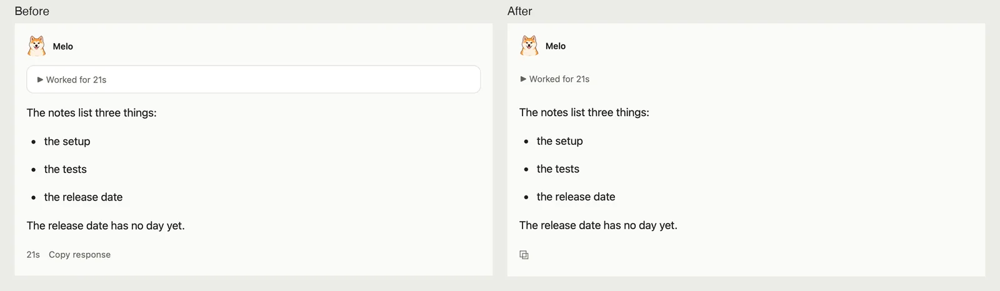
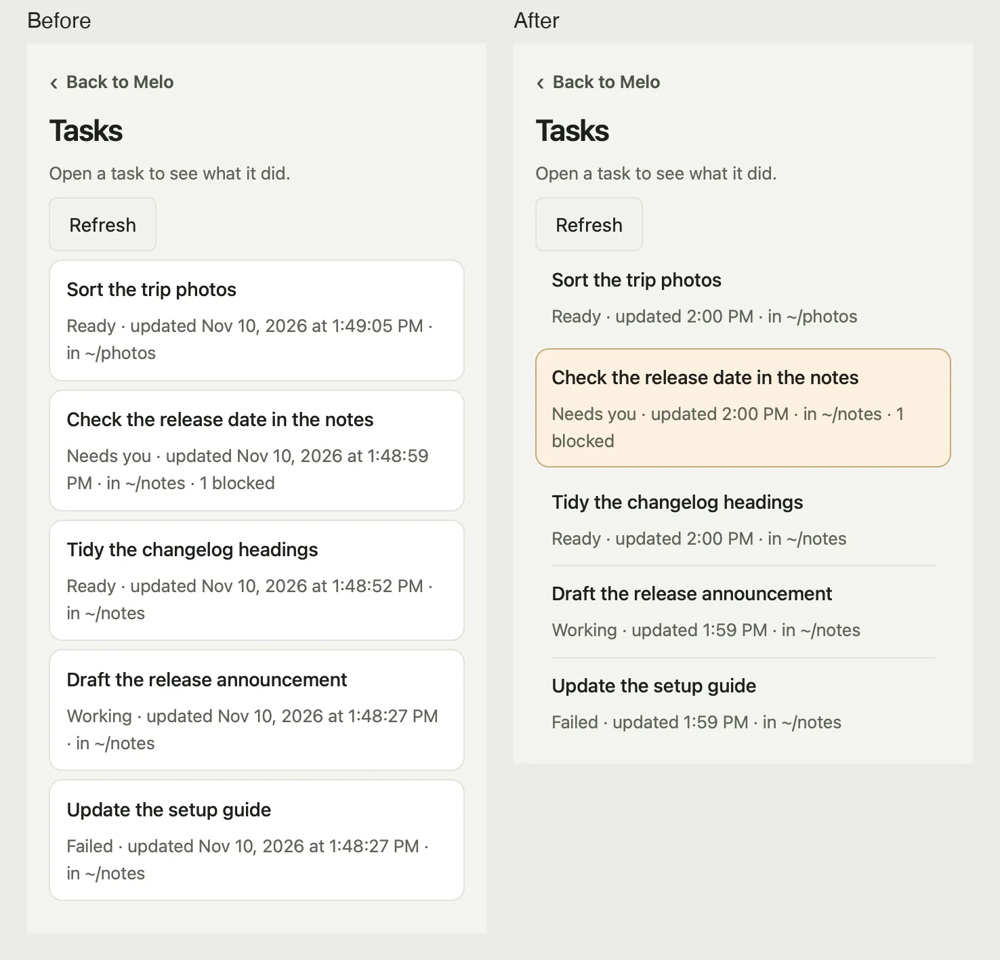
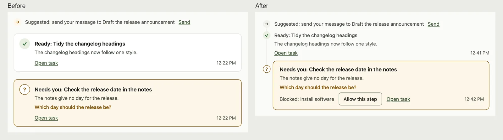
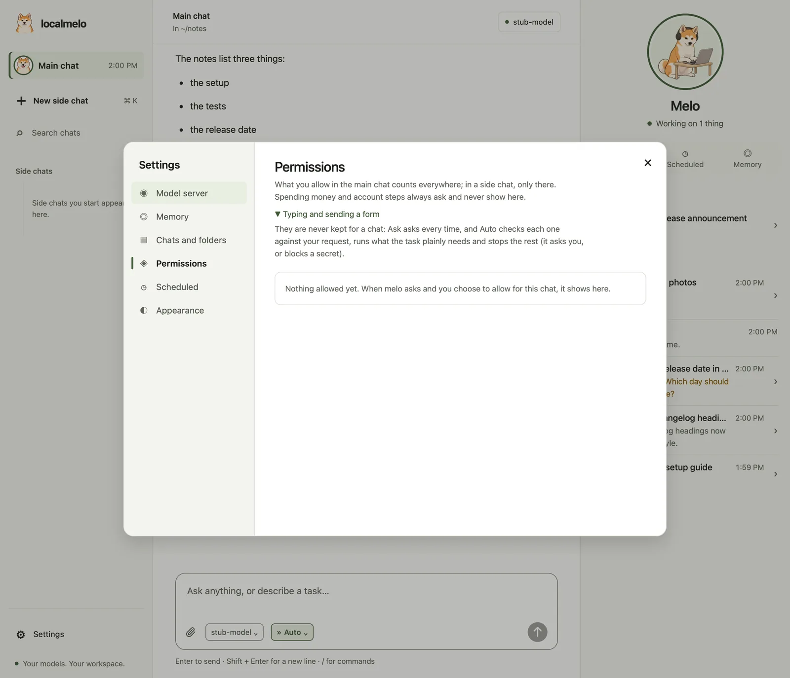

# Console design

How the web console and the macOS app lay out a screen. The pictures show a screen before and after a rule, and where a shadow belongs.

## Reading order

1. **melo's answer.** Full ink, reading size, nothing above it but one quiet line.
2. **What asks you.** A task that needs you, an approval, a blocked step: the only tinted box on the screen.
3. **What happened.** Steps, a finished task, a stopped one: present, but quiet.
4. **Behind a fold.** The steps themselves, a failure's raw record (**Details**), a task's report (its page).

A fact shows once, where it is used.

## Four rules

### 1. Space first

- Turns are apart by space; items of one group by less.
- No line, box or shadow where space already says it.

### 2. A line for peers or for a thread

- Rows of one list get a 1 px line between them, inset to the text.
- What hangs off something sits on one vertical line under it: the tasks under melo's face in the chat.

### 3. A tinted box only for what asks

- An amber box marks the one thing that asks you to act. A fact never gets a box.
- Content keeps its quiet surface: opened steps, code, a diff.

### 4. A shadow only for what floats

- Menus, dialogs and the panel's sheet on a phone have a shadow.
- Rows and cards that sit on the page never do.

## Sizes and steps

| Type | Size | Used for |
|---|---|---|
| `--text-caption` | 12 px | times, notes, chips |
| `--text-small` | 13 px | rows, facts, help |
| `--text-body` | 14 px | controls, labels |
| `--text-reading` | 15 px | melo's answer |
| `--text-title` | 17 px | dialog titles |
| `--text-heading` | 22 px | a task's title |
| `--text-display` | 28 px | the first window |

Spacing steps: `--space-1` 4 px, `--space-2` 8 px, `--space-3` 12 px, `--space-4` 16 px, `--space-5` 20 px,
`--space-6` 24 px, `--space-7` 32 px, `--space-8` 48 px. Colours are the page's own tokens; a screen adds none.

## Cards in the chat

| Card | What it shows | Weight |
|---|---|---|
| **Done**, **Ready**, **Done, not finished**, **Not needed** | the task's answer, or how it ended | a line on the thread |
| **Did not finish** | why, in a few words in your language | a line on the thread, a red mark |
| **Stopped** | what is left, with **Continue** | a line on the thread |
| **Reminder** | your words, at their time | a line on the thread |
| **Approval for** | how an approval was answered | a line on the thread |
| **Needs you** | its question, or the one step to allow | amber box |
| **Needs your approval** | the step, with **Review** | amber box |
| **A step was blocked** | the step Auto stopped, with **Allow once** | amber box |
| Suggestion | a message melo can pass to a running task | a line; buttons while it can be taken |

## Before you change a screen

- Name what the person sees first, and check that nothing louder sits above it.
- Keep every control reachable by keyboard, named for a screen reader, and 44 px tall on touch.
- Check contrast in the light and the dark theme, in English and in Chinese.
