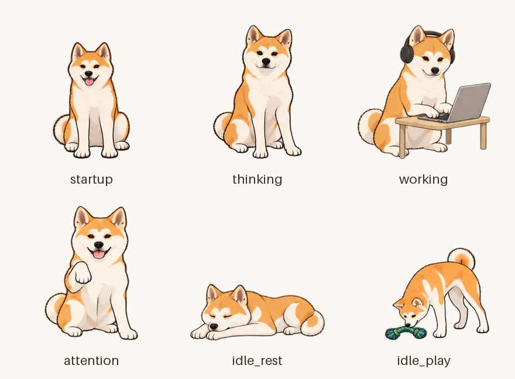
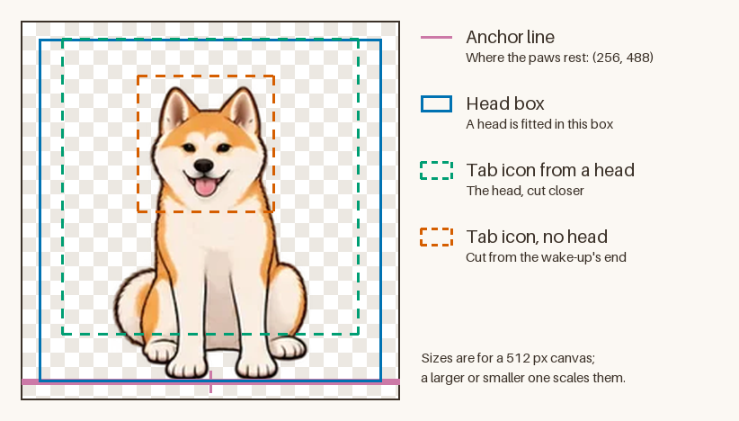

<a id="art-pack-replace-every-picture-of-melo"></a>

# 美术包：替换 Melo 的每一张图片

一条命令检查一个装着 Melo 美术的文件夹或 zip，并用它替换仓库里 Melo 的每一张图片：桌面宠物、控制台的画像、各种脸、标签页图标、应用图标和菜单栏标志。本指南写给绘制或提供美术、并从检出的仓库构建 localmelo 的人。



<a id="quick-start"></a>

## 快速开始

- 你需要一份检出的仓库、`uv` 和一个美术包：按[美术包](#the-pack)所述排布的文件夹或 `.zip`。
- Pillow 不是 localmelo 的依赖。`--with pillow==13.0.0` 只在这一次运行中获取它；固定版本让字节保持一致，因为别的 Pillow 或 libwebp 可能编码出不同的字节。
- 美术包只被读取：其中的任何东西都不会被运行，zip 在写入任何内容之前就先被检查。

**1. 检查。** 它不会向检出的仓库写入任何东西，美术包有问题时退出码为 1：

```shell
uv run --with pillow==13.0.0 python scripts/art_pack.py check melo-pack.zip
```

报告会说明美术包替换什么、缺什么以及改用什么、让 `apply` 停下的问题、警告，以及被忽略的文件。有两个问题的美术包看起来是这样：

```console
$ uv run --with pillow==13.0.0 python scripts/art_pack.py check melo-pack
Art pack: melo-pack

Missing -> uses instead
  brand/app-icon.png: AppIcon.icns stays as it is
  brand/menubar.png: MenuBarLogo.png, MenuBarLogo@2x.png and the website's round logo stay as they are
  brand/emblem.png: docs/assets/melo.png (the README emblem) stays as it is

Problems (2)
  six states: the pack has no thinking
  durations: working: one positive duration (ms) per frame, as whole numbers

Warnings (0)
  none

Ignored (10)
  README.md
  *.apng (6 files)
  *.gif (6 files)
  preview.html
  transition-demo.js
  transition-player.js
  frames/ (16 files)
  integration/ (2 files)
  posters/ (6 files)
  sprites/ (6 files)

Result: the pack has problems; apply would refuse.
```

**2. 应用。** 它会再检查一遍，然后一次运行替换每一张图片，并打印改动的文件、一张预览图和下一步：

```shell
uv run --with pillow==13.0.0 python scripts/art_pack.py apply melo-pack.zip
```

- `-o DIR` 把预览图留在 `DIR`；不给就新建一个临时文件夹。
- `-r ROOT` 写入 `ROOT` 而不是当前检出的仓库，用它可以在不改动仓库的情况下试一个美术包。
- 同一个美术包总是得到同样的字节。

**3. 看一看。** 打开它打印出来的预览图：每一张海报图、静态图、按实际显示尺寸排列的脸、标签页图标和品牌图片，分浅色和深色两个页面。

**4. 测试、提交、重建。** 运行图片测试，提交 `git status` 列出的文件，然后重建应用：

```shell
uv run --with pillow==13.0.0 pytest tests/test_moves_assets.py tests/cli/test_mark.py -q
uv run python scripts/build_macos_app.py --install
```

`docs/assets/img` 里的截图显示的是当前美术下的控制台和应用；图片变了就重新截图。

<a id="the-pack"></a>

## 美术包

美术包是一个文件夹，或一个 `.zip`：它的根目录就是这个文件夹，或者把这个文件夹作为唯一的顶层文件夹。只读取 PNG 和 JSON 文件。

```text
melo-pack/
  manifest.json                  the states, frames, timing, poster frames and the canvas
  frames/<state>/frame_NN.png    the six states, 1 to 16 frames each
  stills/done.png                optional: a run that ended well
  stills/error.png               optional: a failure
  stills/offline.png             optional: nothing known, or no connection
  heads/head-smile.png           optional: the head for small sizes
  heads/head-neutral.png         optional: the calm head for small sizes
  brand/app-icon.png             optional: the macOS app icon
  brand/menubar.png              optional: the menu-bar logo and the website's round logo
  brand/emblem.png               optional: the README emblem
```

- 六个状态是 `startup`、`thinking`、`working`、`attention`、`idle_rest` 和 `idle_play`：恰好这些，每个至少有一帧。
- 帧命名为 `frame_NN.png`，从 `frame_00` 或 `frame_01` 起不间断地编号，顺序就是播放顺序。每个状态最多 16 帧（拼图是 4 x 4）。
- 静态图和头部图也可以放在美术包的根目录。两处都有时用文件夹里的那一份，并在报告里警告。
- 其他文件一律列为被忽略，绝不算错误。美术包可以把预览、精灵图和播放器放在美术旁边。
- zip 在读取之前就先被检查：见[zip 与文件夹的安全](#zip-and-folder-safety)。

清单（manifest）写明每个状态的帧和时长，以及画布。读取的字段如下，其他字段可以保留：

```json
{
  "canvas": {"width": 512, "height": 512, "anchor": {"x": 256, "y": 488}},
  "states": {
    "startup": {
      "frames": ["frames/startup/frame_01.png", "frames/startup/frame_02.png"],
      "frame_durations_ms": [450, 200],
      "playback": "once",
      "poster_frame_index": 1
    }
  }
}
```

- `frame_durations_ms` 为每一帧给出一个正整数毫秒。
- `playback` 是 `"once"` 或 `"loop"`；`loop_count` 为 1 也表示播放一次，为 0 表示循环。
- `poster_frame_index` 从 0 起数，默认是第一帧。
- 清单里还列出其他状态时会被接受并给出警告；只使用那六个。

<a id="the-six-states"></a>

## 六个状态

| 状态 | Melo | 控制台和桌面宠物在这时播放 | 播放方式 | 当前的美术包 |
|---|---|---|---|---|
| `startup` | 醒来，抖抖毛，坐好 | 页面或应用刚刚打开 | 播放一次，然后停在最后一帧 | 16 帧，4.0 秒 |
| `thinking` | 先歪向一边，再歪向另一边 | 模型正在作答，没有工具在运行 | 循环 | 16 帧，5.6 秒 |
| `working` | 在笔记本电脑前打字 | 有对话、任务或运行在工作 | 循环 | 16 帧，1.3 秒 |
| `attention` | 举起爪子轻拍 | 有事在等你批准；立刻显示 | 循环 | 16 帧，1.6 秒 |
| `idle_rest` | 趴着，闭着眼睛，呼吸 | 没有任何东西在运行 | 循环 | 16 帧，3.2 秒 |
| `idle_play` | 玩它的玩具 | 休息约 20 秒之后，最多每 5 分钟一次 | 循环；每次播放一遍 | 16 帧，6.0 秒 |

- 在当前的美术包里，一帧持续 40 毫秒到 1.6 秒；同一个状态里各帧的时长可以不同。
- 海报帧是在什么都不能动时代表这个状态的那一张图片。`startup` 用它的最后一帧，也就是坐着的小狗；其余状态用第一帧。
- 每个状态保持一个姿势，由代码固定：`startup`、`thinking` 和 `attention` 坐着，`working` 在桌前，`idle_rest` 趴着，`idle_play` 站着。
- 两个状态之间的切换会交叉淡化：同一姿势 160 毫秒，不同姿势之间 220 毫秒，切到 `attention` 是 120 毫秒，因为它会打断一切。
- `startup` 应当播放一次，`working`、`thinking`、`attention` 和 `idle_rest` 应当循环；美术包不是这样时报告会警告。

这些状态在实际使用中的样子，见 [macOS 应用](macos-app.md#melo-on-your-desktop)和[网页控制台](web-console.md#the-panel-beside-a-chat)。

<a id="stills-and-heads"></a>

## 静态图和头部图

静态图和头部图是可选的。每一张都是美术包画布上的一张透明图片，爪子落在锚点线上。

| 文件 | 画的是 | 出现在哪里 |
|---|---|---|
| `stills/done.png` | 开心地闭着眼睛，尾巴翘起 | 一次运行顺利结束后的几秒钟里，面板和桌面宠物显示它；最新一条回答上的脸 |
| `stills/error.png` | 耳朵向后，低着头 | 刚刚失败的运行，或连不上的模型服务器；那条回答上的脸 |
| `stills/offline.png` | 蜷成一团 | 还什么都不知道：正在连接，或 localmelo 没有回应 |
| `heads/head-smile.png` | 正面、微笑的头 | 回答的头像、主对话和手机上的面板标签 |
| `heads/head-neutral.png` | 平静的头，耳朵竖起 | 侧边栏和登录页、16、32 和 64 px 的浏览器标签页，以及终端欢迎页的标志 |

- 活动胶囊、批准栏和回答里显示的脸，是用固定的框从海报图和静态图里裁出来的；给了头部图的地方，用头部图取代裁出的脸。
- 头部图是放进头部框里的半身像（见[画布](#the-canvas)）：在 512 px 的画布上是 464 px 见方，底边落在锚点线上。
- 标签页图标从平静的头里裁得更近，不要脖子，这样 16 px 时也还看得清。
- 终端欢迎页的标志由平静的头计算得出，所以 `support/cli/mark.py` 会随它一起变。

<a id="brand-pictures"></a>

## 品牌图片

品牌图片是可选的，不在画布上。它们是任意尺寸、至多 4096 px 的 PNG 文件。

| 文件 | 必须 | 变成 |
|---|---|---|
| `brand/app-icon.png` | 正方形，1024 px 或更大（512 px 会警告） | `macos/assets/AppIcon.icns`，所有尺寸 |
| `brand/menubar.png` | 正方形 | `MenuBarLogo.png`（18 px）、`MenuBarLogo@2x.png`（36 px）和网站的圆形标志（64 px） |
| `brand/emblem.png` | 小于 2 MB | `docs/assets/melo.png`，即 README 的徽标；没有 `brand/app-icon.png` 时也用它做应用图标 |

- 应用图标请画成整幅方形，带一个平整的纸色背景：构建时把它放在 macOS 图标网格的圆角底板上，并让它的边缘渐隐进底板的颜色里。
- 带透明像素的图片会先铺在白色上，报告会警告。
- 颜色按 sRGB 读取；带其他色彩配置文件的图片会警告。

<a id="the-canvas"></a>

## 画布



- 每一帧、每张静态图和头部图共用一块正方形画布：当前的美术包是 512 x 512 px。边长从 256 到 4096 px 都可以；更小的画布会警告，因为图片按 256 px 生成，会被放大。
- `canvas.anchor` 是爪子落脚的点，在画布之内：当前的美术包里是 (256, 488)。整块画布一起缩放，绝不单独裁一帧，所以爪子始终落在这条线上。
- 一张图最低的有画面的那一行离锚点线超过画布的 2% 时，报告会警告。美术自带的影子可以稍微落在爪子下面一点。
- 背景透明：RGBA 的 PNG，四个角是空的，并且画着东西。边缘抗锯齿到透明，不要带彩色背景留下的亮边或暗边。
- 图中的尺寸针对 512 px 的画布；更大或更小的画布按比例缩放。

<a id="when-something-is-missing"></a>

## 缺了东西会怎样

| 缺少 | 改用 |
|---|---|
| `stills/done.png`、`error.png`、`offline.png` | 对应的海报图是 `startup`、`thinking` 或 `idle_rest` 海报图的副本；完成和错误的脸从 `startup` 和 `thinking` 的海报图里裁出 |
| `heads/head-smile.png` | 回答的脸从 `startup` 的海报图里裁出 |
| `heads/head-neutral.png` | 品牌的脸就是回答的脸，标签页图标从 `startup` 的海报图里裁出 |
| `brand/app-icon.png` | 应用图标由 `brand/emblem.png` 画出，否则 `AppIcon.icns` 保持原样 |
| `brand/menubar.png` | `MenuBarLogo.png`、`MenuBarLogo@2x.png` 和网站的圆形标志保持原样 |
| `brand/emblem.png` | `docs/assets/melo.png` 保持原样 |

- 动作文件夹里始终有全部九张海报图，所以控制台和应用不会遇到空缺。
- 在写入任何东西之前，报告会把这些都列在 **Missing -> uses instead** 之下。

<a id="size-and-reduced-motion"></a>

## 体积与减弱动态效果

- `support/gateway/static/moves` 里的动作文件现在约 1.7 MB，不得超过 2 MB；超过的美术包会被 `apply` 拒绝（规则是 `size budget`）。
- 每一帧缩放到 256 px，存为有损 WebP、无损透明通道。帧数更少或着色更平，美术包就更轻。
- 在减弱动态效果下，每个状态都是它的海报帧，切换是 80 毫秒的淡化，所以每张海报图都必须不动也能说明它的状态。
- 页面被隐藏或 Melo 被盖住时，什么也不绘制。

<a id="the-character"></a>

## 角色

Melo 是一只秋田犬。这只是对美术的指引，不是检查：没有任何东西会测试它，美术由你决定。

- 两眼之间和眉毛上方是白色或奶油色的面罩，口鼻和脸颊是白色。
- 橙色只出现在头顶、耳朵、背部和腿的外侧。
- 深色轮廓加橙色的毛，让 Melo 在控制台的浅色和深色页面上都看得清。

<a id="what-the-check-tests"></a>

## 检查测什么

每一条发现都以平实的规则名开头。问题会让 `apply` 停下；警告不会。

| 问题 | 测什么 |
|---|---|
| `zip safety`、`folder safety` | 压缩包或文件夹可以安全读取（见下文） |
| `manifest` | `manifest.json` 是一个可读的 JSON 对象 |
| `square canvas`、`sane size` | 画布是正方形；边长不超过 4096 px，任何一张图片不超过 50 MB |
| `anchor` | 画布有一个带数字 `x` 和 `y` 的锚点，且在画布之内 |
| `six states` | 六个状态都在，而且每个都是对象 |
| `frame count`、`frame names`、`frame files` | 每个状态 1 到 16 帧，按顺序命名，每一帧都是美术包里的文件 |
| `durations`、`playback`、`poster frame` | 每帧一个正整数时长；`once` 或 `loop`；海报帧是其中的一帧 |
| `readable PNG`、`on the canvas`、`RGBA` | 每张图片都是带透明通道的真正的 PNG，并且在画布上 |
| `transparent corners` | 四个角是空的，并且画着东西 |
| `app icon`、`menu-bar logo` | 品牌图片是正方形，应用图标至少 512 px |
| `size budget` | 动作文件小于 2 MB |

| 警告 | 测什么 |
|---|---|
| `canvas size` | 画布小于 256 px，图片会被放大 |
| `six states`、`playback` | 清单里列出了其他状态；某个状态的播放方式与它的用法不同 |
| `paws on the anchor line` | 某张图离锚点线超过画布的 2% |
| `head box` | 头部图画到了框外，会被裁掉 |
| `stills`、`heads` | 同一个文件在根目录和文件夹里各有一份 |
| `colour profile`、`emblem`、`app icon`、`menu-bar logo` | 不是 sRGB 的配置文件、太重的徽标、小于 1024 px 或带透明像素的图标、小于 64 px 的标志 |
| `terminal mark`、`encoder` | 标志无法生成；Pillow 不是固定的版本，字节可能与已提交的不同 |

<a id="what-apply-writes"></a>

## apply 写入什么

- 动作文件夹 `support/gateway/static/moves` 被整个替换：拼图、海报图、静态图、脸、标签页图标和 `manifest.json`。不在新文件集里的文件会被删除。
- 终端欢迎页的标志 `support/cli/mark.py` 由新的平静的脸计算得出。
- 有品牌图片时：`macos/assets/AppIcon.icns`、`MenuBarLogo.png`、`MenuBarLogo@2x.png`、`docs/assets/melo.png` 和 `docs/assets/icon_small.png`。
- 本指南的两张图片 `docs/assets/img/art-pack-moves.webp` 和 `art-pack-canvas.webp`，由新的海报图重新绘制。`art_pack.py figures` 可以单独重画它们。

美术包里的东西，除了它点名的品牌图片之外，一律不会被复制。美术包本身留在仓库之外。

<a id="zip-and-folder-safety"></a>

## zip 与文件夹的安全

美术包来自外部，因此是不可信的数据。只会读取它的名字、大小以及 PNG 和 JSON 的字节。

- zip 在写入任何一个字节之前先被整体检查；被拒绝时什么也不写。
- 名字里有绝对路径、`..`、反斜杠或盘符，有符号链接或任何不是普通文件或文件夹的条目，有加密的条目，或有两个只在大小写上不同的名字，都会被拒绝。
- 超过 2000 个条目、单个文件超过 50 MB 或总共超过 300 MB 时被拒绝，读取字节时会再数一遍。
- 只提取 PNG 和 JSON，放进一个新的临时文件夹，用完即删。Mac 添加的 `__MACOSX` 文件夹、`.DS_Store` 和 `._` 文件会被忽略。
- 文件夹就地读取，拒绝符号链接，并有同样的上限。
