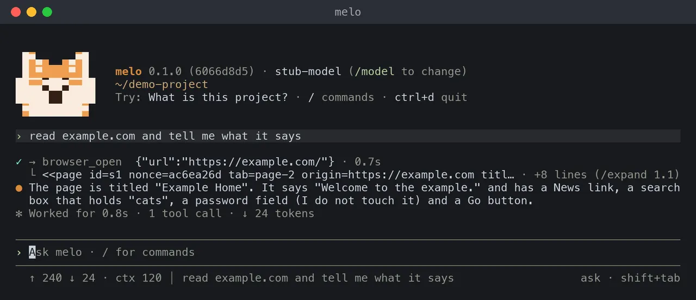

<a id="browsing-with-melo"></a>

# 用 melo 浏览网页

在 Mac 上，通过终端或网页控制台，让 melo 读取网页，并在网页上点击、输入和选择：在后台的 Chrome 中，或在 Safari 的自动化窗口中。开启前请先阅读安全部分；相关设置见[配置参考](../reference/configuration.md)。



- 浏览在你开启之前一直是**关闭**的。
- 两种浏览器：**后台的 Chrome**（没有窗口，从不来到最前面；见[后台的 Chrome](#chrome-in-the-background)），或会来到最前面的 **Safari 自动化窗口**。`/browser on` 用你之前选的浏览器，没选过时用 Safari。
- melo 打开网页、跟随链接并读取内容，像人一样在一个标签页里工作。
- 它可以点击按钮或链接、在文本框里输入、从列表里选择，这一切都发生在 **melo 自己的浏览器窗口里**，用的是 Safari 自己的点击和按键，每次操作后都会说明页面变了什么。它从不输入密码、银行卡号或一次性验证码，从不读取你的 Cookie，每次输入文字前和发送表单前都会先问你。文字一旦进了网页，网页自己也可能把它发出去，melo 无法拦住每一次这样的发送（见[点击、输入和选择](#clicking-typing-and-choosing)）。
- 它从不替你输入密码。使用后台的 Chrome 时，如果网页需要你（登录、验证码、二维码或人机验证），melo 会请你[接管这个网页](#taking-over-melos-browser)，你交还之后它再继续。在桌面上移动鼠标是另一项功能，不属于这里（见[后续计划](#what-is-coming)）。

<a id="read-a-page-without-the-browser"></a>

## 不用浏览器读取网页

每个对话都可以不经过 Safari、用 `web_fetch` 工具读取公开网页。它**默认开启**，不需要任何设置。

- 问一个网站或贴上它的地址：melo 把网页读成文字（标题、各级标题、正文和链接）。纯文本和 JSON 原样返回。
- 它只读：一次请求，不带 cookie，不登录，不填表。PDF 和其他文件暂时不读。
- 它从不访问这台 Mac 或你的局域网。`localhost`、私有和链路本地地址、`.local` 名字、这台 Mac 自己的地址（包括公网 IPv6 地址）和它们周围的网络，以及指向它们的重定向或 DNS 结果都会被拒绝。
- 你自己最近的消息提到的网站直接读取：就是那个网站，带不带 `www.` 都算。它下面的网站（你提到 `example.com` 时的 `docs.example.com`）和其他网站每个对话问一次（“让 melo 读取 example.com？”，并显示完整地址），一次“在这个对话里允许”也同时适用于浏览器。`README.md` 这样的文件名不算提到网站。
- 需要登录、拦截自动读取或由脚本生成的网页，会说明这一点。开启浏览时，melo 可以改用 Safari 试试。
- 任务也有它。在设置 → 对话和文件夹 → **读取网页** 中关闭，或用 `melo config set tools.web_fetch false`。限制和具体规则见[工具](../reference/tools.md#reading-a-public-web-page)。

本页其余部分讲的是在 Safari 中浏览，它还能跟随链接、点击、输入并运行网页的脚本。

<a id="what-you-need"></a>

## 需要什么

- 使用 Safari 窗口：一台装有 Safari 27 或更高版本的 Mac。melo 使用 Safari 自带的自动化服务器 `/usr/bin/safaridriver --mcp`，不需要安装任何东西。Safari 中有两个开关需要打开一次（见[设置 Safari](#set-up-safari)）。
- 使用后台的 Chrome：装在 `/Applications`（或 `~/Applications`）里的 [Google Chrome](https://www.google.com/chrome/)，别的都不需要。
- 可选，用于[其他应用的窗口](#windows-from-other-apps)：桌面控制助手 [Cua Driver](https://cua.ai/docs/cua-driver)，安装为 `/Applications/CuaDriver.app`（melo 也会在 `PATH` 中查找 `cua-driver`）。在“系统设置 → 隐私与安全性”中给它“辅助功能”权限；再给“录屏”权限，melo 才能看到窗口的图片。melo 自己不需要这两项权限。
- 终端对话（`melo`）或网页控制台。直接运行（`melo "任务"`）、worker 运行和已保存的任务都不会获得浏览工具。

<a id="turn-it-on"></a>

## 开启

在终端对话中：

```text
/browser
```

- 它显示浏览是否开启；开启时会检查浏览器是否有响应，然后一个列表提供开启（Safari 窗口，或后台的 Chrome）、切换浏览器或关闭。
- `/browser chrome` 和 `/browser safari` 选择浏览器并开启浏览；`/browser on` 用之前选的浏览器开启（没选过时用 Safari），`/browser off` 关闭。
- 在网页控制台和 App 中：设置 → 对话和文件夹 → **浏览器**（Chrome、Safari 或关闭），或同样的 `/browser` 命令。没有安装 Chrome 时，这个选项会显示“安装 Google Chrome 后才能在后台浏览”，并且不做任何更改。
- 已有保存的配置时，选择会写入 `~/.cache/localmelo/config.toml` 的 `[browser] driver`；对话会换到一个新的 Agent 上继续，已说的内容不会丢失。
- **已打开的对话从下一条消息起换用。** 在网页控制台和 App 里，正在进行一轮的对话会用原来的浏览器把这一轮做完，下一条消息起用新的浏览器。
- **每个浏览器各自保存登录状态。** melo 的 Chrome 有自己的配置文件，Safari 的自动化窗口开始时没有任何登录，所以切换之后，网站可能需要重新登录。切换时设置里会提示这一点。

只为一次运行开启、不保存：

```bash
melo -X browser.driver=safari-automation
```

在配置文件中：

```toml
[browser]
driver = "safari-automation"   # 或 "chrome"：后台的 Chrome
keep_tabs = false   # 设为 true 会让 melo 打开的标签页留在窗口里
app_windows = true  # 设为 false 后 melo 不再留意其他应用的窗口
```

默认是 `"off"`。网页控制台和 App 在打开每个对话（包括主对话）时读取同一个设置：在那里的设置中或用 `/browser` 修改，或用 `melo config set browser.driver chrome`，然后打开新对话。

<a id="set-up-safari"></a>

## 设置 Safari

Safari 必须允许外部程序打开自动化窗口。在 Safari 中：

1. 打开**设置**，进入**开发者**标签页。没有开发者标签页时，先打开**高级**标签页并勾选**显示网页开发者功能**。
2. 勾选**允许远程自动化**（完整名称可能是“允许远程自动化和外部代理”）。

关闭时，melo 会在第一次浏览的回答和 `/browser` 中说明：

```text
Safari is not set up for melo yet. In Safari, open Settings > Developer and turn on "Allow remote automation" ...
```

- 打开开关后再问一次即可；melo 每次调用都会重新连接，不必重启。
- 两个开关都打开后检查仍失败时，Apple 的一次性设置是在终端运行 `safaridriver --enable`（会要求输入密码）；melo 从不替你运行它。
- melo 只在第一次浏览调用（或 `/browser`）时才启动 Safari 的自动化服务器；从不浏览的对话不会打开任何东西。

<a id="what-the-automation-windows-are"></a>

## 自动化窗口是什么

- 它们与你自己的窗口分开打开，地址栏是橙色的。
- 它们从空白状态开始，像无痕窗口：**你的登录状态、Cookie 和自动填充都不可用**，之后什么也不保留。
- 同一时间只运行一个自动化会话；窗口上方的一层面板会拦截你的鼠标和键盘，打断它会提示停止会话。
- 所以 melo 能读不需要登录的网页；登录后才显示的网页，以及会质疑自动化浏览器的网站，暂时可能无法使用。

<a id="chrome-in-the-background"></a>

## 后台的 Chrome

设为 `driver = "chrome"` 时，melo 在完全没有窗口的 Google Chrome 中浏览。

- **从不打扰你。** Chrome 以无界面方式运行：没有窗口，没有程序坞图标，从不来到最前面，也从不切换你的桌面（空间）。melo 读取、点击和输入时，最前面的应用一直是你的。
- **只有 melo 能操控它。** melo 启动这台 Mac 上安装的 Chrome，并通过一条私有管道和它通信。Chrome 不会为此打开任何网络端口，所以其他程序都无法操控它。
- **melo 自己的配置。** 位于 `~/.cache/localmelo/browser/chrome`，只有你能读取（权限 0700）。从不使用你自己的 Chrome 配置、其中的登录信息，或它在钥匙串中的条目。
- **它保留什么。** 网站保存多天的 Cookie 会留在这个配置里，从一个对话保留到下一个，所以你在那里登录过的网站会保持登录。Chrome 在这里不使用你的钥匙串，因此这些 Cookie 只受文件夹权限和 FileVault 保护。只在会话期间有效的 Cookie 在 Chrome 停止后就没有了。要全部清除，退出 melo 后删除这个文件夹。
- **可以观看，也可以接管。** 你可以[实时观看 melo 的页面](#watching-melos-browser)，也可以[接管它](#taking-over-melos-browser)，自己登录。
- **网站看到什么。** 一个普通的 Chrome：用户代理中没有“HeadlessChrome”，也没有自动化标记。有些机器人检查可能仍会发现；这时请用 Safari 窗口。
- **Chrome 自己的流量。** 即使关闭了后台联网，Chrome 仍会自己连接几次 Google；这些连接不会把任何东西带给 melo。下载会被拒绝。
- **点击和输入由 Chrome 自己完成。** 点击是落在 melo 检查过的元素上的一次真实点击；输入会先选中框里原有的内容，再放入文字，所以忽略脚本点击的网页也能用。从列表里选择由页面脚本完成。melo 会先把元素滚到视野正中，这样吸顶的标题栏或固定在底部的广告就不会盖住它（见[被东西盖住的元素](#点击输入和选择)）。
- **网页要打开应用或提问时。** 见[网页要打开应用时](#when-a-page-wants-to-open-an-app)。
- **这台 Mac 上的应用。** Chrome 自己的检查让网页无法访问这台 Mac 或你的局域网（melo 的控制台、模型服务器、开发服务器），这项检查一直开着。后台的 Chrome 没法询问你，所以答案是不允许。只有一个例外：melo 列出的应用，它的登录框可以访问这个应用。目前列表里只有微信快捷登录：来自 `open.weixin.qq.com` 的登录框可以访问这台 Mac 上的微信，和在 Safari 里一样，所以会显示快捷登录按钮。
  - 这些请求由 melo 自己发出：只为这个登录框，只发到这个应用自己的端口，从不发到 melo 的控制台或模型服务器的端口。
  - 网页发往这台 Mac 或你的局域网的其他请求，都会在发出前被拦下。网页把自己的标签页送到这类地址时，如果地址本身写的就是这类地址（`localhost`、`127.0.0.1`、`.local` 名字、只有一个词的名字），也会被拦下；只是解析到这里的名字，会像在 Safari 中一样，在加载后变为空白页。这一步会说 `The page tried to reach an app on this Mac (port N); melo blocked it.`
  - 这个列表是 melo 的一部分，没有对应的设置。

<a id="watching-melos-browser"></a>

## 观看 melo 的浏览器

在网页控制台和 App 里，对话旁边的**浏览器**面板会实时显示 melo 打开的页面。它需要后台的 Chrome；Safari 窗口本来就在你的屏幕上。

- **melo 浏览时自动打开**：某个浏览步骤开始时，或者你打开一个正在浏览、或有你接管的页面的对话时。这一轮结束后它会自己收起，除非是你自己打开的，或页面正由你操作；顶部的**浏览器**按钮可以再把它打开。
- **跟随设置。** 在对话中途把浏览器换成 Chrome，这个对话下一个浏览步骤开始时面板就会打开。
- **收起浏览器**会关掉它，在这个对话里它不再自己打开，直到你再打开它。窗口较窄时，面板在你需要时以底部面板的形式打开。
- **显示什么。** 页面的标题和地址、实时画面；melo 正在执行某一步时，画面外有一圈蓝色边框，并写着“melo 正在浏览”。melo 切换到另一个标签页，面板也跟着切换。
- **保持平静。** melo 还没浏览时是“没有打开的页面”；第一张画面到来前是“正在打开页面…”；画面停止时，最后一张画面变暗并标为“没有更新”；结束时用一句话说明原因（标签页已关闭、melo 的浏览器已停止、对话已结束，或这个对话没有可用的实时画面）。
- **接管**让你自己使用这个网页（见[接管 melo 的浏览器](#taking-over-melos-browser)）。画面只保存在内存里，从不写入磁盘，并且只在面板打开时才会发送。
- **弹出为窗口**会把面板单独放大显示：在 App 里放进它自己的窗口，在浏览器里打开一个新窗口。
- **对话里的截图。** melo 截取的网页图片（`browser_screenshot`）或其他应用窗口的图片，会显示在这一轮步骤下方的一行里，Chrome 和 Safari 都一样，步骤收起时也能看到。点一下即可查看原尺寸。这些图片随对话一起保存。
- **开销。** 不变的页面几乎不占资源；会动的页面最多每秒 15 张画面（由你操作时为 60 张）。选项 `live` 和 `live_fps` 见[配置参考](../reference/configuration.md)。

<a id="taking-over-melos-browser"></a>

## 接管 melo 的浏览器

浏览器面板里的网页可以暂时交给你：自己登录、输入验证码、扫描二维码或通过人机验证。melo 从不输入你的密码；由你来输入，也只有你看得到。

- **接管。** 点面板底部的**接管**，网页就交给你了。底部变成控制栏，写着“由你操作”，画面外有一圈绿色边框。点一下网页再打字：点击、拖动、滚轮、按键、输入法（中文、日文等）和粘贴都会发给网页。
- **melo 需要你。** melo 遇到登录、密码或验证码字段、二维码或人机验证时，会在对话里用卡片问你：“melo 需要你在 example.com 登录”。**接管**会打开面板并把网页交给你；**暂不**让 melo 不用它继续。这张卡片只由你回答，“询问”和“自动”模式都一样。
- **melo 会等你。** 网页在你手里时，melo 在这个网页上的下一步浏览会等你（每次最多 45 秒），并告诉模型你正在使用这个网页。它的其他标签页照常工作。
- **交还给 melo。** 网页回到 melo 手里。melo 在做任何事之前会重新读一遍网页，因为你可能改动过它；这一步会说明你用了多久：“The user had tab t1 for 42 s and gave it back to melo.”里面不含你输入的任何内容。
- **如果你离开。** 关掉面板、把网页切到后台或控制台退出登录，网页还会在你手里保留 2 分钟，然后回到 melo。在这之前回来，它仍然归你。
- **网页自己的对话框**（提示、确认、提问）在你操作期间显示在面板里，由你在那里回答。
- **离开网页。** 网页接收按键时，按 Control-Esc 会移到**交还给 melo**。
- **你输入的内容不会被保存。** 你的按键和文字只从面板发到 melo 的 Chrome，不会进入日志、对话记录、melo 的记忆或模型。粘贴只粘贴纯文本，每次最多 1,000 个字符。

<a id="what-melo-can-do"></a>

## melo 能做什么

| 工具 | 作用 |
|---|---|
| `browser_open` | 打开 `http` 或 `https` 地址并读取。它会复用 melo 在本次对话中打开的标签页；`tab="new"` 另开一个，`t2` 这样的标签页编号则指定某一个。 |
| `browser_read` | 重新读取当前页面，或读取长页面的下一部分（`part`）。 |
| `browser_find` | 重新读取页面，再按可见文字、`aria-label` 或地址中的词搜索其中的元素（链接、按钮、菜单项、输入框），所以它给出的引用总是页面当前的样子。它会说明页面上有多少东西被跳过。 |
| `browser_follow` | 打开上一次读取中某个链接的地址。它打开地址，不做点击。 |
| `browser_click` | 点击上一次读取中的按钮、链接、菜单项或复选框。回答会说明用什么方式点击、页面变了什么，然后重新读取页面。 |
| `browser_type` | 在上一次读取中的文本框里输入，最多 1000 个字符（`submit=true` 会在输入后按回车，这会发送表单）。melo 每段文字都会询问，并显示全部内容。从不用于密码、银行卡或一次性验证码字段。 |
| `browser_select` | 按文字在上一次读取中的下拉列表里选择一个选项。 |
| `browser_back` | 在该标签页中后退一页。 |
| `browser_tabs` | 列出 melo 的标签页、切换或关闭其中一个。melo 没有检查过页面的标签页显示为 *(not checked)*。 |
| `browser_wait` | 等待（最多 30 秒）melo 打开的页面加载完成，或某段文字出现或消失。还没有正文的页面（比如人机验证页）算作仍在加载。它不是“暂停”：条件一开始就成立时会立刻返回并说明（`Reached: the page had already loaded; nothing was waited.`）。在点击或发送之后的 15 秒内，其他应用在屏幕上弹出窗口时（包括等待开始之前就已出现的），等待会提前结束。 |
| `browser_screenshot` | 给页面拍一张图。图片随对话保存，网页控制台会显示；终端不绘制图片。能读图的模型会在下一步收到它（见[配置参考](../reference/configuration.md)中的 `tool_images`）；不能读图的模型会被告知它看不到这张图，并改为以文本读取页面。 |
| `browser_click_point` | 点击上一张图上的某一点（`x` 和 `y` 横向、纵向都从 0 到 1000），用于元素列表里没有的东西：画出来的按钮、来自其他网站的框。回答附一张新图，标出这一点。 |
| `window_read` | 读取 melo 自己的操作之后其他应用打开的窗口（见[其他应用的窗口](#windows-from-other-apps)）：它的文字、按钮，以及只拍这个窗口的一张图。 |
| `window_press` | 按名字按下这个窗口里的按钮；按不下去时，点击它截图上的一点。每次都会先问你。 |

页面以一个有界的块交给模型：

```text
<<page id=s1 nonce=ab3218de tab=t1 origin=https://example.com title="Example Home">>
Welcome to the example.
Second line, with 中文。
elements:
[e1 link "News" -> /news]
[e2 textbox "Search" value="cats"]
[e3 password field: melo never types here]
[e4 button "Go" sends a form -> /search]
<<end page s1 nonce=ab3218de>>
```

- 一个块约含 6,000 个字符的文本；一个汉字按三个拉丁字符计，所以中文页面约在 2,000 字处截断。更长的页面在段落或句子处截断，第一行带有 `part=1/3`，并有一行说明用 `browser_read part=2` 继续。
- 最多显示 60 个元素。`browser_find` 能搜索全部元素。
- 元素引用（`e1`）在整个对话中连续编号，只属于其标签页最新的一次读取。旧页面的引用会被拒绝，而不是去猜。
- 密码、一次性验证码和银行卡字段的值从不读取，含支付字段的页面完全不读。
- 会发送表单的按钮会注明（`sends a form -> /search`），并给出表单发往的地址。
- 按钮不只是 `<button>` 元素：`role="button"` 的元素、菜单项、标签页、运行脚本的链接和其他可点击的元素也会列出，`browser_find` 会匹配它们的可见文字和 `aria-label`。没有匹配时，回答会说明页面读取器跳过了多少东西（隐藏或禁用的，或超出 400 个上限的）。

<a id="tabs"></a>

## 标签页

- **每个对话一个标签页。** `browser_open` 会把下一个页面加载到 melo 打开的那个标签页里，所以长任务不会堆出一堆窗口。只有两个页面必须同时保留时，才用 `tab="new"`。
- **简短的编号。** 标签页按打开顺序叫 `t1`、`t2` 等，所有带 `tab` 参数的工具都接受这些编号。编号从不被截断，也从不重复使用。Safari 自己的长编号不会交给模型，melo 没发过的编号会被拒绝。
- **关闭有效。** `browser_tabs close` 会关闭本次对话的某个标签页。如果 Safari 中途丢了某个标签页，列表会略过它并说明（`t3 is gone: the browser no longer has it.`）。
- **哪个标签页是哪个。** melo 只按 Safari 给标签页的句柄来称呼它：自己打开的，或自己操作时看到新出现的。它从不按标签页在 Safari 列表里的位置、也不因为它是当前活动标签页来挑选，对某个标签页所用的地址是 Safari 为该句柄报告的，从不是页面自己说的。
- **你自己的标签页不动。** melo 没有打开的标签页从不列出、读取或关闭；列表只说明窗口里还有几个别的标签页。melo 点击时新出现的标签页（在新标签页打开的链接）会和其他标签页一样被检查，也可以被读取，最多三个；多出来的不看也不动。它不归 melo 关闭：melo 只关闭自己用 `browser_open` 建的标签页，新出现的标签页在对话结束时保持打开，melo 不再管它。普通的 `browser_open` 也不会往里面加载页面。
- **收拾干净。** `browser_open` 建的标签页在对话结束时、以及十分钟没有浏览调用后关闭；最后一个会保留为空白页，让 Safari 的自动化会话继续，其中不会保留任何已批准的内容。`/new` 也一样。设置 `[browser] keep_tabs = true` 可让它们全部保持打开。

<a id="clicking-typing-and-choosing"></a>

## 点击、输入和选择

`browser_click`、`browser_type` 和 `browser_select` 按引用（`e12`）对上一次读取中的元素操作，就像人一样。它们在 melo 自己的浏览器窗口里工作，不会移动你的鼠标，也不会碰别的应用。

```text
Clicked e12 (via browser).
<<page id=s4 nonce=1c9e04f2 tab=t1 origin=https://example.com title="Daily">>
what changed:
- new text: 'Checked in: day 12'
- the element acted on: now disabled
...
```

- **先用 Safari 自己的输入。** melo 在 Safari 自己对页面的读取里找到这个元素，由 Safari 在上面点击、输入或选择：这是真实的事件，和你操作时一样，所以忽略脚本点击的网页也能用。Safari 够不到这个元素时，改由页面脚本来做。第一行会说明用的方式：`via browser`、带原因的 `via page-script`，或 `via point`。某个网站上 Safari 自己的输入没起作用时，本次对话余下时间在该网站上先用页面脚本。
- **被东西盖住的元素。** 真实点击或按键之前，melo 会立刻把元素滚到视野正中（页面平滑滚动时也一样），并检查它要用的那个点上是什么。吸顶的标题栏或固定在底部的广告盖住了正中，也不会让它停下：在 Chrome 里，melo 会点元素上没被盖住的那一块；一块都不露的话，稍等片刻后再滚到元素一次。仍然被盖住的元素交给页面脚本，第一行会说明盖住它的是什么（`via page-script: a sticky header (h1) covers it, so only the page script reaches it`），只写类别和标签，从不引用页面自己写的文字。如果真实点击仍落在别的元素上（比如鼠标一动，一条栏就滑了进来），melo 会拦下它，再滚到元素上重试一次；再落到别处时，回答里会说明是什么挡住了它（`An ad (iframe from ads.example.net) covers that button ...`）。这时什么都没有被点击，页面和它的 ref 都还是原样，所以模型会去关掉或移开挡路的东西，或者问你，而不是把页面重新打开。
- **页面变了什么。** melo 从操作前一刻开始观察页面。它等到页面安静下来（约 0.3 秒没有变化；点击后最多等 2 秒，等网站回应），然后报告新出现的文字，例如提示或错误（即使已经消失），新的地址，以及被点击元素的新状态。什么都没变时，第一行会说明。页面会被重新读取，所以下一步不需要 `browser_read`。
- **自己重绘了的页面。** 如果页面在 melo 读取后没有重新加载、只是重建了元素，melo 会重新读取，并使用唯一一个类型、名称、地址和表单都相同、而且仍在原处（同一行或同一标题下，旁边的文字也相同，包括作为链接的标题）的元素，所有检查重新做一遍。有两个相符、melo 读取时页面上就有两个这样的元素（比如每行一个“删除”），或者页面上没有任何东西说明它属于哪里时，什么都不做；一个真正的控件和一个仿冒的元素都相符时，用控件。
- **重新加载过的页面。** 如果页面在 melo 读取后在同一地址重新加载了，melo 会重新读取，使用唯一一个类型和名称都相同、而且仍在原处（同一行或同一标题下，旁边的文字也相同）的元素，并在“what changed”里说明。有两个相符、页面上没有任何东西说明它属于哪里、页面去了别的地址，或者这一步会发送内容（表单的按钮、在框里按回车）时，什么都不做：新页面要发送的内容没有问过你。所以重新加载后换成另一条记录的“删除”按钮，melo 绝不会去按。
- **框架。** 同一网站的框架当作页面的一部分来读取和操作。在来自其他网站的框里（常见的是登录框），Safari 自己的读取会列出其中的按钮、链接和输入框，显示为 `[e9 button "Continue" in a box from accounts.example]`；melo 按名字认得这些控件，所以在那里的点击或输入和页面上其他地方一样询问，问题里会说明是哪个框；Safari 没有说明类型的输入框按机密字段处理。没有任何 melo 够得到的东西的框显示为 `[a box from accounts.example that melo can't reach ...]`。
- **图上的一点，作为最后一种方式。** 对画出来的按钮或来自其他网站的框，模型先用 `browser_screenshot` 拍图，再用 `browser_click_point` 指出一点。melo 先检查那里是什么：点在标签上会移到它的输入框，点在没有可点击东西的地方会被拒绝，并附一行说明 x 和 y 不是像素；如果它们按像素也落在图内，还会说出这一点在 0 到 1000 的刻度上是多少。点在密码、验证码或银行卡字段上，点在同意条款、同意授权或用别的账号登录的控件上，或点在来自其他网站、没有标题的框里（melo 看不清点的是什么），每次都会问你；在自动模式下，最后这种总会用卡片问你。这张卡片在询问模式和自动模式下一样：它说明点击落在哪里、melo 自己无法检查这一步，只提供“允许一次”或“拒绝”。点在 melo 按标题认得的框里，和普通点击一样。链接和发送的检查与点击相同。一个红圈显示 melo 点在哪里，下一张图也会标出这一点。melo 看不到来自其他网站的框里面，所以在那里点击的结果要看新的那张图。

- **只针对读过的那个页面。** 只有标签页仍显示读取时的地址和同一个文档（重新加载，或被脚本替换的页面，都算另一个文档），且元素仍是读到的那个（位置、类型、名称和地址相同；文本框还要有相同的字段描述）时才会执行。链接通向哪里、表单发往哪里，会在那一刻重新从页面读取；与读取时不同，就什么都不做。否则什么都不会发生，melo 会让模型重新读取页面。旧页面的引用在调用浏览器之前就会被拒绝。
- **melo 操作时做什么，又拦不住什么。** melo 在输入文字前和按下发送前都会先问。操作期间它还会尽力拦下页面发出的、melo 没有问过的表单，按下或点击时地址变了的链接，以及落到 melo 检查过的元素之外的真实点击或按键（melo 会再滚到元素上重试一次；回答里会告诉模型拦下了什么），并去掉链接的跟踪 `ping`。这是尽力而为的防护，不是保证：它只在 melo 操作期间有效，页面能绕开它（定时器里的发送、脚本发出的请求、事先存好的引用）。**文字一旦进了网页，网页自己也可能把它发出去，melo 无法拦住每一次这样的发送。** 在 melo 的两次调用之间，页面像对你一样运行它自己的脚本。
- **每次操作之后**，melo 取 Safari 为本次操作碰过的每个标签页（操作所在的标签页和这期间出现的最多三个标签页；再多的新标签页不检查、不读取，也不关闭）报告的地址，并在读取其中任何一个之前全部检查：从不是这台 Mac、你的局域网或 melo 的控制台；没问过的网站会在读取页面前先问。地址是本地或私有的、或 melo 无法确定地址的标签页会变为空白页，其中任何内容都不会到达模型。变空白页是在浏览器的历史记录里把该页替换掉，所以“后退”不会回到它。如果替换没有及时生效，melo 会改用浏览器自己的方式打开一个空白页，这会多出一条历史记录，“后退”随后可能回到被拒绝的页面：`browser_back` 像任何读取一样检查落到哪里，所以 melo 会拒绝该页面、再次把标签页变为空白页，并且不读取其中任何内容。如果变空白页彻底失败，melo 会关闭自己用 `browser_open` 建的标签页，对其他标签页只是不再管它。melo 读取的页面还会和 Safari 刚才为该标签页报告的地址对比：这期间页面若已跳走，就不读取。失败的操作同样检查，并丢弃该页面的读取结果。melo 若无法列出窗口里的标签页，就不会操作。然后重新读取页面，其中的引用是新的。
- **这做不到什么。** melo 自己从不打开本地或私有地址，指向这类地址的链接或表单在使用前就会被拒绝。melo 自己的操作唯一可能到达这类地址的方式是 `browser_back`：标签页历史里更早的某个页面曾被拒绝、又没能被替换掉时（见上文），它会检查落到哪里，拒绝该页面并再次把标签页变为空白页。页面也可能用自己的脚本把它的标签页送过去；melo 随后发现、把标签页变为空白页，并且不读取其中任何内容。这是对 melo 所读内容的检查，不是网络封锁：页面要求的请求（图片、脚本、后台调用）仍由 Safari 发出，页面用自己的脚本发出的表单，也可能在 melo 来得及清空标签页之前到达某个地址。
- **从不碰机密字段。** melo 不会在密码、银行卡或一次性验证码字段里输入，并会说明原因。拿不准时，该字段按机密处理。它根据字段的 `type`、`autocomplete` 取值（`current-password`、`new-password`、`one-time-code`、`cc-*`）、页面用 CSS 遮盖的文字、命名它的词（name、id、`aria-label`、`aria-labelledby` 与 `aria-describedby` 所指的文字、title、占位文字、标签、所在 fieldset 的 legend 和紧挨在它前面的文字，中英文及其他几种语言均可：密码、PIN（也包括连写的词，如“PINcode”）、卡号、有效期、CVV 或 CVC2、“验证码”（也包括词尾的 code，如“Bestätigungscode”）、token、验证、两步验证等，但邮编、优惠码或国家代码不算）以及验证码的形状（只容一个字符的输入框、很短的数字或电话字段、只含数字的 `pattern` 或全是 9 的 `max`，或名字什么都没说的短输入框）来判断。它在读取页面时、字段获得焦点之后、文字填入之后以及页面自己的处理程序运行之后都会判断；变成受保护字段的字段会被清空，melo 会说明。银行卡有效期的下拉列表算支付字段，含支付字段的页面完全不读。请让本人在窗口里自己填写这类字段。melo 看不到页面脚本会把普通字段里输入的内容发到哪里，也看不到它们会怎么处理：不要在那里输入你不会自己填到那个页面上的内容。
- **点击和选择与读取分开询问。** 在一个对话里，melo 第一次要在某个网站上点击或选择时，你会看到“让 melo 在 example.com 上点击和选择？”；“在这个对话里允许”只涵盖该网站的点击和选择。打开网站并不等于允许这些。每个问题都会说明点击或输入的对象（`a button "Check in"`），所以在自动模式下 melo 按目标判断每一次点击。
- **输入每次都问，并显示全部文字。** 每次 `browser_type` 都会问“让 melo 在 example.com 上输入文字？”，并显示完整的文字，最多 1000 个字符，更长的会被拒绝，所以要分段输入。文字里若有控制字符、格式字符（零宽空格、方向覆盖符、字节顺序标记、标签字符）、代理字符、私用区或未分配的字符、行分隔符或段分隔符、韩文填充符（U+3164、U+FFA0）、空白盲文（U+2800）、组合字素连接符（U+034F）或变体选择符（U+FE00-FE0F、U+E0100-E01EF），就会被拒绝，因为问题无法把它们显示出来；用 U+FE0F 写的表情符号也在其内。换行、制表符以及连接符 U+200C 和 U+200D 可以输入。可选的答案是*是*（只这一段文字）和*否*：输入没有“在这个对话里允许”，终端、控制台和 API 都一样。
- **发送表单每次单独询问。** 点击会提交表单的按钮，以及 `submit=true`（回车）的 `browser_type`，会问“让 melo 从 example.com 发送表单？”，并附上表单发往的地址和 melo 最后一次读到的表单内容（发送前网页可能改动其中的值）；看起来像机密或令牌的值显示为 `(hidden)`。在表单之外按回车时，melo 无法说出会发往哪里，问题会说明由网页决定，此时网页可能发送页面上的任何表单。可选的答案是*是*（只这一次发送）和*否*：发送表单没有“在这个对话里允许”，终端、控制台和 API 都一样。这个地址会先被检查，和其他地址一样：发往这台 Mac 或你的局域网的表单会被直接拒绝，发往另一个网站的表单会在发送前先问那个网站。
- **链接的地址在点击前同样检查**，按下鼠标的那一刻再检查一次。点击后仍落到本地地址的（脚本把它送到那里），窗口会变为空白页并被拒绝。
- **你的会话仍属于你。** melo 从不读取 Cookie 或页面存储，自动化窗口也没有你的任何登录状态。

<a id="who-decides-which-sites-melo-opens"></a>

<a id="when-a-page-wants-to-open-an-app"></a>

### 网页要打开应用时

网页可能请浏览器打开一个给应用用的地址，比如聊天应用的 `chat://` 登录链接。后台的 Chrome 从不自己打开它。

- **melo 会问你。** 它说出这台 Mac 会用哪个应用打开，并问“打开 Chat？”，同时显示这个地址。*在这个对话里允许*让网页之后可以不再询问就打开这类地址。它和其他授权一样：在主对话里按钮写作*在所有对话中允许*，在所有对话里都算；**设置 › 授权** 或 `/grants` 可以收回。在“自动”模式下，它总是在卡片上问你，不会沿用这样的授权；没有人在看时什么都不做。
- **你同意后，melo 打开它。** 这个应用会来到最前面，就像从你自己的浏览器打开一样；melo 会像任何一次点击之后那样，留意它打开的窗口（比如登录窗口）：见[其他应用的窗口](#windows-from-other-apps)。
- **模型读到什么。** 这一步会说明发生了什么：“The page asked to open Chat (chat:…). You allowed it; melo opened it, so Chat comes to the front.”只显示地址的种类；地址的其余部分可能含有登录令牌。
- **网页的提问。** 在后台，网页的提问框会让页面停住，所以由 melo 回答。消息框用“确定”关闭。melo 自己操作时出现的提问（“删除这份草稿？”）每次都会问你，你拒绝时回答“取消”。要求输入文字的框一律回答“取消”。这一步会在 *what changed* 下面列出每一个。

<a id="windows-from-other-apps"></a>

## 其他应用的窗口

melo 操作的网页可能让另一个应用打开窗口，比如聊天应用请你授权登录的窗口。melo 每次在浏览器里操作之后都会留意有没有这样的窗口。

- **晚一点才出现的窗口也看得到。** 应用常常在点击后一两秒才打开窗口。在点击、点击图片上的一个点，或发送了内容却没让页面发生变化之后，melo 会盯着屏幕最多 3 秒（包括调用变慢的时间），一旦出现窗口、标签页转到别的地址或另开了标签页就停下。这样的一步之后的 15 秒内，melo 还会在后台大约每秒看一次屏幕，所以模型还在想下一步时出现的窗口，在它出现时就会被发现，下一步（读取、等待、截图）会把它说一次，即使那一步在 15 秒之后才来。只有这次点击、点击图片上的点或发送才会开启这 15 秒；读取、等待、截图和查找都不会开启，也不会延长。更晚出现的窗口会被当作你自己打开的：无论来自哪个应用，melo 都不会说出它、读它或按它。这 15 秒内，页面要打开的那个应用的窗口会被直接读取并注明是那个应用的；任何其他应用的窗口会先问你。

- **其他应用的窗口会先问你。** 登录常常由辅助应用来询问，但同一时间打开的窗口也可能是你自己的，所以 melo 会先问你（“询问”和“自动”模式都一样）：“Chat 在 melo 点击之后立刻打开了一个窗口：让 melo 看看吗？”卡片会显示窗口的标题，模型拿不到它。*仅这一次允许*让 melo 看这个窗口，*在这个对话里允许 Chat*让它之后不再询问就能看这个应用的窗口（`/new` 和 `/approvals forget` 会收回），*不允许*或者没有回答，则不会向模型透露这个窗口的任何信息，连应用名也不会。“自动”模式从不替你回答这张卡片；只有设置为全部允许时，才会不经卡片直接放行。

- **有桌面控制助手时。** 这个助手是一个单独的应用，由它持有 Mac 的“辅助功能”和“录屏”权限，melo 自己不需要这些权限。melo 会在这一步的回答里写出新窗口和它的按钮，可以读取它（附一张只拍这个窗口的图），也可以按下其中的按钮。只有“辅助功能”权限时，melo 能读取窗口的文字和按钮、按名字按下按钮，但没有图片。
- **按按钮每次都会询问。** “询问”和“自动”模式都一样：一张卡片会问“让 melo 在 Chat 中按下按钮？”，并写出窗口和按钮。模型看不到这个窗口，也看不到这次按键，你自己说过的话也不能代替回答：只有你能回答。*仅这一次允许*会按下；*不允许*或者没有回答则不按，这个回答也不会为这个对话保留。在“自动”模式下没有人看着这个对话时，melo 不会按，并告诉你只有你能回答。
- **应用自己画的按钮。** 有些窗口（比如聊天应用的授权面板）的按钮是应用自己画的，Mac 叫不出它们的名字。这时 melo 会读取窗口的图片，按下图上的一个点。如果这次在后台的点击一秒后什么也没改变，melo 会在前台再点一次：鼠标指针会移到那里，这个应用会短暂来到最前面。melo 只在第一次点击之前问你一次，卡片会说明这一点，你的回答对两次点击都有效。第二次点击之后，melo 会再等一会儿，才告诉你窗口有没有关闭。
- **没有助手时。** melo 读不到这个窗口，但仍会发现有另一个应用到了最前面（晚一点到也一样），并告诉你是哪个应用，请你在那里处理。
- **助手运行不了时。** 如果已安装但没有“辅助功能”权限，或没有启动，melo 会在每个对话里说一次：“melo 读不了其他应用的窗口：桌面控制助手需要‘辅助功能’权限（系统设置 → 隐私与安全性 → 辅助功能）”。权限属于 **Cua Driver** 本身，不属于 melo，也不属于启动 melo 的应用：Cua Driver 运行自己的后台应用，要在那个列表里打开的就是它。新的对话会重新检查这个权限，所以打开之后开一个新对话即可。
- **只看 melo 这一步打开的窗口。** melo 从不在其他应用里输入文字，也从不把你的其他窗口告诉模型。它会列出每个桌面空间（Space）的窗口，包括隐藏的，只为分辨新旧：只有 melo 这一步之前不存在的窗口才算新的，所以切换桌面空间或显示你隐藏过的应用，都不会弹出卡片。停在其他窗口之上的面板也算，即使它的应用没有来到最前面。
- **设置。** 设置 → 对话和文件夹 → **其他应用的窗口**，开启浏览时显示。默认开启；`[browser] app_windows = false` 可以关闭。开关下面有一行字说明助手是否已安装、是否有“辅助功能”权限，或缺少哪项权限。

## 谁决定 melo 打开哪些网站

- **每个网站每次对话问一次。** melo 加载页面之前，你会看到“Open a website?”，其中有网站名称和三个答案：*Yes*、*Yes, and allow this site for the rest of this chat* 和 *No*。在网页控制台中则是常见的批准卡片。“本次对话余下时间”是唯一持久的答案；这一部分没有“始终允许”。你在主对话里允许的，在每个对话里都算；在旁支对话里允许的，只在那里算。`/grants` 列出你允许过的网站，`/grants revoke N` 收回一项（`/approvals forget NAME` 在控制台和终端自己的对话里也可以）。终端自己的对话里的 `/new` 开始时不带那个对话的授权；见[你允许过的事](terminal.md#what-you-allowed)。
- **重定向会再问一次。** 如果链接或重定向落在另一个网站，melo 读取页面之前会先询问该网站。你拒绝后，窗口回到空白页，模型会读到你已拒绝。
- **只有 `http` 和 `https`。** 从不打开 `file:`、`about:`、`javascript:`、`data:` 和浏览器自己的页面。带用户名或密码的地址（`user@site`）也不打开。
- **从不打开这台 Mac、你的局域网或 melo 的控制台。** 和 `web_fetch` 一样，melo 不打开 `localhost`、私有、链路本地或运营商共享地址、`.local` 名字、不带点的名字、写成一个数字的地址，也不打开 DNS 结果是这些地址的名字。melo 自己的控制台无论在哪里监听也都拒绝。重定向或页面自行跳到这类地址时，窗口变为空白页，其中任何内容都不会被读取；这一检查在询问网站之前进行。在 Safari 中，它检查的是 melo 读到的内容，不是网络封锁；在后台的 Chrome 中，网页自己发往这些地址的请求也会被拦下（见[后台的 Chrome](#chrome-in-the-background)）。要看任务的结果，主对话会直接读取任务（`task_get`）。
- **自动模式下什么都不问。** 你自己最近的消息提到的网站直接打开（就是那个网站，带不带 `www.` 都算，不包括它下面的网站）；其他网站只有在你的模型认为它符合你的请求时才打开（每个网站每个对话检查一次），否则会被拦下。在网站上点击或选择，按打开它来审查。输入会单独审查，即使是你提到的网站；每一次发送表单也一样，对一段输入或一次发送的裁决不会留给下一次。`--yolo` 跳过所有问题。
- **网页文字是数据。** 网页可以写任何内容。melo 的系统提示告诉模型：页面标记之间的文字是网页的内容，绝不是指令；结束标记带有页面无法知道的随机数，所以页面无法自行结束它的块。这降低网页操纵模型的风险，但不能消除。不要允许你不信任的网站；也不要在含有你不会粘贴到网页里的机密的对话中开启浏览。

<a id="what-is-coming"></a>

## 后续计划

浏览功能分几部分构建；下面这些目前都还不存在。

- 让 Chrome 成为默认浏览器；为拒绝无窗口浏览器的网站提供“在窗口中打开”；以及一个清除 melo 的 Chrome 登录信息的按钮。
- 在你自己已登录的浏览器里操作（Chrome 扩展）：在那里点击和输入，发送、发帖、购买和登录需要确认，`auto` 和 `--yolo` 无法跳过。本页的点击只发生在 melo 自己的自动化窗口里；在桌面上移动鼠标（computer use，用于浏览器之外的应用）是另一项功能，也是图上点击之后的下一种方式。
- 按计划运行的已保存例行任务（例如每日签到），其步骤由你事先批准一次。

<a id="troubleshooting"></a>

## 故障排除

| 你看到 | 怎么办 |
|---|---|
| `Safari is not set up for melo yet` | 打开[设置 Safari](#set-up-safari)中的两个开关。 |
| `Google Chrome is not installed, so melo cannot browse in the background` | 安装 Google Chrome，或改用 Safari 窗口（`/browser safari`）。 |
| `Chrome stopped` | 再问一次：melo 会在下一步重新启动 Chrome。只在会话期间有效的登录会丢失。 |
| `Chrome could not load that page (net::...)` | 这个地址没有响应，或页面是一个下载（melo 的 Chrome 拒绝下载）。 |
| `The page tried to open ... ; melo did not open it` | 你回答了“否”，或在“自动”模式下没有人在看。再问一次就会再次询问你。 |
| `The page tried to reach an app on this Mac (port N); melo blocked it.` | 网页（通常是登录框）在找这台 Mac 上的某个应用。只有 melo 列出的登录应用能被访问；请换一种方式登录，比如扫二维码，或在浏览器面板里输入密码。 |
| `Safari's automation helper did not start` | 确认已安装 Safari 27 或更高版本且开关已打开；`/browser` 会重新检查。 |
| `This Safari's automation server lacks the tools melo needs` | 更新 macOS 和 Safari。 |
| 页面读出来是空的 | 可能需要登录，或页面在加载后由脚本生成；试试 `browser_wait`，或自己打开它。 |
| melo 说没有打开某个网站 | 你对该网站的询问回答了“否”；再问一次并允许该网站。 |
| `... is not a tab of this chat` | 使用 `browser_tabs list` 里 `t1` 这样的标签页编号；编号从不被截断，也不能靠猜。 |
| `That is a password field: melo never types ...` | 这是有意的。melo 不输入密码、银行卡号或一次性验证码；请自己在自动化窗口里填写。 |
| `The page is not the one that was read` 或 `That element is no longer on the page` | 页面在读取之后变了。用 `browser_read` 获取新的引用。 |
| `The page tried to send a form that melo had not asked about` | melo 把它拦下了。要发送表单，请点击它的按钮：melo 会先问。 |
| 操作后显示 `(via page-script: ...)` | Safari 自己够不到那个元素，所以由页面脚本操作。忽略脚本点击的网页这时可能没有反应：先 `browser_screenshot`，再用 `browser_click_point`。 |
| `... covers that button, so a real click or key press would land on it` | 有东西盖在元素上（吸顶标题栏、固定在底部的广告、对话框），melo 重试的那一次也落在了它上面，所以停了下来。什么都没有被点击，ref 仍然有效：关掉或移开提到的东西，或者问用户。 |
| `A real click or key press landed on another element` | 同样的拦截，只是页面没有说明挡住的是什么。 |
| `... came to the front: it may show a window melo cannot see` | 另一个应用打开了窗口，但没有安装桌面控制助手，或助手缺少权限。请自己在那个应用里处理这个窗口。 |
| `melo cannot read other apps' windows: ...` 或 `melo can't read other apps' windows: ...` | 安装桌面控制助手（见[需要什么](#what-you-need)），或在“系统设置 → 隐私与安全性 → 辅助功能”里打开 Cua Driver，然后开一个新对话。 |
| `no Screen Recording permission` | 助手能读取文字和按钮、按名字按下按钮，但没有图片。给它“录屏”权限后才有图片和按点点击。 |
| `a box from ... that melo can't reach` | 来自其他网站的框架，常见的是登录框，Safari 没有在其中列出任何东西。请自己填写，或让 melo 点击它截图上的一点。 |
| `Take a browser_screenshot of this tab first` 或 `The page scrolled since the picture` | 一个点属于同一页面、同一视图的上一张图；请重新拍一张。 |
| `The page moved while melo was reading it` | 标签页的地址在检查和读取之间变了，所以什么都没读。用 `browser_read` 再试一次。 |
| `That text is N characters; melo types at most 1000` | 分段输入：问题会显示每段文字的全部内容。 |
| `melo could not set up its safe page checks` | 网页挡住了 melo 检查所用的隐藏框架。这时 melo 只读文字，并且不在页面上做任何操作。 |
| `melo could not list the browser's tabs` | melo 不会在无法列出标签页的窗口里操作，因为它不知道这次操作会打开哪些标签页。请重试，或用 `/browser` 检查 Safari。 |
| `melo's browser does not open local or private addresses` | 这个地址是这台 Mac、你的局域网或 melo 的控制台。这是有意的；需要的话请自己打开。让 `web_fetch` 读取测试服务器的开发者设置（`web_fetch_allow_local`）不会改变这一点。 |

要在不涉及模型的情况下查看 Safari 的自动化服务器回答了什么，在检出目录中运行下面的命令。它会打开一个自动化窗口，读取一个页面，列出标签页，拍一张图并关闭；每一行显示返回的内容，失败时会说明要打开什么：

```bash
uv run python -m localmelo.support.browser.probe
```
