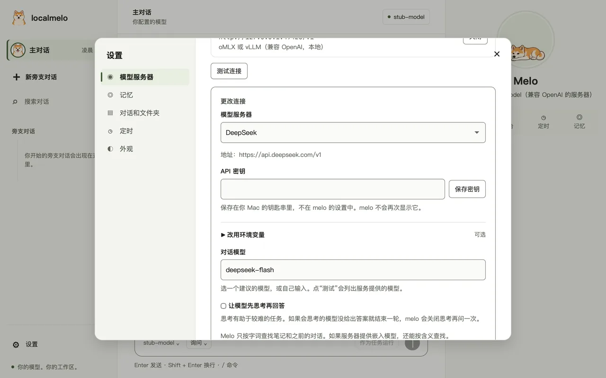
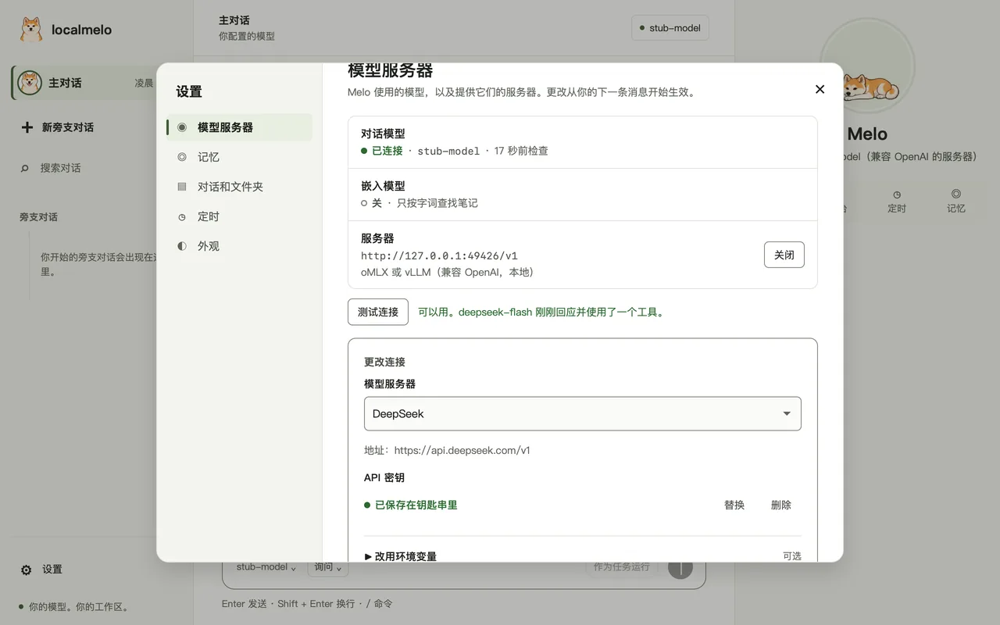

<a id="guide-hosted-models"></a>

# 云端模型指南

当你 Mac 上的模型不够用时，可以使用云端服务（OpenAI、Google Gemini、Anthropic、NVIDIA、DeepSeek，或任何使用 OpenAI 格式的服务）上的模型。在设置里就能完成，不需要任何命令行操作。自行运行的模型服务器见[模型服务器](model-servers.md)。

- 选择一个服务，只粘贴一次密钥，点 **Test connection**，然后保存。
- 密钥保存在你 Mac 的钥匙串里，不会写进 melo 的设置。
- 会思考的模型如果把答案只留在思考里，melo 会把它找回来。

<a id="set-up-a-service"></a>

## 设置一个服务



- 打开 **Settings**，再点 **Model server**，然后点 **Change…**。
- 在 **Model server** 列表的 **Hosted services** 下选择服务。它的地址和建议的模型会自动填入。
- 粘贴你的密钥，点 **Save key**。
- 从列表里选一个模型，或自己输入，然后点 **Test connection**。
- 点 **Save connection**。你的下一条消息就会使用这个服务。

<a id="the-services"></a>

## 可选的服务

| 服务 | 地址 | 建议的模型 |
|---|---|---|
| OpenAI | `https://api.openai.com/v1` | `gpt-4o`、`gpt-4o-mini` |
| Google Gemini | `https://generativelanguage.googleapis.com/v1beta/openai` | `gemini-2.0-flash` |
| Anthropic | `https://api.anthropic.com/v1` | `claude-sonnet-4-20250514` |
| NVIDIA | `https://integrate.api.nvidia.com/v1` | `nvidia/llama-3.1-nemotron-70b-instruct` |
| DeepSeek | `https://api.deepseek.com/v1` | `deepseek-flash`、`deepseek-v4-pro` |
| Other (OpenAI format) | 你输入的地址，写到 `/v1` 为止 | 你输入的模型 |

- **Test connection** 会列出服务提供的模型，你可以直接从列表里选。
- OpenAI、DeepSeek 和 Other 共用配置文件里的 `[openai]` 表；Gemini、Anthropic 和 NVIDIA 各有自己的表。
- 列表里没有的服务（例如公司内部的网关）用 **Other**。

<a id="your-key"></a>

## 你的密钥

- **Save key** 把密钥写进你 Mac 的钥匙串，名称是 `localmelo.<service>`（例如 `localmelo.deepseek`）。
- 配置文件里只有一个指向它的引用：`api_key = "keychain:localmelo.deepseek"`。melo 不会再次显示密钥，它也不会进入配置、日志或页面。
- **Replace** 保存新的密钥；**Remove** 把它从钥匙串里删除。
- 环境变量仍然可用：如果设置了 `api_key_env` 且变量有值，会先用它，再用钥匙串。
- macOS 应用拿不到你 shell 里的变量。请在设置里粘贴密钥，不要用 export。

如果 melo 读不到密钥，它会说明怎么办：

| 你看到的提示 | 怎么办 |
|---|---|
| 钥匙串里没有已保存的密钥 | 在设置里重新粘贴密钥，或运行 `melo setup`。 |
| 钥匙串已锁定 | 先解锁（打开“钥匙串访问”，或重新登录这台 Mac），然后再试一次。 |
| 这台电脑上没有钥匙串 | 改用环境变量设置密钥，并把变量名写进 `api_key_env`。 |
| 这看起来不像 API 密钥 | 只粘贴密钥本身：不要有空格、引号或换行。 |

<a id="test-the-connection"></a>

## 测试连接



- **Test connection** 先向服务要模型列表，再发一条很短的对话，其中提供一个工具。
- 它用平实的话告诉你哪里不对，以及该怎么做。
- 密钥只发给这个服务，并且只放在请求头里。

| 结果 | 含义 |
|---|---|
| 可以用 | 模型回应了，并使用了这个工具。 |
| 服务不接受这个密钥（401） | 重新粘贴密钥。 |
| 服务拒绝了这个账号（402、403） | 到服务的网站上检查套餐、余额和访问权限。 |
| 服务里没有叫 ... 的模型 | 从列表里选一个。 |
| 服务正忙（429） | 稍等片刻再测试。 |
| 服务没有及时回应 | 再试一次，或换一个更快的模型。 |
| 连接不上服务 | 检查网络连接和地址。 |
| 已连接，但模型没有使用测试工具 | melo 需要能使用工具的模型。 |

<a id="from-the-terminal"></a>

## 在终端里设置

```shell
melo setup
```

- `melo setup` 会列出这台电脑上的服务器，以及和设置里相同的云端服务。
- 密钥以隐藏方式输入并保存到钥匙串；按 Enter 会保留 melo 已有的密钥。
- **Use an environment variable instead** 会设置 `api_key_env`。
- 找不到模型服务器时，首次运行会提供 **Use a hosted service**。

<a id="thinking-models"></a>

## 会思考的模型

- 有些模型会先思考再回答。部分服务提供了开关；对这些服务，设置里会显示复选框 **Let the model think before it answers**。
- 会思考的模型有时会结束一轮，而答案只在它的思考里。melo 会关闭思考再问一次。
- 如果回复仍然是空的，melo 会把思考的最后几行作为答案，并标注 `(from melo's thinking)`，然后结束运行。
- 完全没有思考内容的空回复仍然会失败，和以前一样。
- 运行结果会说明这两步是否发生过（JSON 记录里的 `empty_reply`，以及聊天里的一条通知）。想统计它们，或不要这两步，可以设置 `[agent] empty_reply_fallback = "off"`（`-X agent.empty_reply_fallback=off` 仅对一次运行生效）；此后只含思考的回合会像以前一样失败。
- DeepSeek：`deepseek-flash` 默认关闭思考；`deepseek-v4-pro` 保持它自己的默认。可以用复选框或配置里的 `thinking` 来改。

<a id="pictures"></a>

## 图片

- 有些工具会返回图片，例如浏览器截图。当 `[agent] tool_images = "auto"` 时，melo 会在已知模型能读图的情况下把图片发给它。
- 服务的模型列表不会说明这一点，所以每个服务自己列出哪些模型能读图：GPT-4o、GPT-4.1 和 GPT-5（OpenAI）、所有 Gemini 模型、Claude 系列以及 `deepseek-flash` 能读图；`deepseek-v4-pro` 和 NVIDIA 的 `nemotron` 不能。
- 其他模型按未知处理，不会收到图片；它的工具消息会注明它看不到图片。如果你的模型能读图，请设置 `tool_images = "on"`。

<a id="the-config-file"></a>

## 配置文件

设置会写下这些行；你也可以自己写。

```toml
chat_backend = "openai"
embedding_backend = "none"

[openai]
base_url = "https://api.deepseek.com/v1"
api_key = "keychain:localmelo.deepseek"
chat_model = "deepseek-flash"
thinking = "off"             # "on", "off", or leave out to follow the service
```

- 用 `base_url` 区分各个服务：OpenAI 没有它（地址是内置的），DeepSeek 用上面的地址，其他地址都算 Other。
- `api_key_env` 仍然可用。所有键见[配置参考](../reference/configuration.md#cloud-api-keys)。
- 你自己写的 `extra_body` 字段优先于思考开关。

<a id="troubleshooting"></a>

## 故障排查

| 现象 | 处理 |
|---|---|
| 粘贴了密钥，测试仍显示密钥错误（401） | 密钥里可能有空格或换行，或者它属于另一个服务。重新粘贴。 |
| 应用找不到你 export 过的密钥 | 应用启动时没有你 shell 里的变量。请在设置里粘贴密钥。 |
| 运行停在 “melo did not finish an answer” | 模型回复为空，而且没有可用的思考内容。换一个模型试试。 |
| 答案末尾有 `(from melo's thinking)` | 模型只在思考里给出了答案。为这个模型关闭思考，或换一个模型。 |

下一步：[配置 melo](configure.md)、[网页控制台](web-console.md)。
