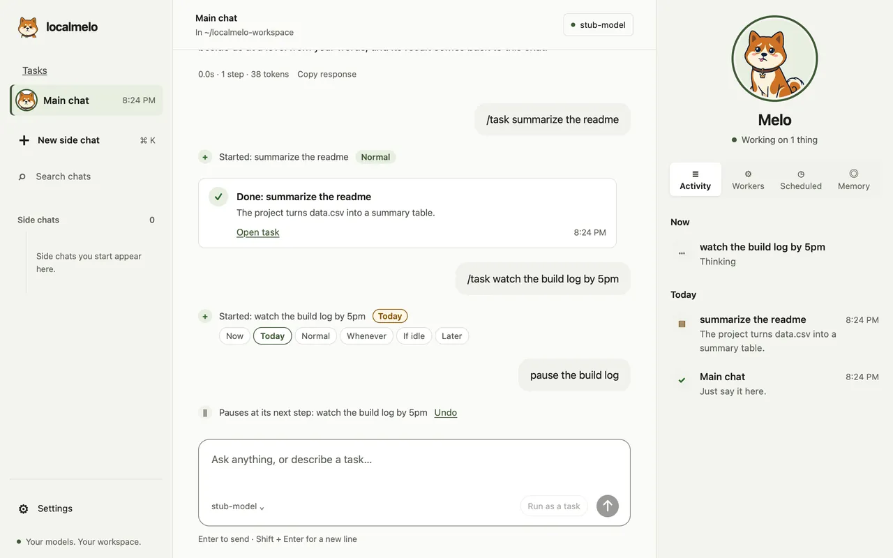

<a id="guide-scheduler"></a>

# 指南：调度器

本指南说明调度器如何决定对话请求何时可以到达共享的模型服务器，以及如何运行一次模拟。修改调度设置之前请阅读本指南；策略、存储和模拟器见[调度器参考](../reference/scheduler.md)。

<a id="tasks-from-the-main-chat"></a>
## 来自主对话的任务



- **谁开始任务。** 你向主对话交代工作时，任务归主对话所有（`front_id`）；`/task …` 或 **Run as a task** 不调用模型就开始一个任务。外观见[网页控制台指南](web-console.md#hand-work-to-the-main-chat)。
- **任务的级别。** 代码只读你自己的消息：紧急用词、今天的截止时间或请求里的“today”“今天”本身（“not today”“今天不用”除外）为 Today（P1），"no rush"、"不急" 为 Whenever（P3），其余为 Normal（P2）。理由与任务一起保存（`you said "urgent"`）。网页、文件或任务报告从不设定级别。
- **你设定的级别保持不变。** 你设定的级别（那一行的 **Change**、面板、`melo task level`）属于你：调度器不会改动它。
- **改变任务需要你的话。** 只有当你最新的消息要求并点名某个任务时，主对话才会改变它（停止、暂停、继续、级别）；否则显示一条建议，点一下才会生效。
- **任务的文件夹。** 任务在开始它的对话所在的文件夹里工作：主对话用默认文件夹，旁支对话用它自己的文件夹，或者用你的请求指定的文件夹。melo 不能使用的文件夹（主目录之外、隐藏文件夹、`~/Library` 下）会让任务在开始前就停下；它绝不会改到别的文件夹运行。
- **worker 不用询问就能做的事。** 读取 git 状态（`git_status`：status、branch、log、diff、show）和列出文件夹（`list_files`）；用 `file_edit` 修改文件，它会询问并把改动显示为 diff。它的 Python 通过一个小辅助函数运行的只读命令（`run("git", "status")`）算作常规操作，因此 **Allow for this task** 能覆盖它们；写入、提交或切换分支仍会询问。
- **收尾。** 只剩两步时，worker 会被告知把它们用在任务要求完成的事情上，例如提交和报告。
- **任务里的测试。** worker 的工具运行时 `HOME` 指向这个任务专用的新文件夹（保留你的 git 身份和 uv 的缓存），因此拒绝真实主目录的测试套件也能运行。大多数错误出自同一个这类原因时，worker 会先读到 `The test environment refused: <cause>`。
- **默认模式用词。** 凡显示级别的地方都写作 Now、Today、Normal、Whenever、If idle 和 Later；开发者模式另外显示 P 代码。`melo task` 在接受 P 代码的地方也接受这些词（`melo task level ID today`）。

<a id="the-gate-on-chats-s2"></a>

## 聊天的门（S2）

网页工作区聊天发出的每次模型调用都会经过一个进程内的门（`support/gateway/chat_gate.py`）。网页控制台会话的调用经过同一个门，该门由网关根据同一张表构建一次：两个界面共用一个 `n_srv` 预算，并写入同一个 `calls.jsonl`。门把调用提交给策略，然后要么立即发送，要么扣住它，直到策略准许。页面每 2.5 秒轮询一次聊天，因此被扣住的聊天会在标题栏的状态胶囊和状态标签中显示 `Waiting: <reason>`，在侧边栏中显示 `● Waiting`；原因是策略的代码之一（第一个被阻塞的调用为 `Resources`，之后的调用为 `Priority`）。扣住属于等待：它不计入每轮 600 秒的上限，扣住期间按 Stop 会把该轮以取消结束。被扣住的调用还会至少每 30 秒（焦点窗口）唤醒一次以重新运行策略，因此只等待输入窗口过期的扣住会自行结束，无需新请求，门中也没有计时器。网关对 GPU 锁和电池各有一个监视任务（[见下文](#the-gpu-lock-and-the-battery-s2b)）；门本身仍然没有计时器。

`config.toml` 的 `[scheduler]` 表设置策略：

| 键 | 默认值 | 含义 |
|---|---|---|
| `policy` | `"off"` | `off` 只记录；`fcfs` 为先到先服务；`class` 先准入 P1，再 P2、P3、P4，同一级内先到先服务 |
| `n_srv` | `8` | 模型服务器的槽位数 |
| `r_f` | `1` | 为门看不到的调用方（命令行和直接运行）保留的槽位；当 `n_srv <= 2` 时强制为 0 |
| `n_fg` | `1` | 聊天获得焦点时，允许同时在途的后台 P2-P4 调用数（P1 豁免） |
| `call_log` | `true` | 每次网关运行写入一个 JSONL 调用日志 |
| `call_log_dir` | `""` | 日志的父目录；为空时使用 `~/.cache/localmelo/scheduler` |
| `gpu_lock_file` | `""` | 要读取的共享 GPU 锁；为空表示不读取锁 |
| `lock_self` | `""` | 本台基准机自己的锁，必须精确匹配 `holder:`（或 `holder:run`） |
| `lock_gate` | `"record"` | `record` 只显示锁；`wait` 在存在外部锁时扣住每个工作区调用 |

通道是正在输入的那个聊天：你输入时，`POST /api/presence` 会设置它（旧版 `POST /v1/playground/presence` 只在启用 playground 时这样做，即在进行中的 security-1b 变更之下）；每次运行也都会设置它，包括通过轮次路由的一轮、一次重试，以及带第一轮的创建。通道的下一次调用会先于后台调用获准，并绕过它们的上限，但从不绕过服务器的 `n_srv`。非通道的上限是 `max(1, n_srv - 1 - r_f)`；嵌入、`retrieve` 和 `estimate` 调用从不被策略扣住，也从不参与排序，但它们计入在途数量（在 `lock_gate = "wait"` 下，外部锁会在策略看到它们之前扣住它们，见下文）：前台嵌入可能占满最后一个 `n_srv` 槽位，此时通道就要等待它。

聊天的级别为 P1-P4，每个聊天单独设置，默认 P2；聊天标题中的标签用于设置它，`fcfs` 会记录但忽略它。级别保存在网关的内存中，不写入 `sessions.db`。

门为每次网关运行写入一个文件：`<call_log_dir>/runs/<UTC yyyymmddThhmmss>/calls.jsonl`（权限为 0600；两次运行在同一秒内开始时加 `-N` 后缀；早于思考保留期（默认 30 天）的运行目录会在启动时删除）。每行是 S1 的 schema-1 轨迹记录，对应一次调用，包含提交、准入和结束时间、扣住时长（`admit_s - submit_s`）、token 数和计费量。用 `read_trace()` 读回文件：

```bash
uv run python -c '
import sys
from pathlib import Path
from localmelo.support.scheduler.sim.trace import read_trace
for task in read_trace(Path(sys.argv[1])):
    print(task.task_key, len(task.calls))
' "$(ls -t ~/.cache/localmelo/scheduler/runs/*/calls.jsonl | head -1)"
```

```text
84dd6b2355c5 1
```

以下调用不受门控，行为与之前完全一致：直接模式（`melo --url … -- <task>` 以及带配置的 `melo`）、交互式命令行和旧版 `/v1/agent/run` 路由。它们在自己的进程中或 `melo/` 内构建提供方，因此门看不到它们的调用，而 `r_f` 为它们保留一个槽位。

<a id="the-gpu-lock-and-the-battery-s2b"></a>

## GPU 锁和电池（S2b）

网关读取两个机器来源并记录它们，从不写入其中任何一个。一个任务监视共享的 GPU 锁，另一个轮询电池，两者都是只读的。锁是基准测试的写入方创建的四行文件（在这台 Mac 上为 `~/Developer/mlsys/experiments/.gpu-lock`）；电池信息来自 `pmset -g batt`。直接运行和交互式命令行都不读取两者。网关应用导入该监视器并随网关一起启动（`/v1/agent/run` 的请求和回答保持不变），`melo serve` 在启动时输出一行 INFO 日志，之后每次变化再输出一行。

```toml
[scheduler]
gpu_lock_file = "~/Developer/mlsys/experiments/.gpu-lock"
lock_self = "local_ai-benchmark session"   # exact holder, or holder:run
lock_gate = "record"                       # "wait" to hold chats
```

路径用 `Path.expanduser` 展开；文件缺失表示没有锁，而不是错误。`open()` 失败、UTF-8 无效、空文件、超过 64 KiB 的文件以及没有 `holder:` 的文件都是**不可读**的，不可读的锁按外部锁处理（失败即关闭，fail closed）。陈旧的锁（其预计结束时间已过去 600 秒）仍按外部锁处理，只是会以 `· ETA passed` 显示，因为另一个会话可能正在超时运行，而 localmelo 绝不能删除别人的锁。这台 Mac 使用的两个写入方会输出：

```text
holder: local_ai-benchmark session
purpose: Night chain: Core AI llm-server gate, M8 ...
start: 2026-10-20T23:30:09-0400
eta: 2026-10-21T12:00:09-0400 (750 min)
```

```text
holder: agent-benchmark session (personal-agent-bench)
purpose: real-web UI eval: 27B oQ5 then Flash-Next oQ4e (untimed, port 8510)
start: 2026-10-27 03:06:08 EDT
eta: 330 min
```

键为 `key: value` 格式，每行一个，首次出现的为准：`holder` 必填；`purpose`、`start`、`eta`、`run`、`mem_gib` 可选，其他键会被忽略。`lock_self` 的匹配是精确且区分大小写的：要么与整个 `holder:` 值完全相同，要么（当文件含有 `run:` 行时）与 `holder:run` 相同。没有前缀或子串匹配，因此 `lock_self = "local_ai-benchmark session"` 不会匹配 `local_ai-benchmark session (copy)`；写错一个字符会让每个锁都被视为外部锁，页面会显示持有者的名字。`mem_gib:` 只解析进快照（不进入 `machine.jsonl`）；目前还没有为它预留任何内存。

`lock_gate = "record"`（默认值）只是观察：页面和机器日志能看到锁、持有者和电池档位，但策略保持其默认的 `Machine()`，无论 `off`、`fcfs` 还是 `class`，都没有调用会等待。`lock_gate = "wait"` 在锁为外部锁时，扣住工作区门看到的每个调用：规划、反思**以及嵌入**。这是对 S2 “从不扣住”规则的有意例外，因为嵌入仍是使用同一 GPU 的模型服务器调用。策略中已经待定的调用会通过一次 `MachineChanged` 看到锁，并在 `reservation_policy="respect"` 下等待；已经在途的调用不会被中止，会正常完成。锁释放后，被停放的调用按 `(submit time, call id)` 顺序提交，并由策略决定；600 秒上限只计算活动时间，因此锁的持有会让它暂停。电池只做记录：`battery_gate_enforce` 保持 `False`，下表是 S7 将会强制执行的规则，而不是 S2b 当前阻止的内容。

| 电量 | 档位 | class 规则会阻止的内容 |
|---|---|---|
| 60% 或以上，或接通电源/未知 | 4 | 无 |
| 50-60% | 2 | P3 和 P4 |
| 20-50% | 1 | P2、P3 和 P4 |
| 低于 20% | 0 | 每个聊天级别 |

档位是 S1 的 `battery_band()` 加上其滞后机制：电量降到 50% 时降为 2，降到 20% 时降为 1，回升到 80%（或接通电源）时恢复为 4。`pmset` 失败时保留最后一次有效读数，并记录一次 `battery unknown: <reason>`；在第一次有效读数之前，状态视为接通电源且没有百分比，因此电池读数永远不会阻止聊天。聊天的 `Task.size = ""`，因此电池规则中与大小相关的分支对 S2 聊天不会触发。

锁监视器在 macOS 上使用 `kqueue`（一个目录监视加一个文件监视），并带有 2 秒的安全轮询；在没有 `kqueue` 的系统上则每秒轮询一次。唤醒后它会等待 200 毫秒，然后重新读取并重新布防，因此 O_EXCL 创建和原子的 `mv -f` 替换各自只产生一个状态，而不是“先不存在、后存在”的一对事件。字段没有变化的重新读取不产生任何事件（ETA 的 `stale` 翻转算作变化）。电池每 30 秒轮询一次，运行在一个线程中，`pmset` 超时为 2 秒。

每个发生变化的快照在 `machine.jsonl` 中占一行，它与 `calls.jsonl` 位于同一运行目录中（权限 `0600`，随运行目录一起清理，设置 `call_log = false` 时禁用）：

```json
{"at_s":0.0,"battery_pct":100.0,"battery_state":"charged","band":4,"eta":"","event":"start","harness":"localmelo","holder":"","lock":"none","on_ac":true,"purpose":"","readable":true,"run":"","schema":"localmelo.sched.machine","stale":false,"version":1,"wall_s":1793000000.0}
```

`event` 的取值为 `start`、`lock`、`battery` 或 `stop`；它的 schema 是独立的，绝不与调用轨迹的 schema 相同。页面上的机器状态行来自现有的 2.5 秒轮询：外部锁显示为 `GPU lock: <holder> · <purpose> (recorded)`，或显示为 `(chats wait)`；本机的锁显示为 `GPU lock: yours`；不可读的锁显示为 `GPU lock unreadable`；电池供电显示为 `Battery 55% · discharging`。接通电源且没有锁时不显示任何内容。在 `wait` 下、外部锁存在时，播种创建（seeding create）会以 HTTP 409 快速失败并指出持有者，因为否则播种嵌入会在聊天存在之前发出模型调用。

<a id="run-one-simulation"></a>

## 运行一次模拟

30 分钟的 W2 在每种模式下运行大约需要一秒：

```bash
uv run python -c '
from dataclasses import replace
from localmelo.support.scheduler.sim import compute_metrics, make_workload, run

wl = replace(make_workload("W2", 1), horizon_us=30 * 60 * 10**6)
for mode in ("off", "fifo", "class", "las2"):
    result = run(wl, mode)
    m = compute_metrics(result)
    print(mode, "reply p95", m.reply_whole_s[1], "s; finished",
          sum(m.finished_by_class), "of", len(result.tasks))
'
```

```text
off reply p95 9.211797 s; finished 6 of 6
fifo reply p95 9.494473 s; finished 6 of 6
class reply p95 10.787873 s; finished 6 of 6
las2 reply p95 7.690171 s; finished 6 of 6
```

`run()` 接受 `Params` 和 `ServerParams`（槽位数、Θ 的指数、缓存模型、门看不到的外部调用）；`keep_log=True` 会把每个决策保留为一行 JSON。完整的扫描（五个工作负载、四种模式、20 个种子）占用大量 CPU：请在基准测试窗口之外运行。
