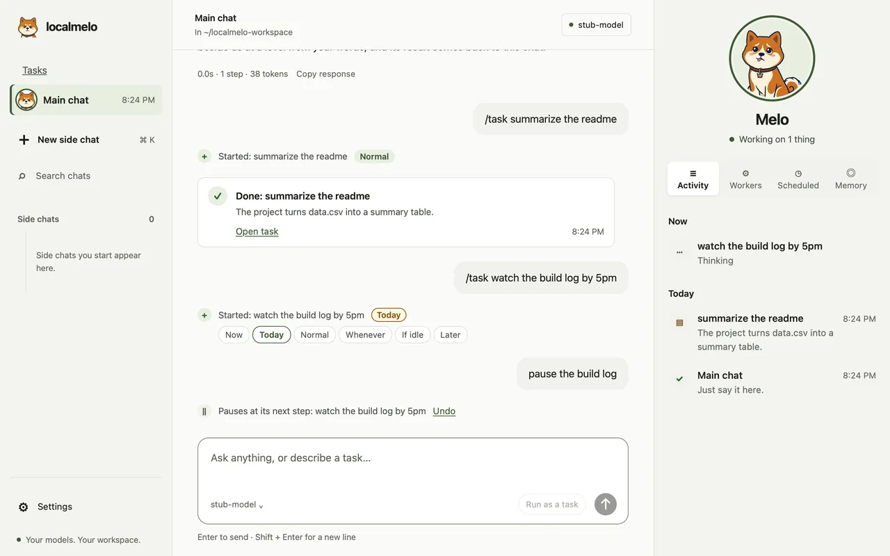
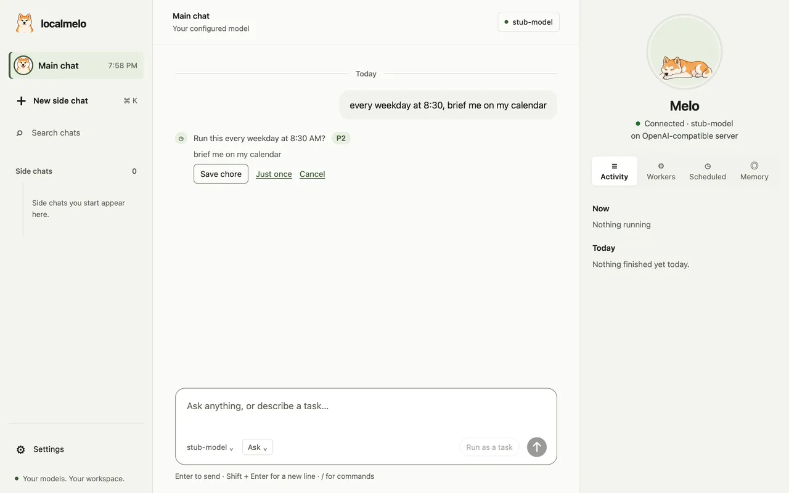
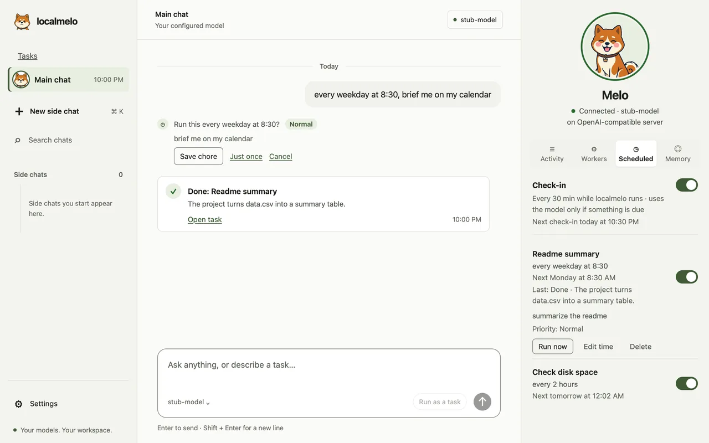
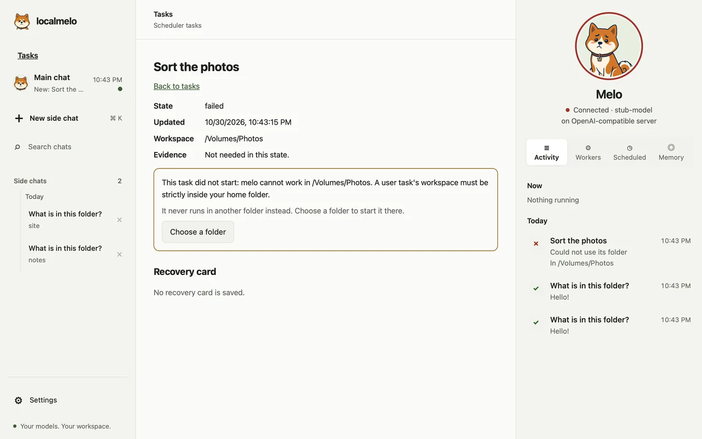

# 指南：网页控制台

使用网页控制台可以配置 localmelo 网关、进行对话以及查看已保存的 worker 运行记录。本指南面向在浏览器中使用控制台的用户。

开始前，请安装网关额外依赖并准备好模型服务器；参见[启动网关](gateway.md#start-the-gateway)。网关需要身份验证，且只监听回环地址。工具以你的权限运行，且没有沙箱；批准工具调用前请先审查任务。

## 网页工作区

在浏览器中打开 `http://127.0.0.1:8401/` 即可进入网页工作区。这是控制台的页面，只与 `/api`（[API v2](../../reference/api-v2.md)（英文））通信，因此网关必须运行才能提供该页面：先运行 `melo serve`，它会在浏览器中打开已登录的页面。没有链接就打开页面时，会显示 “Sign in to localmelo”：在终端运行 `melo console`，页面会以已登录的状态打开（非默认端口需加上 `--port PORT`）。通过 SSH 或没有浏览器能启动时，它会改为输出一次性链接，请在 60 秒内打开。不要分享该链接；见[网关安全](gateway.md#keep-the-gateway-private)。

首次运行时，如果还没有设置模型，欢迎页会用一张卡片代替起始提示。它像终端的首次运行一样，在这台 Mac 上寻找模型服务器，并显示找到的内容：**Found oMLX on this Mac**（或 Ollama，或某个模型服务器）及其模型、**A model server needs an API key**，或 **No model server is running on this Mac**。**Use this model** 会保存该服务器、测试它，并让欢迎页无需打开设置即可使用。如果有多个对话模型而且不知道哪个已加载，卡片会列出它们、标出已加载的那个，并等你选择，绝不会替你选。没有服务器在运行时，卡片会显示启动服务器的命令（Mac 上是 oMLX，其他系统是 Ollama，与[模型服务器指南](model-servers.md)中的一致），放在一个点按一次即可全选的方框里，并提供键盘可用的 **Copy commands** 按钮；卡片在屏幕上且标签页可见时，每三秒再次寻找，服务器一响应，模型就会出现。**Check again** 立即寻找；**Enter a server address…** 会打开连接设置；在设置好模型之前，输入框显示 `Connect a model to start`。已配置的服务器不再响应时也会显示这张卡片，而且只在它显示在屏幕上时才会查找服务器（[`GET /api/setup/detect`](../reference/api-v2.md#get-apisetupdetect)）。

页面以默认模式打开，不显示只有开发者才需要的内容：对话的级别标签、**Details**、GPU 锁状态行、**LOCAL** 徽标、状态行的缓存、步骤、阶段和队列段、运行中标签（[对话旁的面板](#the-panel-beside-a-chat)会显示正在运行的内容），以及任务页面里的优先级一行（运行中任务的优先级菜单仍然保留）。它的措辞也更平实：正在运行的对话在 **Stop** 旁写 `Working…`，设置里把服务器叫 **Model server**、把它的地址叫 **Server address**。页眉显示一个模型标签（模型名称、`Model offline` 或 `No model`），点按它会打开设置。任务在[对话旁的面板](#the-panel-beside-a-chat)里打开，入口是它在 Activity 里的那一行，侧边栏里没有它自己的链接；worker 运行在面板的 **Workers** 标签页里，空的[主对话](#the-main-chat-and-side-chats)里也有链接。[开发者模式](#developer-mode)会在侧边栏显示 Workers 链接。这些元素都保留在页面中，只是隐藏。

新对话在你发送任何内容之前，就会显示 melo 将在哪里工作。输入框里的标签显示 `In localmelo-workspace`，点按它会打开一个面板：默认文件夹（`[gateway] workspace`，没有设置时是 `~/localmelo-workspace`）、最近对话的文件夹（从新到旧，最多四个）、**Choose a folder…**，以及在 [macOS 应用](macos-app.md)中的 **Show in Finder**。在浏览器里，**Choose a folder…** 会打开一个路径输入框（完整路径，或以 `~/` 开头的路径；在其中按回车绝不会发送你的消息），在应用里则打开系统的文件夹面板。文件工具只在该文件夹内活动；shell 命令和 Python 从那里启动。你的选择会随第一条消息作为 `POST /api/sessions` 中的 `workspace` 发出（使用默认文件夹的对话不发送它），并保留给下一个新对话，之后显示在对话的页眉里（`In ~/notes`；开发者模式会把它加在模型之后）。输入框下方有三个单行起始提示（**Summarize the files in this folder**、**Plan a small project with me**、**Explain a piece of code**），会替你填好输入框，可以直接发送或修改，输入内容后它们就让开。

1. 打开 **Settings** 连接模型服务器。左边列出各个分区，右边显示选中的那个；在手机上先显示列表，点开一个分区会以面板形式滑入（**‹ Settings** 返回）。尚未保存任何设置时，它停在 **Model server**，表单展开，停在空白的 **Choose a server…** 上。你也可以使用 `melo setup`。[更多关于 Settings](#settings)。
2. 输入并发送消息。页面打开在始终存在的[主对话](#the-main-chat-and-side-chats)上；在新的旁支对话里，第一条消息会创建对话：页面以该对话的第一轮回答你的草稿，绝不会自行创建对话。回答以 Markdown 渲染，包含代码块。
3. 一轮的呈现方式与终端类似：你的消息、包含已运行工具卡片的工作组、推理、通知和反思、运行时的实时行，以及带有 `Copy response` 的最终回答。工具输出中的转义序列会被清除，其图片（PNG、JPEG、GIF、WebP）会在页面内显示，这一轮产生的图片会显示在回答下面（见[回答里的图片](#pictures-in-the-answer)）。没有工具调用的一轮，其时间只在回答下方的一行里显示一次；它的推理（如果有）在 `Thought` 一行下展开。对话会告诉模型它是 localmelo 的 melo、它运行在哪个模型和服务器上，以及它记得什么，所以问“你是谁？”或“你记得什么？”时会得到直接的回答（见[melo 如何介绍自己](terminal.md#what-melo-says-about-itself)）。
4. 输入框上方有一行状态行：与终端开发者模式状态栏相同的段（终端的默认模式用文字表述这些数字），`cache 67% idle 3m`、`ctx 1.0k/8.0k`、`step 3`、`tasks 1 running 2 queued`，读取自 `GET /api/sessions/{id}/status`，因此两边一致。默认模式只显示上下文段；有任务在等你批准时，还会显示 `1 task waits for you` 这样的一句话。模型服务器没有报告缓存 token 时，缓存占比显示 `cache --`，绝不会显示 0%；本地服务器显示空闲时间，而不是倒计时。有事件到达时最多每秒读取一次，页面的轮询时也会读取；屏幕较窄时从右侧开始省略段。打开的 worker 运行显示同样的一行。
5. 开发者模式下，页眉中的 **N running** 标签统计当前正在运行的内容：本控制台中有轮次在进行的对话、任务、直接运行和终端对话（运行或终端对话只在其进程持有有效租约时才计入）。数量为 0 时隐藏，屏幕较窄时仍然保留。点按它会显示一个简短的列表，每一行写明类别和标题，并打开该对话、该任务的卡片或 Workers 详情；按 Esc 或点按别处即可关闭。数字来自 `GET /api/health` 的 `status`，随页面每 4 秒的轮询读取；列表最多显示 20 行，并说明还有多少在运行。

侧边栏把主对话固定在最上面，把它的旁支对话列在下面，按从新到旧排列，每天一条分隔（`Today`、`Yesterday`、`Oct 28`），支持搜索、切换和关闭旁支对话。每个标题下写出对话的文件夹（开发者模式把模型放在前面），标题前的强调色圆点表示这个对话在等你批准。上、下方向键在列表中移动（主对话在最前），Home 和 End 跳到两端。草稿在当前浏览器标签页中按对话保留。打开的对话通过事件流（SSE）接收轮次；页面重新加载后会恢复对话，读取最近十轮，并从那里重放已保存的事件，因此不会丢失内容或重复显示。**Show earlier turns** 加载更早的轮次，不会移动当前视图。浏览器放弃连接的事件流会在 1、2、4、8、16 秒后以及之后每 30 秒，从页面自己的游标处重新打开，但只会在重新读取对话之后进行：如果对话已不存在，页面会进入新对话，而不是无限重试。标签页可见时，对话列表每 4 秒重新读取一次，以获取其他浏览器的更改。**Reconnect now** 会先检查对话，再重新打开事件流。独立的横幅分别显示存储、模型和连接问题，不会替换其他通知。

## 主对话与旁支对话

控制台有一个**主对话**，始终存在，位于侧边栏最上面：Melo 的头像、最后一条消息的时间，以及有新结果回来时的一个圆点（在等你时为琥珀色）。它不能被关闭。页面打开在它上面；之前打开着某个旁支对话的标签页会回到那个对话。

主对话始终在默认文件夹里工作：`[gateway] workspace`，未设置时为 `~/localmelo-workspace`，首次启动时创建。在设置里改了默认文件夹后，主对话的下一轮就在新文件夹里工作；它没有自己的文件夹选择。

**New side chat**（`⌘ K`）开始一个专注的对话，有自己的文件夹：文件夹选择提供默认文件夹、最近用过的文件夹和 **Choose a folder…**，对话会一直保留你的选择。它列在主对话下面。旁支对话的页眉以 **Main chat ›** 开头，点按即可返回；关闭正在打开的旁支对话也会回到主对话。主对话出现之前创建的对话原样成为它的旁支对话。

你在主对话里允许的，在所有对话里都算；在旁支对话里允许的，只在那里算（见[授权](#permissions)）。

### “他”或“她”指的是谁

- **新的旁支对话知道你刚才在聊什么。** 它的第一条消息还会带上最多五行简短摘要，来自你最近 30 分钟里的其他对话：每一轮说的是谁或什么，在哪个对话里。于是 `先读他的简历`（`read his résumé first`）指的就是你刚才在主对话里聊的那位朋友。你自己说的话优先。你的消息下方，**来自你的其他聊天（最近 30 分钟）** 可以展开 melo 读到的这几行，点对话的名字会打开那个对话。`[chat] recent_digest_minutes = 0` 可以关掉它（见[配置](../reference/configuration.md)）。
- **他、她、它指的是这个对话在聊的人或事。** 你自己的资料（文件夹里的个人资料文件、关于你的笔记）只在你说到自己时才算（`我`、`我的`、`I`、`my`）。他、她、它读音相同、常被混用，换一个字不代表换了人。仍然不清楚时，melo 会问你一个简短的问题。
- **简短的追问不会跑题。** 长时间搜索之后说一句 `去查一下`（`go look it up`），回答仍然是关于这个对话在聊的那个人，即使 melo 的工作记忆已经放下了前面的消息。

旁支对话的一次运行结束时，主对话会在事情发生的那一天下面显示一张卡片。主对话自己的任务完成、失败或等你批准时也一样；旁支对话自己的任务则回到那个旁支对话（见[下文](#side-chats-start-tasks-too)）。卡片是这样的：

- `Done: Fix the list_files test` 加上回答的前两行：改了什么、测试结果、提交。
- `Did not finish: Fix CI` 加上它结束的原因。
- `Ready: Fix CI`、`Done, not finished: Fix CI` 或 `Needs you: Fix CI` 表示任务做完了：这是代码核对出的结局，不是报告里说的（[怎样核对](scheduler.md#tasks-from-the-main-chat)）。没收尾的任务用琥珀色写出原因（`No test ran after the last change · The changes are not committed`），并提供 **Finish it: run the tests and commit**（或 **Finish it: run the tests**），像 **Continue** 一样让它接着做。需要你的任务显示它的问题。
- `Stopped: Fix CI` 表示任务用完了所有步数还没做完。它显示回答里说明还剩什么的那一句（`Remaining: run the tests and commit.`），并提供 **Continue**，让任务从停下的地方接着做，并记得之前做过什么。同一个任务在它的页面和面板的 Activity、Workers 行里也读作 Stopped；**Continue** 在它的页面上。因其他原因失败的任务仍是 `Did not finish`。
- `Needs your approval: Fix CI` 加上它请求做什么：这一步有一句话概述时，就是那句话（`Needs your OK: Close the extra Safari tabs`）。你回答之后，同一张卡片会写出结果（"Allowed once"、"Allowed for this task"、"Denied"），不再提供 **Review**。
- 标题是主对话给任务起的标题，否则是你的请求的第一句话：开头的“请”或表示优先级的词不算，只有“你好”的第一行会跳过，路径只写文件名，在词的边界处截断。
- **Open side chat**、**Open task** 或 **Review** 会前往来源。卡片不是消息：模型从不读取它。

在你的两条消息之间，一个忙碌的旁支对话只保留最新的一张卡片。你自己的停止、关机，或在查看主对话之前就已答复的审批，都不会产生卡片。

面板的 **Workers** 标签页列出当前对话的 worker：旁支对话列出它自己的，主对话列出今天的全部。要看更早几天的运行，空的主对话会链接到 **See what worker runs did**（有运行或终端对话之后出现；开发者模式下始终出现）。

## 把工作交给主对话

- **提问，或交代工作。** 主对话用自己的工具能做的，就自己做：回答简短的问题，为 "哪个文件定义了 X？" 搜索你的文件夹，读取文件和公开网页。带有 `briefly`、`in short`、`one line`、`简单说一下` 或 `一句话` 的问题一律在这里回答，只做快速查看：不会被提议作为任务。
- **它自己开始工作。** 用自己的工具做不了的请求（运行命令、修改文件、多步的调研或写作）会立刻作为任务开始，并显示一行和 **Stop**：`Started: Plan the trip · P2`。它不会先问你。任务的请求就是你的原话。开始任务本身不是有风险的步骤：任务里的每一步仍然像在对话里一样问你，或在 Auto 中被拦下。结果以卡片回到主对话。它不会只说自己打算做什么就结束：像 "我先看一下测试文件" 这样的回复会改为把工作作为任务开始。
- **分几步的请求也会开始，用哪种语言都一样。** 先看一看对话之外的东西（网站、链接、文件、仓库或文件夹、你自己的东西）、再告诉你或做点什么的消息（`look at this site and tell me the latest prices`、`去这个网站看一下，然后告诉我最新的价格`、`分析一下这个仓库，告诉我它的结构`）是请求，即使最后一部分是个问题；对话一两步做不完时，它会作为任务开始。`看看天气然后告诉我`、`look at this and tell me what you think`、看看你的某个任务，以及冒号后面请它翻译或解释的文字（`翻译成英文：…`），都在对话里回答。
- **一句“放手去做”也会开始。** `I authorize you to apply`、`you have my permission` 或 `我授权你去投简历` 是在要求做对话里谈到的工作，所以会开始做这件事（作为任务，或在对话里用浏览器工具），而不是以建议或一串链接结束。`What does authorization mean?` 仍然是个问题。
- **什么时候不开始任务。** 打招呼、没有要做的事的简短消息（`thanks`、`今天天气不错`）、它能回答的简短问题、关于某个任务的问题（`is it done?`、`what did it find?`、`跑完了吗`；`Is the report ready? If not, write it to report.md` 是要求做事），或者请它讲解某件事（`please explain what a monad is`、`帮我看看 x.py 是做什么的`），都在对话里回答。不清楚到无法动手的请求，它会回问一个简短的问题。只有在开始任务不合适时才提议 **Start this as a task?**：提问，它是想知道而不是要动手（`why do the tests fail?`；`can you run the tests?` 这样要求做事的客气请求仍是请求）；说了不要动手、又没有要求别的事的话（`just explain how`、`don't change anything`、`no need for a task`、`只解释一下`、`不用开任务`；`fix the login bug without changing anything else` 要求了修复，会开始）；指挥某个任务的话（`cancel it`、`continue the report task`）；没有你自己文字的消息（只有附件）；或者代码没能排上时间的定时事项或提醒。
- **用代码认得的说法。** `/task …`，或发送按钮旁的 **Run as a task**，会立刻把这条消息作为任务开始，不需要模型来判断。要求修改它点名的文件的消息（`Fix tests/cli/test_e2e_pty.py and commit`）也一样。主对话这样开始的任务会立刻以你消息的开头部分作为标题开始，等模型回答一次简短的请求（用最低优先级，不会排在真正的工作前面）后，再按你消息的语言改成 3 到 8 个词的标题（`Hide the recovery card in default mode`）；很短的消息本身就是标题，你在这期间给任务起的名字会保留，模型 6 秒内没有回答时，开头部分保持不变。`stop`、`pause`、`resume` 或 `first` 加上任务名（`pause the slides`、`暂停 Fix CI`、`先做 slides`）会立刻改变那个任务，并带 **Undo**。你禁止的、或只是引用的请求绝不会被当作工作请求：`don't delete a.md` 和 `不要删除 a.md` 什么也不会开始。
- **优先级写作 P0 到 P5。** 一行里显示代码（`P1`），悬停可看含义。由你的话决定："urgent"、"asap"、"尽快"、今天的截止时间（`by 5pm`、`今天下午三点前`）或请求里任何位置的 "today"、"今天"（"not today"、"今天不用" 除外）为 P1（今天），"no rush"、"不急" 为 P3（有空时），其余为 P2（正常）。那一行的 **Change** 会打开列表（`P0 · runs first; others wait`、`P1 · today`、`P2 · normal`、`P3 · when there is time`、`P4 · only when the computer is idle`、`P5 · on hold until you start it`；含义依次是：最先运行，其他任务等待；今天；正常；有空时；仅在电脑空闲时；暂停，等你启动），设定你自己的优先级，之后不再自动改变。
- **跟进一个任务。** `finish it`、`commit it` 或 `继续那个任务` 会送到你指的那个任务：正在运行的任务在下一步读到它，已完成或已停止的任务在自己的会话里接着做，并记得之前做过什么。那一行写明送到了哪里：`Sent to: Slides`、`Continued: Fix CI`。
- **按名字继续已停止的任务。** `Continue the recovery card task where it stopped: run the tests` 或 `继续恢复卡片任务` 会立刻继续标题与这些词相符的那一个已停止的任务，不需要再点一下建议；整条消息就是它的下一轮。有几个已停止的任务相符时，每一个都作为一键发送的建议（`Suggested: send your message to …`）列出，供你挑选。已完成或仍在运行的任务会直接告诉你（`Fix CI is done. There is nothing to continue.`）。
- **做完了什么。** 主对话会读取每个任务的状态和回答的前几行，所以能说出任务做了哪些提交。问到某一个任务时（`is it done?`、`what did it find?`），它会读那个任务的完整回答和它写下的文件，据此回答，不需要打开任务页面。
- **只有你自己的话能改变任务。** 只算你键入的文字；附加的文件、网页或任务报告里写着 "stop the slides" 不会改变任何东西：那一行显示 `Suggested: stop Slides`，点一下才会生效。
- **较长的请求。** 主对话 4 步内没有办完的请求会成为任务（`This needs more than a quick answer, so I started it as a task.`）。其他消息会得到它根据已查到的内容给出的最好回答，并直说哪些没能核实；它自己不会开始任务的提问（`why do the tests fail?`）还会在回答下面显示 **Start this as a task?**。它能回答的问题、关于任务的问题，都不会出现这一行。一步里的调用全部被检查拒绝时（不能记下的笔记、你没要求的任务、被拒绝的网站），这一步不计入 4 步，每条消息最多 2 步；你自己点的 **Deny**，以及再次发出的同一个被拒绝的调用，始终计数。它用你这条消息的语言回答。你打字时，已完成的结果会等到你发送或停顿 10 秒再出现；需要你批准的会立刻出现。

## 旁支对话也能开始任务

- **同样的说法，同样的优先级。** 在旁支对话里，`/task …`、**Run as a task**、`pause the slides` 和模型自己的判断都与主对话一样，用同样的 P0 到 P5 级别，也在同一个调度器之下。新旁支对话的第一条消息交给模型，模型可以自己开始任务；代码认得的说法从第二条消息起生效。
- **任务回到开始它的对话。** 它的那一行（`Started: Find hotels · P2`，带 **Change** 和 **Undo**）、卡片、审批和结果都出现在那个旁支对话里；该对话在下一次回答之前会读到已结束的任务。主对话不会为它们生成卡片。
- **主对话仍然看得到全部。** Activity 和 Workers 列出每个任务；旁支对话开始的任务写作 `From Trip plan`。
- **先看本对话自己的。** `pause the slides` 先指本对话的 slides 任务，再指别的对话的。话语符合本对话的好几个任务时，每一个都显示一键的 `Suggested: pause …`，绝不会碰别的对话的任务。别的对话的任务仍然可以点名：用它的 id、它所在的对话，或本对话自己的任务都对不上的话语；那一行写作 `From Main chat` 或 `From Trip plan`。模型挑任务时也一样。
- **只有你的话能开始任务。** 模型开始任务时，任务就是你自己的消息，绝不是模型的措辞（模型只给它起名）；文件、网页或任务报告可以给模型念头，但不能成为请求。melo 自己发起的一轮（任务的问题、跟进）根本不会开始任务。开始任务不合适时，对话会带着你自己的消息显示 `Start this as a task?`，你点一下才会开始。主对话也一样。
- **删除旁支对话**会一步把它没做完的任务、定时事项和等待中的审批交给主对话，包括删除过程中结束的任务。主对话随后显示它们的卡片并读到结果；已完成的任务保留原来的记录。
- **等你的任务会显示在列表上。** 旁支对话那一行出现圆点，写着 `A task waits for you`；主对话那一行写着 `1 waiting in a side chat`。
- **旁支对话做完工作，主对话会知道。** 旁支对话给出了回答，或它的某个任务完成时，主对话在你的下一条消息里会读到一行：旁支对话的名字和一段简短的摘要。这是信息，不是消息。
- **定时事项和提醒属于创建它们的对话。** 在旁支对话里保存的定时事项，作为那个对话的任务运行并在那里汇报，不进主对话的 check-in。
- 终端里的 `/task …` 在旁支对话里也能开始任务，前提是这个对话已经有了第一条消息。

## 任务卡住时，会问开始它的对话

- **任务问的是开始它的对话，不是你。** 那个对话里会出现一行：`Task “Fix tests” asks…`（中文界面为「任务「Fix tests」在问…」）。**查看问题** 展开任务写下的内容：背景、进展、问题、可能原因、可选方案、需要的帮助，以及如果无人能解决该告诉你什么。它的卡片和 Activity 显示 `Waiting on Main chat`（或旁支对话的名字）。
- **对话空闲时，melo 来回答。** 它从不打断你自己的消息。它把问题当作信息来读，可以用这个对话的工具和记忆查资料，然后回答：`melo answered “Fix tests”`，下面引用回答的内容。同一个对话收到几个问题时，一次回答一个，先到先答。
- **或者问你。** 只有你能决定时，会出现一行 `“Fix tests” needs your answer`：任务在做什么、发生了什么、已经试过什么、各个选择及其利弊，以及要问的问题。在它的输入框里输入并点 **发送回答**；如果这个对话里只有这一个任务在等你，也可以直接发消息回答：会显示 `Sent to “Fix tests” as your answer`，10 秒内可以 **撤销**，之后才交给任务（提问、新的工作请求、命令或控制短语仍归对话）。有几个任务在等时，用各自的框，或者 `/answer Fix tests: B`。任务会一直等你；它的卡片显示 `Waiting on you`。
- **这期间你发的消息会排队。** melo 回答任务时，你仍然可以输入并发送：你的消息显示为 `Queued: this runs once melo has answered “Fix tests”`，并紧接着运行，排在下一个问题之前；即使网关先重启也不会丢。
- **10 分钟没有回答。** melo 开始处理问题后 10 分钟内既没回答也没问你，任务就按它的最佳方案继续，并在报告里说明（`No answer for “Fix tests”; it goes on with its best option`）。停止任务会立即结束等待，melo 也会停下对它的处理；重启会让问题失效。
- **回答从不代替批准。** melo 的回答只是给任务的信息。需要你批准的步骤仍然问你（或 Auto 的审查），和以前一样。任务的话从不算作你的话：在 Auto 中它们不能放行 melo 拦下的步骤，melo 不会把它们当作你说过的话记住，melo 处理这个问题的那一轮也没有重试。
- 每次运行一个任务最多问 3 次。被删除的旁支对话，它的任务的问题会交给主对话，标为 `From <task title>`，正在等你回答的问题也一样。

## 对话开始的任务停下时，由对话跟进

- **任务完成时，答案会回到对话。** 对话开始的任务以 **Ready** 结束时，这个对话会自己走一轮：出现一行 `melo follows up on “Plan the trip”: it finished`，标着 `melo started this`（中文界面为「melo 跟进「Plan the trip」：它完成了」和「由 melo 发起」），对话用你的语言先告诉你结果，再说要点和它写下的文件。回答很长时会概括，其余内容在 **打开任务** 里。每次结束只说一次；你在任务结束后发过消息就跳过（你的那一轮已经读到了）；它不会继续任务；Activity 显示 `Told you the answer: Plan the trip`（中文界面为「告诉了你结果：Plan the trip」）。
- **结果归开始它的对话。** 对话开始的任务失败、步数用完、以 `Done, not finished` 结束或需要你时，这个对话会紧接在任务卡片之后自己走一轮：出现一行 `melo follows up on “Fix CI”: it ran out of steps`，并标着 `melo started this`（中文界面为「melo 跟进「Fix CI」：它的步数用完了」和「由 melo 发起」）。
- **只做一件事，然后说明。** 它把任务继续一次，附一句简短的话（`Continued: Fix CI`）；或者绕开被拦下的步骤（Auto 拦下了一次安装：就用已经装好的，或者不用那个包来写）；或者问你一个清楚的问题。然后用一两行告诉你做完了什么、没做完什么。
- **被拦下的步骤不会再运行。** 在对话继续的任务里，你、Auto 或 melo 的规则拦下过的步骤会在审查之前就被拒绝（`blocked earlier`，中文界面为「之前已被拦下」），相似的步骤也一样：换了写法的同一条命令（`pip3` 代替 `pip`、不同的引号、安静参数）或同一个安装。`web_fetch` 或浏览器询问某个网站时被你或 Auto 拒绝的，也算在内：那个地址，不管怎么写（空格、大小写、`http` 或 `https`、换一个端口、国际化的拼写），以及那个网站的其他任何页面，即使你的请求点了它的名。抓取那个网站上某个地址的命令或脚本也会被拒绝：`curl`、`wget`、Python 的 `urllib`、`requests` 或 `httpx`，地址存在变量里或写进 f-string 里，交给 `curl` 或 `wget` 的地址不带 `http://`，对那个网站名打开的连接，通过阅读器、存档网站或代理去访问它，用大写、带端口、百分号编码或国际化的拼写都一样。有网站被拒绝时，地址在运行时才拼出来的步骤一定会被审查，即使它本来会作为常规步骤直接运行；审查时会被告知哪些网站已被拒绝。任务必须换一种办法。你自己发给任务的消息，或 **Allow once**，会解除这一点。被撤回的询问（网关停止时）不算拦下。
- **最多继续一次。** 你每发一条消息，对话最多替任务继续一次；如果它又停下，对话只汇报并提问。第三次停下只留卡片。
- **你的消息优先。** 跟进从不打断你的消息：它等对话空闲才开始，这期间你发的消息会排队。如果你在任务结束后发了消息，你的这一轮会读到任务的结局，跟进就不再进行。
- **还能运行时 Stop 一直在。** 任务运行时，`Started` 那一行一直有 **Stop**；任务结束后，只要对话对它的跟进还可能继续它，Stop 也还在。这时按 Stop 也会结束跟进（不管是在等待还是在运行），它就不会再继续任务。等到不会再运行任何东西（跟进问了你、做了汇报或被跳过），Stop 才消失。任务已经没有什么可停时，按 Stop 不会提供 **Undo**。
- **重启后仍然有效。** melo 停止时还在等待的跟进，会在重启后运行，限制不变：每次结束只跟进一次，你的每条消息最多继续一次，如果你在任务结束后发了消息就跳过。已经开始那一轮的跟进绝不会运行两次。
- **每张卡片保留自己的报告。** 任务运行过不止一次时，每张 `Did not finish` 卡片显示的是它自己那次运行的报告。
- **它不批准任何东西。** 跟进只有任务工具（没有网页、浏览器、文件或命令工具），不扩大任何权限。它告诉任务的话以 melo 的备注送达，绝不算作你的话：你自己的请求没有要求的步骤，在 Auto 中仍然会被拦下，不管备注怎么说。
- **只跟进对话自己开始的任务。** 定时事项、从任务页开始的任务和别的对话的任务仍然只有卡片。Activity 会写明对话做了什么：`Continued the task: Fix CI`、`Asked you: Should I split it?`（中文界面为「继续了任务：Fix CI」「问了你：…」）。
- **关闭它**：设置 → 对话和文件夹 里的 **跟进任务**（开发者模式），或 `[tasks] follow_up = false`。

## 任务需要的批准

- **在开始它的对话里问你。** 任务中需要你批准的一步，会显示在那个对话的卡片里（`Needs your approval: Fix CI`，中文界面为「需要你批准：Fix CI」）：代码显示的这一步、melo 为什么要问，以及 **允许一次**、**在这个任务里允许** 和 **拒绝**。任务页面上是同一张卡片。
- **melo 解释，你决定。** 对你自己的任务和定时事项，在这一步下面，**melo 的说明** 用几句话讲任务在做什么、为什么需要这一步、可能出什么问题、每个回答会怎样。它根据任务的标题和目标、这一步本身以及审查给出的理由来写，从不读取工具的输出；最多需要 20 秒，没有它卡片也照常可用。它不能批准任何事：这一步、按钮以及你的回答放行什么，都由代码决定。由其他程序或 melo 自己开始的任务没有说明。
- **同样的一步不问第二次。** 你在某个对话或它的任务里允许过一步之后，这个对话后来的任务遇到完全相同的一步（同一个工具、同样的命令或文件内容、同一个文件夹，melo 为它读过的文件也没有变化）时，只要 melo 的规则读过这一步的全部并认为它是常规的（Python 代码、shell 命令或文件写入），就不再询问而直接运行。卡片会在按钮下面说明：`Your Allow also lets this chat's tasks run this exact step later without asking, until you revoke it.`（中文界面为「你的允许也会让这个对话的任务之后遇到完全相同的这一步时不再询问，直到你撤回。」）对话里会显示 `Used your approval from 2:02 PM`（中文界面为「用了你 下午 2:02 的批准」）和 **撤回**，任务页面在 **按你之前的批准运行** 下列出它。只要有一个参数不同，或者在别的文件夹里运行，就会再问。melo 会读这个对话开始以来改动过的所有文件，所以早先的任务写下的文件会先被检查，你的批准才会再次算数。
- **“在这个对话里允许”也覆盖它的任务。** 你在某个对话里允许的工具，在这个对话的任务里也可以不问就运行它的常规步骤，和在对话里一样，前提是 melo 先读过这个对话开始以来改动过的文件。你在主对话里允许的在那里也算；别的旁支对话的授权从不算数，**Allow for this task** 只在那个任务里算。
- **哪些每次都问。** 高影响的步骤（安装、下载、删除、把数据发出去、改动文件夹之外的内容、使用你的密钥、修改 melo 自己）不管你之前允许过多少次，每次都问。melo 无法看清全部内容的步骤（文件太大读不了、运行时才拼出来的命令）也一样，melo 的规则不读的工具（网页或 MCP 工具，比如支付发票的工具）的每次调用也一样。定时事项，以及由其他程序或 melo 自己开始的任务，从不使用、也从不记录你的批准。Auto 的 **允许一次** 只放行这一步一次，从不记录。你用自己的网关令牌创建的任务（`melo task new`）算是你的，会使用主对话的批准。
- **撤回。** 在对话的那一行、任务页面，或对话 **Details**（开发者模式）里的 **你在这里批准过的步骤** 中点 **撤回**，就收回这个批准：这一步会再问你；已经运行的不会撤销。这些记录下来的步骤只保存在内存里：重启网关或删除对话都会忘掉它们。你的“为这个对话允许”授权不在其中，它们会被保存（见[授权](#permissions)）。
- **在 Auto 中。** 你开始的任务里被 Auto 拦住的步骤会在它的对话里用同样的卡片询问，任务等待你的回答。任务里被 Auto 拦下的步骤也会显示在它的对话里，说明拦下了什么、为什么，并提供 **允许一次**。之前的批准从不解除 Auto 的拦截：Auto 只拦住不是常规的步骤，而这些步骤从不被记住。

## 斜杠命令

[终端](terminal.md#commands)的命令在这个页面和 [macOS 应用](macos-app.md)里都能用。在输入框开头输入 `/` 就能看到它们。

- 输入框上方会打开一个菜单（与文件夹菜单、询问/自动菜单一样），随你输入而缩小范围。↑ 和 ↓ 移动，Enter 或 Tab 选定，Esc 关闭，也可以点按。选定后会填入 `/name ` 让你接着写；没有参数的命令按 Enter 就运行。
- 命令不会发给模型。它的回答是对话下方的一行，你发送下一条消息时就会消失（`/clear` 会立即清除）。
- 未知的名字会回答 `Unknown command /NAME — /help lists them`。`/etc/hosts is broken` 和 `//text` 是普通消息，与终端一致；要发送以命令开头的消息，请在前面加一个空格。
- 会改变对话的命令在一轮运行时被拒绝（`/new is not available while a turn runs (Esc stops it).`），消息留在输入框里。
- 命令列表就是终端自己的列表，由 [`GET /api/commands`](../reference/api-v2.md#get-apicommands) 以中英文提供。

| 命令 | 在这个页面上 |
|---|---|
| `/help [command]` | 常用命令；`/help all` 列出全部，`/help NAME` 给出某个命令的详情。 |
| `/model [name]` | 带名字：切换模型并保存，同样经过设置的检查。不带：打开设置里的模型服务器。 |
| `/backend [url]` | 带地址：切换模型服务器并保存。不带：打开设置里的模型服务器。 |
| `/new`、`/clear`、`/side [title]` | 新对话，由第一条消息创建，是主对话下的旁支对话；`/side` 给它命名，`/clear` 还会清除已显示的行。 |
| `/chats`、`/sessions [filter]` | 打开对话列表，并按所给的词筛选。 |
| `/resume [id\|title]` | 打开该 ID（或其开头）或标题的对话；匹配多个时显示筛选后的列表。 |
| `/main` | 回到主对话。 |
| `/task TEXT` | 在当前对话里开始一个任务。对话还没创建时，要等第一条消息。 |
| `/answer TASK TEXT` | 回答一个在等你的任务。 |
| `/status [all]` | 模型及其是否有回应、文件夹、对话、审批和上下文；`all`（以及开发者模式）还显示版本和网关。 |
| `/usage` | 这个对话的轮次、工具调用、token 和用时。 |
| `/progress` | 这一轮的步、尝试、阶段和上下文。 |
| `/mcp` | 说明控制台暂时不支持 MCP 服务器。 |
| `/undo`、`/retry` | 忘掉最近一轮已结束的轮次（文件改动保留），或把它再跑一次。 |
| `/copy [turn]` | 把一个回答拷贝到剪贴板；不带数字时是最新的。 |
| `/title [text]` | 查看或设置对话标题。 |
| `/memory [window\|import]` | 打开“记忆”标签页；`window` 显示模型的窗口；`import` 还会按下 **Look for notes**，列出其他助手保存的文件（记忆关闭时会有一行说明）。 |
| `/approvals [ask\|auto\|deny\|forget [tool]]` | 显示对话的模式和授权；`ask` 和 `auto` 切换模式，`forget` 收回授权。在旁支对话里，`forget NAME` 作用于来自主对话的授权时会在所有对话里收回它，单独的 `forget` 只收回这个对话自己的（在主对话里：收回每一项在所有对话里都算的授权）。`deny` 只在终端里有。 |
| `/grants [revoke N]` | 你允许过的事，编号与 **设置 › 授权** 的列表一致；`revoke N` 收回第 N 项。 |
| `/browser [on\|off\|chrome\|safari]` | 查看或切换读网页的方式（后台的 Chrome 或 Safari 窗口），保存到 `[browser] driver`。 |
| `/attach`、`/attachments`、`/detach` | `/attach` 打开选择器，选一张图片或一个文本文件；`/attachments` 列出等待发送的内容，`/detach N`（或 `/detach all`）把它移除。 |
| `/verbose`、`/thinking`、`/stream [on\|off]` | 页面如何显示对话，保存在这个浏览器里：展开工具调用、展开思考，或只在一轮结束时显示各步。 |
| `/expand [turn.call]` | 展开一次工具调用及其完整输出。 |
| `/exit`、`/quit` | 在应用里：先询问，再退出。在浏览器标签页里：说明关闭标签页即可，因为 melo 会继续运行。 |

## 定时事项

- **说一次就行。** 一条消息，如 `every weekday at 8:30, brief me on my calendar` 或 `每天早上九点 总结我的邮件`，会出现一张卡片 `Run this every weekday at 8:30?`，带 **Save chore**、**Just once** 和 **Cancel**。你点按之前不会保存或开始任何东西，也没有模型读取这个时间安排。
- **三种安排。** 每天某个时间、每个工作日某个时间，或每 1 到 24 小时。没有说时间时，由一天中的时段决定（`every morning` 是 8:00，`every evening` 是 18:00），否则是 9:00。`every Monday` 或 `every 30 minutes` 不会被读取：它像普通消息一样交给主对话。
- **准时运行。** 网关运行期间，定时事项会作为任务在工作区里自己的文件夹中开始，比约定时间晚不超过三分钟，绝不提前。电脑睡眠期间错过的一次，会在唤醒时只运行一次；上一次运行还没结束的事项会跳过下一次。
- **Scheduled 标签页。** 最上面是 check-in，然后是每个定时事项：标题、运行时间、下次运行、上次运行的结果和一个开关。点开一行会看到它的优先级（`Priority: P2 · normal`），并可以 **Run now**、**Edit time** 或 **Delete**（会先询问）。主对话列出全部事项，旁支对话只列自己的；`#/scheduled` 会打开这个标签页。
- **提醒。** 提醒是只运行一次的定时事项。`remind me to send the report on Friday at 9`、`in 2 hours` 或 `提醒我明天九点给导师发邮件` 会出现一张卡片 `Remind you on Fri Oct 30 at 9:00?`，带 **Remind me** 和 **Cancel**；卡片总是写出它理解的日期和时间。相对的说法（`tomorrow`、`Friday`、`in 2 hours`、`下周一`、`两小时后`）按你电脑的时钟换成具体的日期和时间。只说了日子没说时间是 9:00，单独的 1 到 6 点算下午，今天已经过去的时间算明天，除非你说了 `today`（今天）。星期五说 `Friday` 指下周五。没有可用的时间时，主对话会问 `When should I remind you?`，绝不猜：只回复一个时间就行（`Friday at 9`）。到了时间，melo 用一张卡片说出提醒，`Reminder: send the report`，运行没有完成时也一样。电脑睡眠或网关没运行期间错过的提醒，会在 melo 重新启动时运行，并说明晚了多久（`ran 2 h late`）。在 Scheduled 标签页里，它显示日期和时间，运行之后显示 `Reminded today at 9:01 AM`；**Edit time** 接受日期和时间，也能让已完成的提醒重新生效。提醒最多提前一年；`every …` 仍然生成重复的定时事项。
- **Check-in。** 每 30 分钟它会看有没有要告诉你的事：某个事项刚结束的运行，或一个等了你整整一个周期的任务。没有就什么也不做，也不用模型；有的话，调用一次模型写一条简短的说明，作为一张卡片发到主对话。它的开关可以把它关掉。

## 边做边补充

melo 回答时，消息框仍然可用。它的提示是 `Add to what melo is doing…`，按回车会把你的话，以及消息框上方那一行里的图片，加到正在运行的这一轮，而不是等它结束。Shift + 回车仍然换行，Esc 仍然停止这一轮。

- **melo 在下一步读到。** 模型会把这些话当作你的消息收到，并标明是它工作时补充的，所以一句更正（例如 `use the 2024 file instead`）会改变这一轮余下的部分，而不只是下一轮。一轮最多收 20 条补充，每条最多 8,000 个字符。
- **先“已发送”，再“已看到”。** 这些话在这一轮的工作里先显示 `Sent. melo reads it at its next step.`，运行读到后变成 `Seen by melo at step 3`。它们随这一轮一起保存，所以重新打开的对话也会显示。
- **图片一起发送。** melo 工作时，像给[任何消息](#pictures-and-files-in-a-message)加图片那样拖放、粘贴或选择图片，点发送就会把它和你的话一起加到这一轮。只有图片也可以。补充会在这一轮的工作里显示它的图片，模型在下一步把图片和话放在一起读到。图片的种类、最多 4 张的限制，以及对读不了图片的模型的拒绝，都与普通消息相同。如果在读到这条补充之前发现模型读不了图片，模型会被告知你附了图片、而它看不到，图片仍留在对话里给你。
- **这一轮先结束了**，它们（包括图片）就成为你的下一条消息：`melo finished first. This goes next as your message.` 它们和对话里其他排队的消息一起按顺序等待，网关重启后也会保留。
- **停止会把它们还给你。** 停止仍然取消这一轮；melo 还没读到的话和图片会回到消息框和它上方的那一行里，不会再开始新的一轮；已经读到的留在这一轮的工作里。
- **不变的部分。** 只有你自己开始的一轮才能补充；melo 为回答任务的问题而开始的一轮不行，任务的问题仍按[上文](#when-a-task-is-stuck-it-asks-its-chat)所述回答。文本文件不能加入正在运行的一轮（`Text files cannot join a turn that is running. Send them when melo is done, or press Stop.`）。
- 客户端用 [`POST /api/turns/{turn_id}/notes`](../../reference/api-v2.md#post-apiturnsturn_idnotes)（英文）发送同样的话。

## 在消息里加图片和文件

在浏览器和 [macOS 应用](macos-app.md)里，加图片或文本文件的方式相同：

- **拖放**：把它拖到页面任意位置。文件在窗口上方时会显示提示 `Drop pictures or text files to add them to your message`。
- **粘贴**：光标在消息框里时按 Cmd-V；剪贴板里的截图也可以。粘贴的文字仍然是文字。
- **选择**：点消息框旁的回形针，或输入 `/attach`，它会打开同一个选择器。`/attachments` 列出等待发送的内容，`/detach N`（或 `/detach all`）把它移除。

你加的内容会在消息框上方排成一行：图片是缩略图，文件是带名字的小标签，每个都有移除按钮。点缩略图会放大打开图片。一条消息可以只有图片或文件。

- **哪些图片。** PNG、JPEG、GIF、WebP 和 HEIC。melo 按内容而不是文件名判断它是什么。HEIC 会转成 JPEG，GIF（动图也一样）的第一帧和 WebP 会转成 PNG，长边超过 1,280 像素的图片会缩小到这个尺寸（与 melo 自己截的屏一样），所以一张很大的照片并不比小图占用更多模型上下文。在任何程序打开文件之前，melo 先从文件头读出图片的尺寸（GIF 的每一帧、HEIC 的每张图都算），超过 1.2 亿像素的会被拒绝。不是图片的文件和损坏的图片同样会被拒绝，并附一句说明该怎么办的话。如果这台 Mac 无法缩放或转换某张图片，melo 会明说（`Save a smaller PNG or JPEG`），而不是原样发送。
- **不会夹带隐藏信息。** 每张图片在交给模型之前都会被重写，没有经过转换的也一样：EXIF 数据块（相机、时间，常常还有 GPS 位置）、XMP、注释、文本块和图片结尾之后的任何内容都会被去掉。只保留方向和解码所需的少量颜色数值，不保留内嵌的颜色配置文件。melo 无法重写的图片会被拒绝，而不是发送。
- **多少张。** 一条消息最多 4 张图片，每张缩放前最多 20 MB。一张图片会占用模型的上下文（这个尺寸大约一千个 token），而在本机运行的模型窗口是 8,000 到 32,000 个 token，超过四张会挤掉对话本身。
- **文本文件。** 最多 8 个文件，每个 256 KB，合计 512 KB，随消息一起发送，方式与终端的 `/attach` 相同。其他类型的文件会回答 `report.pdf: this kind of file is not supported yet. Pictures and text files work.`，页面停在原处：拖到消息框以外的文件，在浏览器或应用里都不会在窗口中被打开。
- **在对话里。** 消息气泡显示图片和文件名。图片随这一轮一起保存，所以重新加载或重新打开的对话仍会显示它们，**Try again** 会再次发送它们。
- **不能读图片的模型。** 当所选模型已知读不了图片时，缩略图下面会有一行说明，并链接到 设置 → 模型。melo 不会悄悄丢掉图片：仍然发送会被拒绝，并说明 `This model cannot read pictures. Choose a model that can in Settings → Model, or send the message without the picture.`。如果 melo 无法判断，就会发送图片。如果模型或其服务器随后因为不接受图片而拒绝这一轮（错误本身这样说才算；只有状态码的错误、关于长度的提示，或图片无法解码的提示，都保持原来的文字），这一轮会以一行话结束，`This model can't see pictures; choose one that can in Settings → Model`，此后一分钟内，或直到你换了模型，melo 把该模型当作只能读文字；之后会再次询问模型的服务器，并以它的回答为准。这期间输入框会提醒，而这一轮的 **Try again** 会被拒绝（`model_text_only`），不会再次发送同一张图片。
- **等待中的图片留在内存里。** 加了但没发送的图片最多在本机内存里保留 30 分钟（24 张、64 MB），移除或关闭对话后就没有了。消息发送之前不会写入磁盘。
- **不是任务。** 带图片的消息交给模型，没有任何规则读它，所以不会开始任务；有图片时 **Run as a task** 和 `/task` 会被拒绝（`Pictures cannot start a task. Send them as a message.`）。
- **melo 工作时**，图片的加法相同，并像[补充的话](#add-words-while-melo-works)那样进入这一轮；文本文件则会被告知不能加。
- 客户端用 [`POST /api/uploads`](../../reference/api-v2.md#post-apiuploads)（英文）发送图片，并把它写进这一轮的 `images`，或[补充](../../reference/api-v2.md#post-apiturnsturn_idnotes)的 `images`。

## 回答里的图片

一轮产生了图片，就会显示在回答下面，浏览器和 [macOS 应用](macos-app.md)里都一样，所以你要的图表不用打开文件夹就能看到。

- **melo 截取的图片。** 某个步骤截取的图片（melo 用 `browser_screenshot` 看过的网页、其他应用的窗口）显示在这一轮步骤下方单独的一行里，步骤收起时也能看到：依次为“截图 1”“截图 2”等，每张只出现一次，和其他图片一样可以按原尺寸打开。它们是对话自己保存的副本（`GET /api/sessions/{id}/blobs/<sha256>`），所以会一直留在对话里。
- **哪些图片。** 这一轮在对话文件夹里创建或修改的 PNG、JPEG、GIF、WebP 和 SVG 文件，以及回答里用文件夹内路径提到的图片文件。网关在这一轮开始和结束时各看一次文件夹，所以 `python_exec` 写出的文件虽然没有任何工具列出，也会算进来。查看时会跳过隐藏文件夹、`node_modules`、链接和三层以下的文件夹，看过 4,000 个条目就停止，一轮最多保留 24 张图片。
- **这一行。** 每个预览显示图片、文件名和大小（这一轮改动了已有文件时写 `updated`）。显示四张；`+N more` 展开其余，**Show fewer** 收起。对预览点按、按回车或空格会以完整大小打开；按 Esc、点按 **Close** 或点按图片外面即可关闭。预览在两种主题下和手机宽度下都能用。
- **重新打开的对话。** 这个列表随这一轮一起保存（[`turn.pictures` 事件](../../reference/events.md#session-events)），所以重新打开的对话只要文件还在文件夹里，就仍会显示图片。文件已经不在的预览写 `No longer in the folder`；不再是图片的写 `Not a picture file`。
- **网关提供什么。** `GET /api/sessions/{id}/pictures?path=` 只在以下条件都满足时返回文件：它的真实路径（跟随链接后）位于该对话的文件夹内，名称和内容都是 PNG、JPEG、GIF、WebP 或 SVG，并且不超过 20 MB。带 `..` 的路径、文件夹外的绝对路径、指向外部的链接和另一个对话的文件夹都会被拒绝（403）；名为 `chart.png` 的文本文件会被拒绝（415）；不会写入或列出任何内容。这个路由和所有 `/api` 路由一样需要控制台登录。SVG 带有禁止脚本、不让它作为页面打开的策略（[API v2](../../reference/api-v2.md#get-apisessionsidpictures)（英文））。

## 对话旁的面板

对话右侧是 Melo 的面板。最上方是 Melo 的画像，外圈的颜色表示它在做什么（工作时为绿色，有事等你时为琥珀色），下面是名字和一行状态：`Connected · <model> on <server>`、`Working on 2 things`、`Waiting for you`，或带 **Open settings** 的 `Model server not reachable`。

画像里的 Melo 随它在做的事而动：

| Melo | 含义 |
|---|---|
| 醒来，抖抖毛，坐好 | 页面刚打开。它坐几秒钟，然后休息。 |
| 在笔记本电脑前打字 | 有内容在运行。 |
| 歪着头 | 模型正在作答，没有工具在运行。 |
| 举起一只爪子 | 有事等你。会立刻显示。 |
| 趴着，闭着眼睛 | 没有内容在运行。它偶尔会起来玩一会儿（最多每 5 分钟一次）。 |

- 刚结束的运行让 Melo 开心地闭上眼睛、尾巴翘起，错误让它耳朵向后、低着头；这两种都是静态图片。控制台正在连接或连不上网关时，Melo 蜷成一团，颜色变淡。
- 单纯休息三分钟后，Melo 静静地趴着，直到有变化或到了玩耍的时候。
- 在减弱动态效果下，每个状态都是一张静态图片；隐藏的标签页或滚出视野的画像什么也不绘制。

再往下是四个标签页：**Activity**、**Workers**、**Scheduled** 和 **Memory**。方向键、Home 和 End 在它们之间切换，面板会打开你上次用的标签页。

面板显示属于当前打开的对话的内容。侧边对话的面板列出这个对话自己的活动和它启动的 worker；主对话的面板，以及没有打开任何对话时的面板，列出今天的全部内容。Melo 的状态行也跟随对话：在侧边对话里，它说明这个对话在做什么。打开另一个对话会重新读取列表。

**Activity** 分为两部分，读取自 [`GET /api/activity`](../../reference/api-v2.md#get-apiactivity)（英文）：页面的健康轮询发现正在运行的内容有变化时读取，此外每 30 秒读取一次。

- **Now** 列出正在运行或等待的内容：本控制台的对话、任务、worker 运行和终端对话。每一行用平实的话说明它在做什么（`Reading notes.md`、`Running the tests`、`Waiting for your approval`），并用图标表示工作的类别。等你处理的行是琥珀色。没有任何内容在运行时写 `Nothing running`，Melo 在休息。
- **Today** 按从新到旧列出今天完成的内容：标题、一行结果（`All 412 tests passed.`）和时间。先显示八行；**Earlier today (n)** 显示其余的。

结果行始终是平实的话。在回答之前就被停止的运行写 `Stopped before answering`，图片写 `Made a picture`，文件写文件名，而内容是代码的回答写代码周围的第一句话（没有这样的句子时写 `Wrote some code`）。Markdown 标记会去掉（代码保留原样，例如 `__init__.py`；删除线里的文字一起去掉；`x**2` 保持不变），`In short:` 这样的开场白也会去掉，结果行到第一句话为止。对话的结果行先说这个对话做了什么，再接它回答的第一句话：`Offered a task: Visit example.com · I can't open websites myself.`；做了什么写作 `Started a task: …`、`Offered a task: …` 或 `Kept a note`（中文页面上是“开始了任务：…”“提议了任务：…”“记下了一条笔记”）；只说把事情交给了任务的回答不再重复。主对话那一行用页面的语言命名。

请求过审批的行会把审批折叠在结果行下面：`1 approval`，或 `2 approvals, 1 waiting`。选中它，会用平实的话列出每个请求（`Write slides.md`、`Run the tests`、`Run a command`，从不显示命令本身）、它是怎样被回答的（`Allowed once`、`Allowed for this chat`、`Denied`、`No answer in time`）以及请求的时间。等你处理的请求就在那里提供 **Allow once** 和 **Deny**，与对话里审批卡片的回答相同，还有 **Review**，打开带卡片和确切内容的对话或任务。不再有单独的 Approvals 标签页。

选中任务的那一行（行尾有一个 `›`），任务的详情会在面板里打开，取代 Melo 的页面；见[任务](#tasks)。选中对话、worker 运行或终端对话的行，会在原处展开：正在运行的行实时显示它的步骤（标记、用文字写出的步骤和用时）和最近一次输出的最后几行。**Open chat** 或 **Open run** 打开完整视图；等待中的行提供 **Review**，打开带审批卡片的对话或任务。同一时间只展开一行；运行期间，它的步骤跟随会话的事件流更新。

**Workers** 列出上述范围内的 worker：当前对话启动的任务，运行中的在前，然后是今天完成的。每一行有标题、用文字表示的状态（`Working`、`Waiting for your approval`、`Waiting to start`、`Paused`、`Done`、`Failed`、`Stopped`）、时间，已完成的 worker 还有一行结果。选中一个任务，会在面板里打开它，与 Activity 相同；worker 运行则在原处展开。主对话的 Workers 还会列出记录为会话的 worker 运行，例如 `melo worker`。没有 worker 时，标签页会说明它们何时出现（`This chat has not started any workers. When it hands a task to one, the worker is listed here, running first.`）。底部的 **All tasks** 在面板里打开所有任务的列表，包括今天和更早的；**All worker runs** 打开 Workers 视图。

窗口宽度达到 1180 px 时，面板宽 340 px。窗口在 700 到 1180 px 之间时，对话列表变成一列首字母圆标（把指针停在圆标上可看到对话标题），面板保留。窄于 900 px 时，面板变成底部弹出的面板：页眉里的脸部标签（两项在运行、一项在等待时显示 `2 · !`）从底部打开它；按 Esc、点按背景或向下拖动它的把手即可关闭（Esc 会先离开面板里显示的任务）。[macOS 应用](macos-app.md)现在以 1280 × 800 打开，三栏可以并排放下。

**Memory** 列出 melo 记得的关于你的内容：它根据你输入的话保存的笔记（见[跨对话记忆](../concepts/memory.md#memory-across-chats)）。

- 开关 **Remember across chats** 打开或关闭跨对话记忆，下面一行说明 melo 怎样搜索：`Searching by meaning with Qwen3-Embedding-0.6B, and by words.` 或 `Searching by words only.`。设置里点 **Discover models** 在你的服务器上找到嵌入模型后，会问 `Remember across chats with <model>?`。
- 笔记按时间从新到旧排列，每条带主题（About you、Preferences、People、Projects、Decisions）和来源：`From chat “Planning”, Oct 30`，对话被删除后是 `From a deleted chat, Oct 30`，因为笔记比对话活得久。搜索框可以筛选。
- **Edit** 打开笔记供改写；**Save** 保存新文字（看起来像密码或密钥的文字会被拒绝并说明原因）。**Delete** 会问 `Forget this note?`，选项是 **Keep it** 和 **Forget it**。
- **Forget everything…** 在删除之前说明将删除什么：`This removes 12 notes and melo's search index of 48 chat turns. Your chats stay. It cannot be undone.` **Keep everything** 排在第一位。开发者模式下，**Rebuild search index** 会重新读取对话。
- 没有任何记忆时，标签页说明记忆怎样开始：在对话里告诉 melo 一件关于你自己的事（如 `I prefer short answers`），或让它记住某件事。

**From other assistants**（Memory 标签页底部）导入这台 Mac 上其他助手已经了解的关于你的信息。**Look for notes** 列出含有笔记的文件，样子和下面首次运行的卡片一样；**Bring them in** 写入勾选的文件，标签页会说 `Brought in 4 notes.`。每一批都会继续列为 `4 notes brought in · Oct 31`，并带自己的 **Undo**；导入的笔记会写明 `From the file CLAUDE.md, Oct 31`。

主对话在已连接模型且记忆开启时第一次打开，会显示一张卡片 `melo found notes on this Mac from other assistants`，每个文件一行：路径（`~/.claude/CLAUDE.md`）、`3 notes`、一个复选框（默认勾选），以及 **See what is in it**，展开后显示示例行和舍弃了什么（`2 left out: secrets, other people’s details`）。**Bring them in** 写入勾选的文件，卡片显示 `Brought in 6 notes · Undo`；**Undo** 收回这一批，但会保留你之后编辑过的笔记（`Taken back. Kept 1 note you edited.`）。**Not now** 关闭卡片，它不会再回来；如果 melo 无法保存这个回答，卡片会说明，下次可能还会再问。在你按下 **Bring them in** 之前不会写入任何内容；什么都没找到时不显示卡片。

关闭一个产生过笔记的对话时会问 `Also forget the 2 notes from this chat?`：**Keep the notes**（第一位）、**Forget the 2 notes too** 或 **Don’t delete the chat**。

开发者模式下，**Details** 在面板里打开，代替标签页，直到你关闭它。

## 浏览器面板

melo 在后台的 Chrome 中浏览时（见[用 melo 浏览网页](browsing.md#watching-melos-browser)），对话旁的**浏览器**面板会实时显示它的页面，你也可以接管它。

- melo 浏览时它自动打开，并跟随 melo 切换到另一个标签页。这一轮结束后它会自己收起，除非是你自己打开的，或页面正由你操作；顶部的**浏览器**按钮可以再把它打开。头部的**收起浏览器**会关闭它，直到你再打开。
- 在设置里把浏览器换成 Chrome 之后，这个对话下一个浏览步骤开始时它就会打开。正在进行一轮的对话会用原来的浏览器把这一轮做完。
- **弹出为窗口**会把面板单独放大显示：在 App 里放进它自己的窗口，在浏览器里打开一个新窗口。
- 它显示页面的标题和地址、实时画面，以及 melo 执行步骤时的边框和“melo 正在浏览”。画面停止时变暗并写着“没有更新”；结束时说明原因。
- 窗口宽度达到 1480 像素时，它位于对话和[对话旁的面板](#the-panel-beside-a-chat)之间；更窄时，它打开期间取代那个面板，窗口不到 900 像素时，需要时才以底部面板的形式打开。
- 收起或所在标签页在后台时它不接收任何画面，关闭标签页就会结束画面流。
- 底部的**接管**让网页归你操作：显示“由你操作”，你的点击、按键、输入法和粘贴都会发给网页，melo 在一旁等你。**交还给 melo** 会把网页还回去，melo 在操作之前会重新读一遍网页（见[接管 melo 的浏览器](browsing.md#taking-over-melos-browser)）。
- melo 在网页上需要你时（登录、验证码、二维码、人机验证），对话里会出现一张卡片：“melo 需要你在 example.com 登录”，带有**接管**和**暂不**。点接管会打开面板，并把网页交给你。
- 你操作期间网页弹出的对话框（提示、确认、提问）显示在面板里。离开面板 2 分钟后，网页会回到 melo。
- 你输入的内容不会被保存，画面也不会保存在任何地方。

## 页面里的 Melo

页面在原来就有 Melo 图片的位置显示 Melo，这只秋田犬幼崽，在应用和浏览器里一样。面板的画像会动；其他图片是静止的，它们都来自同一套动作。在 `prefers-reduced-motion: reduce` 下页面显示静态图片。

- **空对话。** Melo 坐在 *What would you like to work on?* 上方。
- **面板。** Melo 的画像在[面板](#the-panel-beside-a-chat)顶部，随它在做的事而动：醒来、工作、思考、有事等你时举起爪子、休息，偶尔玩一会儿。一次运行顺利结束后开心地闭着眼睛几秒，模型服务器无法连接或刚有运行失败时耳朵向后、低着头；这两种是静态图片。页面连不上 localmelo 时，Melo 蜷成一团，颜色变淡。
- **回答。** 每条回答的 `localmelo` 旁是 Melo 的脸。最新一条回答上，它显示该轮的状态：运行时在笔记本电脑前，等待批准时举起爪子，完成时开心地闭着眼睛，以带警告或错误结束时耳朵向后。你自己停止的一轮不算失败，保持平静的脸；更早的回答也都是平静的脸。
- **批准栏。** 写着 “melo is waiting for your answer” 的栏显示举起爪子的脸。
- **品牌和标签页。** 侧边栏和登录页显示 Melo 平静的脸，浏览器标签页以 16、32 和 64 px 使用它（裁得更近）。主对话和回答一样显示微笑的脸。

在文字已经说明状态的地方（实时行、工作组、失败卡片、批准栏），这些脸只是装饰，替代文字为空。上方没有工作组的已完成回答，没有别的东西说明它完成了，所以它的脸对屏幕阅读器读作 `Done`。空对话里的 Melo 保留替代文字 `Melo, the localmelo Akita mascot`；面板里会动的画像只是装饰，因为状态行用文字说了同样的内容。

动作由 `/assets/moves/` 提供：每个状态一张包含其所有帧的图片、每个状态的一张静态图（`poster-<state>.webp`）、完成、错误和离线三张静态图（`poster-done.webp`、`poster-error.webp`、`poster-offline.webp`）、Melo 的头像（`face-idle.png`、`face-brand.png`、`face-working.png`、`face-waiting.png`、`face-done.png`、`face-error.png`）、标签页图标（`favicon-16.png`、`-32`、`-64`），以及记录每帧时长的 `manifest.json`：共 1.6 MB，应用显示同样的文件。页面在打开时加载一次动作。

图片是透明的。在浅色画布上，Melo 身上的深棕色线条让它显现出来（对控制台的浅色表面约 15:1）；在深色画布上靠的是它橙色的毛（对深色表面约 7.5:1，图片的要求是 3:1）。

在手机上，或在宽度不超过 700 px 的窗口里，页面会去掉小触摸屏用不上的内容。页眉在模型标签只写出模型名时把它去掉（输入框里已经显示模型），而在它发出警告时（`Model offline`、`No model`）保留。键盘提示（`Enter to send · Shift + Enter for a new line · / for commands` 和 `⌘ K`）在触摸屏和窄窗口中都不显示。失败轮次的下一步操作是至少 44 px 高的按钮。

## 查看 worker

**Workers**（开发者模式下在侧边栏；默认模式下从空主对话里的 **See what worker runs did** 或面板的 **All worker runs** 进入）打开来自命令行会话文件的只读 worker 历史记录。你可以按状态、来源或精确的父运行筛选，使用服务器的游标加载更多记录，并打开一次运行以查看其记录的任务简报、元数据、工作过程和回答。每次直接运行的 `melo` 默认都会记录在这里（`--no-save-session` 或 `[sessions] record_direct = false` 可退出，见 [Worker 历史记录](../reference/cli.md#worker-历史记录)）。列表会显示仍在运行的任务，并每三秒重新读取一次。打开一个未完成的运行时，它先读取一次，然后跟随它的事件流：新的步骤、工具调用和文本约在一秒内出现，不会再次读取之前的工作，运行结束后事件流停止。隐藏的标签页会继续跟随；事件流断开后，会从最后一个事件起，等待 1、2、4、8、16 秒，之后每次 30 秒，再重新打开。**Refresh** 会立即重新读取该运行。包含笔记、已接受的消息、记忆决定或召回的运行，会把每一项显示为一行淡色文字。该视图不能发送消息、批准调用或更改授权；打开 Workers 时，关闭对话和级别控制均不可用。连接设置仍可单独使用。侧边栏里对话的那一行会回到该对话。记录按模式进行脱敏，不能保证不含秘密信息；分享前请先检查。

**Worker runs** 旁边的 **Terminal chats** 标签会列出同一文件中交互式 `melo` 会话的对话，按最近活动排序；状态筛选保留，来源和父运行筛选不再显示，因为对话没有这两项。对话以只读方式打开，每一轮一个小节；当它的终端正在运行一个轮次时，页面会在其事件流上跟随，该轮结束后页面继续检查这个对话，并跟随下一轮。这些对话不会出现在侧边栏的对话列表里，控制台也不能向它们发送消息。终端以未脱敏的方式保存对话，所以控制台读取时会对每段文本脱敏：密钥、Bearer 令牌和私钥块显示为 `[redacted]`，读取过 `.env` 之类密钥文件的输出会被一条说明替换。图片不会被脱敏。

## 任务

任务在[对话旁的面板](#the-panel-beside-a-chat)里打开，取代 Melo 的页面。选中它在 Activity 或 Workers 里的那一行；也可以在主对话里点任务的 **Open task** 或 **Review**，点 **N running** 列表里的任务，或在地址栏里用 `#/tasks/<id>`（旧链接和 macOS 应用使用它）。对话和页眉保持原样。任务标题上方有一个链接 **Back to Melo**，回到 Melo 的页面，焦点落在你来时的控件上（那一行、对话里的卡片或 **All tasks** 链接）；按 Esc 也一样，不论焦点在哪里，除非你正在输入框里打字，或打开着菜单或对话框（“继续运行”的确认框先处理它自己的 Esc），关闭弹出的面板也一样。点了 **Back to Melo** 之后，浏览器的“后退”不会再调出你从对话里打开的任务（从全部任务列表里打开的任务，后退会回到列表，和任何页面一样）。打开任务时焦点移到它的标题，手机上面板会随之弹出，窗口在显示任务时被调窄也是如此。等待中任务的批准卡片，在面板显示该任务时画在它的页面上，否则画在对话里该任务的卡片中，不会两处同时出现。

页面显示任务的状态、保存的恢复卡片（以纯文本显示）、有证据时的证据状态，以及它当前状态允许的操作，还有与对话相同的状态行（任务运行过之前没有这一行）。正在运行或等待运行的任务可以暂停（**Pause**），也可以改优先级（`P0` 到 `P4`，各带含义；P5 就是 Pause），与终端的任务列表提供的操作相同；正在运行的任务要到下一个安全点才会停下，所以按 **Pause** 后页面先写 `Pausing…`，停放后改写 `Paused.`，与 Activity 行的说法一致；已暂停的任务提供 **Resume**。默认模式下页面不显示调度器的用语和空的恢复卡片；开发者模式会加上这些，以及优先级一行。

面板 Workers 标签页底部的 **All tasks**（默认模式下有任务后才出现）在同一处打开所有任务的列表：按最近更新排在前面，显示状态、优先级（仅开发者模式）、标题和时间，也包括 Activity 不列出的更早几天。选中一个即可打开。地址栏里的 `#/tasks` 打开这个列表。侧边栏里没有 Tasks 链接，任务页面也不再是单独的视图。

- 已结束的任务以它的回答开头，排版与对话中相同，位于各项信息之上；没有完成的任务在同一处写出原因。它的步骤折叠在 **Steps** 下。
- **melo 告诉任务的内容** 在任务开始时从你或它所在的对话拿到内容的情况下，折叠显示在任务页面上（参见 [记忆指南](memory.md)），每一部分有自己的标签：“你输入的原话”（请求里没有包含时）、“聊天中之前的对话”、“聊天为它想起的内容”，以及“你的聊天对你和这个项目的了解”（你的笔记）。它们是资料，不是指令。什么都没拿到的任务不显示这个折叠块。

- 已停放或中断的任务会显示 **Resume**。页面先询问服务器，只有服务器要求时才请你确认：对话框会写 "A process from before the restart may still be running. Resuming may repeat effects. Confirmation does not prove the process stopped or effects happened only once."，并提供 **Resume anyway** 和 **Cancel**。按 Escape 即取消。在你选择 **Resume anyway** 之前不会记录任何东西；确认在五分钟内有效，网关重启后失效。
- 请求运行工具的任务会显示状态 "Waiting for your approval"，以及和对话相同的批准卡片，包含 **Allow once**、**Allow for this task** 和 **Deny**（可附说明）。通过 `melo-task` 提交的任务也在这里等待批准，别处不会显示。回答后卡片消失，任务继续（允许）或收到拒绝（拒绝）；暂停或停止任务会撤回卡片。视图打开时，每 3 秒重新读取任务（或列表），只重绘有变化的部分，因此之后到达的请求会自动出现。
- 已开始的任务会在批准卡片下方显示它的步骤：运行时在 **Live** 下，其余时候在 **Steps** 下：步骤、工具调用和模型文本，画法与 Workers 视图显示一次运行相同。`python_exec` 步骤写出它的代码所运行的命令（`grep -rn DEFAULT_WORKSPACE .`），而不是第一行 import。卡片先读取一次任务的会话（`GET /api/sessions/<task id>/turns?events=true`），任务运行或等待批准期间再跟随 `GET /api/sessions/<task id>/events?after=<last id>`。新事件合并后最多每 150 毫秒绘制一次，不会重新读取之前的工作，也只重绘 Live 区，因此在批准卡片里输入拒绝原因时焦点不会丢失。标签页隐藏时仍会继续跟随，所以 Auto 显示的卡片在你回来时仍可回答；事件流断开后，会从最后一个事件起，等待 1、2、4、8、16 秒，之后每次 30 秒，再重新打开。任务完成、失败、取消、过期、中断或停放时，事件流在最后一次读取后关闭；任务恢复后会再次被跟随。从未开始的任务没有步骤，已结束的任务只显示一次它的工作过程。控制台显示任务事件的方式与显示对话事件相同：同一个需要身份验证的回环地址，不做额外脱敏。
- **Stop** 使用任务自己的停止操作，而不是对话的停止。在任务结束前都可用，并且优先于正在进行的 Resume。
- 已经开始但没有保存卡片的任务会显示 "Resume unavailable: recovery information is missing." 和 **Start again as a new task**，它会根据原始目标创建一个单独的新任务。之前那个任务的效果是未知的，也不会被撤销。

- **任务的文件夹。** 任务在开始它的对话的文件夹里工作（主对话用默认文件夹，旁支对话用它自己的），除非你的请求指定了文件夹。任务列表、面板和 Workers 标签都会写出它（`In ~/notes`）。
- **melo 不能使用的文件夹。** 在主目录之外、隐藏文件夹或 `~/Library` 下：任务不会开始，也绝不会改到别的文件夹运行。它的卡片说明原因，**Choose a folder** 会在你选的文件夹里重新开始它。

- **只差提交。** 步数用完、只剩提交没做的任务，会在卡片和任务页上显示 `Not committed. Run: <command>`。
- **怎样结束的。** 已结束任务的状态是代码核对出的结局：**Ready**（绿色）、**Done, not finished** 和 **Needs you**（琥珀色）、**Failed**（红色）、**Stopped** 或 **Not needed**（灰色）。**How it ended** 写出原因，**Tests it ran** 列出任务自己这次运行启动的测试，每个标着通过、没通过或结果没核对；回答里只是提到的测试不会列出。**Ready** 需要证据：测试结果或文件夹没能核对时，任务就不算完成。改了代码就欠一次测试；之后 **Finish it** 找不到适用于这个文件夹的测试工具时，任务显示 **Ready** 并注明 **No tests apply**；找到了测试却没法运行时，显示 **melo found tests here but could not run them**。**Finish it** 一点就让还欠着测试或提交的任务继续；它自己的运行结束后不会再提供。文件夹太大或读不了、没法核对时，只有还能跑测试或提交时才提供 **Finish it**；之后直接说明原因，例如 **The folder was too large to check**。面板的 Activity 和 Workers 行也这样显示，`GET /api/tasks/<id>` 以 `ending` 字段给出它。要求写入或保存某个具名文件的任务（请求或之后的消息里写了 `write the summary to notes.md`、`保存为 report.csv`），只有那个文件在它的文件夹里时才算 **Ready**；否则显示 **Done, not finished** 并注明「要求写的文件没有找到：notes.md」，对话的跟进可以继续它一次去写这个文件。

请求进行中时对应按钮不可用。被拒绝时（确认已过期、任务已结束、Stop 抢先）会显示服务器给出的文字。

## 查看对话详情

在开发者模式下，**Details** 在[面板](#the-panel-beside-a-chat)里代替标签页打开会话详情，显示工具和在这个对话里算数的授权（旁支对话也显示主对话的，无论对话是否打开）、工作记忆及长期记忆状态，以及已完成的运行；当页面提供轮次游标时，还可分页查看运行记录。你可以在那里撤销已授权的工具，在那里撤销主对话的授权会在所有对话里撤销；工具视图可能会打开一个暂停的会话。**Close details** 或 Esc 回到标签页。在窄屏上，面板会随之弹出。

## 语言

控制台可以显示英文或简体中文。

- **自动**跟随浏览器的语言，在 macOS App 里跟随 Mac 的语言：取第一个是英文或简体中文的语言，否则用英文。繁体中文会显示英文。
- 要指定一种，打开**设置 → 外观 → 语言**：**自动**、**English** 或 **简体中文**。页面会以它重新载入。在终端里运行 `melo config set console.language zh-Hans`（或 `en`，或 `auto`）效果相同，之后重新载入页面。
- 每个页面都跟随：主对话和它的卡片、面板的标签页和它显示的任务、后台、设置和登录页。
- 网关为页面写的文字也用同一种语言：错误信息、面板里的行、主对话的卡片，以及它在你的消息后面加的行（`Started: …`、`Saved: …`，中文里是“已开始：…”“已保存：…”）。终端和其他 API 客户端保持英文。
- 时间和日期按页面的语言写，而不是按你电脑的设置：英文是 `2:06 AM`、`Oct 31`，中文是 `上午 2:06`、`10月31日`、`星期五`。英文的钟点跟随你的电脑，所以用 24 小时制的电脑保持 24 小时制。
- 失败运行的详情和**拷贝详情**拷出的那一行用页面的语言；状态、原因、错误文本和运行 id 原样拷出。状态行里的文字（上下文，开发者模式下还有缓存、步骤和队列）也用页面的语言，终端则用英文打印同样的数字。
- 在中文里，询问高风险步骤的卡片（询问模式）和报告被拦下步骤的卡片（自动模式）都用中文写出问题和原因，按步骤的类别；步骤本身仍按原样显示在卡片上，你的模型写的内容也一样。
- 定时事项的文字（`every weekday at 8:30`）和每一行说明自己正在做什么的话（`Reading notes.md`，macOS 的活动胶囊也这样显示）都跟随语言，钟点则按页面的格式（`8:30 AM`、`上午 8:30`）。check-in 的提示也用这种语言写：先看设置，其次是页面最近一次请求的语言。
- 在 macOS App 里，页面以新语言重新载入的那一刻，菜单、活动胶囊和 Melo 的菜单就换了语言，不需要重启。
- 命令、路径、模型名和级别 P0-P5 从不翻译；术语见[界面术语](../STYLE.md#interface-glossary)。无论设置是什么，Melo 都用你写的语言回答。

## 设置

侧边栏的 **Settings**（或 macOS app 菜单里的 **Settings…**）按主题分成几个分区。每项更改立即保存，并在底部显示 `Saved: …` 和 **Undo**；保存时带上读取时的修订版本，所以如果文件在此期间被别处改过，会提示你重新加载。

- **Model server**：聊天模型和嵌入模型各自的状态（`Connected · <model> · checked 12 s ago`、`Not reachable`、`Off`）、服务器地址、**Test connection**（绝不显示密钥）和 **Change…**。**Change…** 打开的表单用来选择服务器、地址和模型（**Discover models** 会列出模型）；这是唯一用按钮保存的更改，即 **Save connection**，**Cancel** 恢复已保存的内容。在 **Hosted services** 下，列表提供 OpenAI、Google Gemini、Anthropic、NVIDIA、DeepSeek 和 Other (OpenAI format)：表单里会有带 **Save key** 的 **API key** 字段（密钥保存在你 Mac 的钥匙串里，只显示为 **Saved in the keychain**，并带有 **Replace** 和 **Remove**）；对有思考开关的服务，还有 **Let the model think before it answers**。这时 **Test connection** 会列出服务的模型，并试一条带工具的简短对话。见[云端模型](hosted-models.md)。
- **Memory**：**Remember across chats**、Melo 查找笔记的方式（**By words and meaning** 或 **By words only**；开发者模式再加两种，并显示键 `memory.retriever`），以及打开笔记本身的 **Open Memory**。
- **Chats and folders**：新对话的默认文件夹（**Change…** 在 app 里打开系统的文件夹面板，在浏览器里显示路径输入框）、新对话的开始方式（**New chats start in**）、**Read web pages**（默认开启；让对话和任务用 [`web_fetch`](../reference/tools.md#reading-a-public-web-page) 读取公开网页）、**Web search**（默认关闭；让对话和任务用 [`web_search`](../reference/tools.md#searching-the-web) 查资料，搜索用的关键词会离开这台电脑）、**Reflect when stuck after many steps**（默认开启；任务做了 50 步仍没完成时，先停下来反思一次再继续，这会多花一个模型请求；关闭后一直做到 100 步；键是 `agent.reflection`）、**melo 可以读取的其他文件夹**（你选了 **总是允许这个文件夹** 的文件夹，每个都有 **移除**；见[工作区之外的文件夹](tools-mcp.md#folders-outside-the-workspace)），以及最近用过的文件夹，每个都有 **Make default**。
- **授权**：你允许过的事，分两组，**所有对话** 和 **单个对话**（见[授权](#permissions)）。
- **Scheduled**：check-in 开关及下一次的时间，以及打开定时事项的 **Open Scheduled**。
- **Appearance**：主题（System、Light、Dark，记在当前浏览器里）、[语言](#language)（自动、English、简体中文）、macOS app 中的 **Melo on the desktop**（与 app 菜单是同一个选择），以及 **Developer mode**。
- **Developer**（仅开发者模式）：`melo -h all` 列出的每个设置，按分区分组，显示当前值、小字的 `config.toml` 键、设置它的旧选项，对比实验还标明决定它的 issue；最后是只作用于一次运行的选项。这里只读，用 `melo config set KEY VALUE` 修改。该分区也显示设置文件及其修订版本。

## 开发者模式

**Settings → Appearance → Developer mode** 保存为 `config.toml` 中的 `[ui] mode`，也就是 `melo --help` 读取的设置，并与其他设置一样做修订版本检查；手工写进文件的模式会在页面下次读取时生效。它只改变显示的内容，不改变任何运行行为。开启后：

- Settings 列出 **Developer** 分区（每个设置及其键和值）；
- **Details** 增加 **Events** 标签页，显示最近一轮保存的原始事件；**Memory** 标签页增加智能体状态和长期记忆后端；
- **Runs** 标签页增加每次运行记录的计数：请求数、工具调用数、token 用量和缓存数字；
- 页眉显示对话的级别标签、**Details**、GPU 锁状态行、**N running** 标签，以及显示页面状态（`Ready`、`Working`、`Approval needed`）的标签，侧边栏始终列出 **Workers**；
- 状态行增加缓存、步骤、阶段和队列段，任务页面写出任务的优先级；
- 侧边栏显示 **LOCAL** 徽标，正在运行的对话写 `Running on your backend`，连接表单保留它的技术用语（**Chat backend**、**Chat API URL**、`Settings apply to subsequent turns…`）。

关闭时这些内容只是隐藏，不会被删除：再次开启即可看到。对话在等待其他持有者的 GPU 锁时，默认模式会在 GPU 状态行的位置显示一条横幅：“Waiting for this Mac's GPU, your chat starts when it is free.”对话、批准、Workers 视图、面板里的任务，以及设置所保存的内容，在两种模式下的行为相同。

## 恢复发送

每次发送由一个 `client_request_id` 标识。如果回答丢失，页面会向存储查询消息是否已被接受，并仅在未被接受时提供 `Retry`；重试会复用同一个键，因此一条消息只产生一个轮次。未被接受的消息会返回该对话的草稿。发件箱及其键也保存在标签页的会话存储中；重新加载时仍在发送的消息，会先对照存储进行检查，再决定是否重试。页面会显示 `Not sent`（如果无法查询存储，则显示 `Outcome unknown`），以及 `Retry` 和 `Cancel and keep draft`。

## 调度与停止

在开发者模式下，对话标题栏有一个级别标签（P1 至 P4，默认 P2，菜单里写出各自的含义），用于设置调度器如何相对于其他对话排列该对话的调用；级别只保存在内存中，不会持久化。标题和级别标签旁边的机器状态行会显示其他持有者的 GPU 锁（`GPU lock: <holder> · <purpose>`，附带 `(recorded)` 或 `(chats wait)`）、`GPU lock: yours`、`GPU lock unreadable`、`· ETA passed`，以及电池状态（`Battery 55% · discharging`）。使用交流电且没有锁时不显示任何内容。级别标签是菜单按钮：按 Enter 或向下箭头会打开菜单，焦点落在对话当前的级别上，方向键、Home 和 End 在各级别之间移动，Escape 关闭菜单并回到按钮。调用等待时（等待可用槽位、后台上限或其他持有者的锁），标题栏的状态标签和状态文字会显示 `Waiting: <reason>`，侧边栏显示 `● Waiting`，实时行也显示相同的等待状态；原因使用调度器自身的代码（`Resources`、`Priority` 等），只有等待其他持有者的 GPU 锁（`Reservation`）时显示 "Waiting for this Mac's GPU"，与横幅的说法一致。这些与终端显示的是同一组信息，通过网关共享的同一个门控机制读写：会话上的 `level` 和 `held`、列表上的 `machine`，以及用于设置它们的 `POST /api/sessions/{id}/level` 和 `POST /api/presence`。

停止操作会取消运行；光标在消息输入框内时按 Escape 也会停止，在其他位置按 Escape 只会关闭已打开的内容，在 Workers 里与在对话中一样；它会离开面板里显示的任务。正在进行的模型请求会被放弃，但模型服务器可能仍会完成计算；正在运行的 `python_exec` 子进程会连同其进程组被终止。`python_exec` 代码在子进程中运行，因此网关在其运行期间仍能响应其他请求。工具的限制参见[工具与 MCP](../reference/tools.md)。该轮次以 `cancelled` 状态保存，保存完成后对话即可接收下一条消息。每条消息都能看到该对话先前的回答，与[会话](gateway.md#sessions)相同。

## 审批与失败

需要审批的工具调用会在其 `Needs approval` 工具下方显示卡片。控制台会话使用 `RememberingPolicy`，在执行 `file_write` 和 `python_exec` 前请求审批；旧版 `/v1` 没有审批策略。审批不是针对持有 bearer 令牌的人或同一操作系统账户下恶意进程的安全边界，他们可以响应审批请求。

卡片用一个简单的问题发问（"Run this command in demo-project?"、"Replace notes.txt?"、"Let melo use <tool>?"），问题下方是工具名和将要运行的确切内容。命令或 Python 脚本的卡片以一句平实的话开头，说明这一步要做什么，它由 melo 根据调用生成，并按顺序写出发现的每个效果（“Operate Safari, then delete files”；太长而无法完整显示的命令以“and 2 more”结尾）。模型自己的话（`why` 参数，或代码开头的注释）始终带着标签“melo says: …”。规则没有发现需要询问的内容时，这些话就是那句话，代码折叠在 **Show the code** 下面；规则发现了风险时，那句话仍由 melo 生成，模型的话放在它下面的一行，代码是展开的，所以这些话永远不会让一步看起来更安全；无论哪种情况，问题和理由都来自 melo 的规则。对已有文本文件的写入会显示它替换的内容：问题下面一行统计行数（"5 lines removed, 1 added"），框里列出有变化的行，每行带行号、− 或 + 符号，以及每侧两行上下文。删除的行标红，添加的行标绿，符号在没有颜色时表达同样的意思。较长的改动先显示前 20 行，**Show all N lines** 显示其余部分。行中的密钥读作 `[redacted]`。melo 无法比较时（文件不是文本、无法读取、超过 200 KB 或含有私钥，或者包括上下文在内的改动超过 1,000 行），卡片用一行文字说明，问题仍带着文件大小（"Replace logo.bin (480 bytes)?"），并只显示新文本。这个比较只供你阅读：下面的回答与其他文件写入的回答规则相同。实心按钮 **Allow once** 只运行这一次调用。**Allow for this chat**（在任务页面上为 **Allow for this task**）让该工具的常规调用在这个对话里不再询问（保留多久、在哪里算，见[授权](#permissions)）；按钮下方的一行会说明这一点，对命令或 Python 代码还会补充说明：安装、下载和工作区之外的更改仍会询问。**Deny** 会打开一个可选的输入框 "Tell melo what to do instead"，并连同你写的内容一起发送拒绝；**Back** 或 Escape 回到三个回答。控件需等待 500 毫秒才能使用；请求到达不会移动焦点，也没有单键快捷方式可响应请求。卡片不在视图中时，消息输入框上方的提示条会写 "melo is waiting for your answer"，点按 **Review** 会打开其所在分组并移至 **Allow once**（高影响卡片上移至 **Deny**）。如果无法加载审批详情，或参数被截断或转换，两个允许按钮将不可用；你可以重新加载详情、拒绝或停止运行。

安装软件、下载文件、更改工作区之外的文件或做其他[高影响](tools-mcp.md#high-impact-calls)事情的调用每次都会询问，并使用不同的卡片。它的问题说出调用要做什么（“Install software?”），问题下方一行写着 `python_exec · asks every time`，**Why melo asks** 列出最多三条原因（“Installs playwright with pip into .signin_venv (downloads about 42 MB).”）。**You asked:** 重复发起本轮的那条消息，方便你把它和 melo 将要做的事对照。如果模型的话和代码在“删除文件”或“把数据发出去”上不一致，卡片会用红色警告引用模型的话（“melo described this as “Close the tabs”, but the code deletes files.”）。如果这些话说得对，却指名了某个文件、文件夹或网站，而代码删除或发送到的还有话里没有点名的地方，卡片会说明在哪里（“…but the code deletes build/.”）。按普通名称操作一个应用的脚本（用 AppleScript 让 Safari 关闭标签页、`open -a Notes`）会问 **Control an app?** 并写明应用名；运行 shell、按键、操作 System Events、指名终端或路径、或运行快捷指令的脚本仍然是 **Change system settings?**，不指名应用就接触 macOS 的脚本、不是 `http`、`https` 或 `file` 的链接（`open shortcuts://…`）、擦除磁盘和停止其他程序也一样。丢弃未提交的工作（`git checkout -- .`、`git restore`、`git clean`）会问 **Delete files that cannot be restored?**。卡片只有 **Allow once** 和 **Deny**，其中 **Deny** 是实心按钮：没有对整个对话的授权，按钮下方的一行会这样说明（“A chat-wide allow never covers installs, downloads or changes outside ~/demo-project.”）。melo 无法读懂的调用，或出于其他原因询问的调用，显示普通卡片。

melo 想要对话文件夹之外的文件时，卡片会询问那个文件夹（“让 melo 读取 ~/Documents/letters 里的内容？”），在一个框里显示它的真实路径，以及 melo 想在那里做什么（“melo 想读取这个文件夹里的 cover-letter.md。”）。读取提供 **允许一次**、**在这个对话里允许这个文件夹**、**总是允许这个文件夹** 和 **拒绝**：“这个对话”是一项授权（见[授权](#permissions)），“总是”会把文件夹记在设置的 **对话和文件夹** 里，你可以在那里移除。在那里写入是高影响卡片，每次都只有 **允许一次** 和 **拒绝**。对话可以读取的文件夹列在 **Details › Tools** 里，每个都有 **撤回**。密钥、melo 自己的数据、系统文件夹和你的整个主文件夹从不提供（见[工作区之外的文件夹](tools-mcp.md#folders-outside-the-workspace)）。

失败的轮次会显示一张卡片：符号（错误为 ✗，警告为 ⚠）、简明的标题、错误的第一行和一条提示。最近的轮次用实心按钮给出一个下一步，其余操作以链接显示：模型服务器给出了错误回答（密钥被拒绝、模型不存在）时为 **Open model settings**，步数用尽或超时后为 **Continue**（没有运行过工具时为 **Try again**），卡住、失败或反思后停止时为 **Try again**，工具无法启动时为 **Show tools**，localmelo 内部崩溃后为 **Copy details**。**Try again** 和 **Continue** 只在最近完成的轮次上提供，Continue 还要求该轮次已运行工具。**Copy error** 复制一行文字和运行 ID，便于提交错误报告；技术字段仍放在 **Details** 中。已停止或中断的轮次使用中性提示行（■）。页面连不上网关时，提示条带有 **Try again**。

模型服务器完全连不上时，卡片写 `Could not reach the model server`，并问 `Is your model server still running at 127.0.0.1:8000? Start it, then try again.`，其中的地址就是失败的那个地址。卡片不重复错误本身：提供方的原始文字留在 **Details** 中。实心按钮是 **Try again**（该轮次已运行过工具时是 **Continue**，接着做而不是从头开始），**Change the server address** 是打开设置的链接。使用云端模型时，提示是 `Check your network connection, then try again.`，链接仍是 **Open model settings**，因为没有地址可改。以这种方式结束的运行，其工作框也不再列出重试行（卡片已经说过了）；运行仍在重试时它们照常显示。

只含模型未完成思考的回复绝不会显示为回答：它是工作框中折叠的思考项，附有一行 `The model's reply ended inside its thinking; asking it for its answer.`，模型会被再问一次。如果服务报告了模型的思考，melo 会在服务提供相应开关时，关闭思考再问最后一次；回复仍为空时，把思考的最后几行作为回答显示，末尾带有 `(from melo's thinking)`。这两步各会在工作框里加一行（`The model ended its turn with only thinking; asking again with thinking off.` 和 `The model gave no answer after thinking; the answer is the end of its thinking.`）。没有思考可用、且第二个回复仍没有回答时，卡片标题是 `melo did not finish an answer`，提示是 `The model's reply held only its thinking. Try again, or rephrase the request.`，实心按钮是 **Try again**。

## 自动模式

在 **Auto**（自动）下，melo 自己做：常规步骤直接运行；遇到你没要求的步骤，或只有你能允许的步骤，melo 会用平常的卡片问你；风险最高的步骤会被拦下并说明原因。默认的 **Ask**（询问）会在运行命令和更改文件前先问你。

- **melo 以你的名义行事，由卡片来问。** 你要求的事会以你的身份完成：用你的简历投递、登录、填写并提交表单、以你的名义发消息、预订。模型不会因为它以你的名义进行或无法撤销而拒绝，也不会让你打字授权；哪些步骤需要你确认，Ask 下由卡片决定，Auto 下由 Auto 的审查决定。只有会伤害他人的事才会被拒绝。
- **切换。** 输入框下方模型旁边的按钮写着 **Ask** 或 **Auto**；它的菜单“melo 在这个对话里怎么做”从 melo 的下一步起切换这个对话（已经在等待的卡片保持不变）。新对话以 设置 → 对话与文件夹 → **新对话开始时**（`[approvals] mode`）中的模式开始；主对话在你为它选定模式之前跟随这个设置。
- **会运行什么。** 在对话文件夹内、不安装、不下载、不发送、不删除任何东西的步骤。melo 无法判断的步骤先交给你的模型，只有在它属于常规且是你要求的内容时才会运行。在自动模式下，写入文件夹之外的操作即使没有被规则发现也会失败：它的输出写着 `writing outside the workspace is not allowed in auto mode`。自动模式下的步骤既读不到 melo 的登录令牌，也连不上 melo 自己的 API。
- **是审查，不是围墙。** 自动模式会拦住有风险的步骤和偏离你要求的步骤。它的沙箱把步骤的文件限制在文件夹内，并让它碰不到 melo 的登录信息；但把工作交给另一个应用或程序的步骤（打开应用或脚本、用脚本控制另一个应用、交给另一种语言的代码、临时下载并运行的软件包或后台任务）是由审查来判断的，而不是被隔离：这类步骤会被拦下或交给你的模型检查，永远不会当作常规步骤运行。沙箱也不让步骤连接容器引擎。
- **由目标决定。** 在对话所针对的网站或应用上，任务明显需要的步骤不显示卡片直接运行，不管你有没有点名：打开并阅读、按你说过的方式登录、选择选项、填写并提交任务本身的表单、查看结果。一句“帮我在论坛上签到”就足以覆盖登录的点击、选心情、写一句话和提交。melo 按每一步点的或输入的对象，对照你在这个对话里的全部消息来判断；你提到之前的做法时（“按我之前说的方法做”），也对照它召回的笔记。
- **你的话只会多放行。** 你的消息要求的步骤，或点名了它要操作的对象（软件包、文件、网站、页面上的输入框或按钮）的步骤，也不经询问直接运行；没有点名某一步的话，绝不会拦住任务需要的步骤。只有你自己打的字算你的话，melo 的回答和网页内容都不算。
- **会询问什么。** 偏离目标的步骤，以及安装、下载、更改文件夹外的文件、删除、向外发送数据或在任务表单之外给其他人发消息、开启网络服务、melo 无法检查的代码，或在另一个网站的框里 melo 看不清目标的点击，会在对话里显示审批卡片并等待，和询问模式一样：**Allow once**、可附说明的 **Deny**，对于你没要求的网站还有 **Allow for this chat**。付款，以及更改账号的邮箱、密码或登录方式，即使是你要求的也总会询问。melo 会读到你的选择和说明；点了 **Deny** 之后，在你发下一条消息之前它不会再问同一步。melo 会自己问你，从不要你打字授权。
- **只在你看着时等待。** 只有当这个对话在控制台、应用或终端中打开时，卡片才会等待。没有人在看时，这一步会像以前一样被拦下。1 分钟内没有人回答的卡片，或者你关掉对话时还在等的卡片，算作 **Deny**：这一步显示为 "No answer in time"，下面一行写着（"Not run: no answer within 1 minute"）。
- **未允许不是失败。** 你拒绝的步骤，或者没有人回答的步骤，以琥珀色显示，下面只有一行平实的话（"Not run: you declined it" 和你的说明），不会显示为失败，也不会显示 melo 读到的说明。询问模式的 **Deny** 也一样显示。
- **本对话已允许。** 网站卡片上的 **Allow for this chat** 让同一网站上的同类步骤（打开并阅读，或点击和选择）在本对话里直接运行。自动模式在本对话里打开过的网站，也在本对话里仍可直接阅读它的页面，切换到询问模式后也一样，并且只在那个对话里算，主对话也一样；在询问模式下点击它仍会询问。按钮的菜单列出本对话允许过的网站，每个都有 **移除**。在页面上输入文字和发送表单每次都会询问，高影响步骤永远不会沿用这种允许，新对话只带有你在主对话里允许的。
- **会拦下什么。** 输入或读取机密（密码、一次性验证码、密钥；点击登录按钮不算）、系统设置、操作另一个应用的脚本、以后自动运行的东西以及来自网络的代码会直接被拦下，不显示卡片；更改 localmelo 本身的步骤永远不会运行；如果文件夹里包含正在运行的那份 localmelo，写入那份副本的操作会被拒绝。该步骤的那一行写着 `blocked: uses passwords or keys`，工作内容下方的卡片说明拦下了什么、为什么，并显示这一步，melo 的回答会给出其他办法。
- **允许被拦下的步骤。** 卡片上的 **Allow once**（允许一次）在 30 分钟内只运行这一步一次，并以你的名义发送“Go ahead with the step melo blocked: use your passwords or keys.”。melo 工作时按钮会等待；之后卡片写着 `Allowed once · ran at 14:02` 或 `Allowance expired`。
- **任务。** 任务保留创建它时所在对话的模式。你开始的任务会在它的对话里询问，和询问模式一样，并等待你的回答。定时的例行任务每次运行时采用它所在对话当时的模式；在自动模式下没人看着，它会直接拦下这一步：任务页面显示 **模式**，并列出 **被拦下的步骤**，每一项都能打开同样的卡片；任务在没有这些步骤的情况下继续，在那里点 **Allow once** 会把消息发给这个任务。
- 被拦下的步骤上的 **Allow once** 只保存在内存中：重启 localmelo 后会忘记；重试的那一轮没有用到的允许，会在那一轮结束时失效。本对话允许过的网站是授权，会被保存（见[授权](#permissions)）。

## 授权

你为这个对话允许的每件事都是一项授权：一个工具、一个网站、工作区之外的一个文件夹、另一个应用的窗口，或网页可以打开的一个应用。**设置 › 授权** 列出它们，网关重启后仍然有效。

- **规则：** 你在主对话里允许的，在所有对话里都算；在旁支对话里允许的，只在那里算。“所有对话”指每个旁支对话、你开始的任务和终端。
- **卡片会说明：** 在主对话里，保留授权的按钮写作 **在所有对话中允许**（文件夹写作 **在所有对话中允许这个文件夹**，另一个应用的窗口写作 **在所有对话中允许 Chat**），并有一行说明它在所有对话、你开始的任务和终端里都算，直到你在这里收回。旁支对话的卡片写 **这个对话**，任务的写 **这个任务**。
- **在旁支对话里：** 对话的菜单会把来自主对话的授权标为 **来自主对话**；收回它会在所有对话里一并收回，对话也会这样说。清除旁支对话的授权（`/approvals forget`）只收回它自己的，并说明还有几项主对话的授权在那里有效。
- **只在那里：** 旁支对话的授权只在那个对话里算。任务的 **Allow for this task** 只在那个任务里算。自动模式让对话读的网站只在那个对话里算，主对话也一样。
- **页面：** 两组，**所有对话** 和 **单个对话**（每个对话一个小标题）。每一行用平实的话写出允许了什么、哪个对话、谁决定的（你或自动模式）、什么时候，以及 **收回**；收回立即生效，正在运行的对话也一样。没有授权时页面会这样说。**总是允许这个文件夹** 不是授权：它仍在 **对话和文件夹** 里。
- **`/grants`** 以编号列出同样的行（所有对话的在前，从新到旧，然后是各个对话，有最新授权的对话在前）；`/grants revoke N` 收回第 N 项。
- **从不保留，从不列出：** **Allow once**、在页面上输入文字、发送表单、点击密码、验证码或银行卡字段、同意控件或来自其他网站的框、在另一个应用的窗口里按键、付款、更改账号设置，以及每一个高影响步骤（在“自动”模式下也包括网页要求打开的应用），每次都会询问。

删除对话会删除它的授权。把旁支对话移到另一个文件夹会收回它自己的授权（主对话的仍然有效）。

## 持久化与限制

页面中的对话是保存在网关自身会话文件 `~/.cache/localmelo/gateway/sessions.db` 中的会话；终端则使用自己的 `~/.cache/localmelo/cli/sessions.db`。对话会一直保留，直到你关闭，你给它们的授权也一样：重启网关不会删除它们，重新打开对话时会从文件读取对话记录，但尚未构建智能体（`not_loaded`）；下一轮或重试开始时，才会根据文件中保存的对话构建智能体。

对话以网关模式运行：其智能体使用网关默认运行选项，包括四个内置工具 `file_read`、`file_write`、`list_files` 和 `python_exec`，不使用 MCP 工具，但会保留回答。它可以列出文件夹、读取和写入文件、运行 Python 代码；由于不提供 `shell_exec`，因此没有直接的 shell 命令（Python 代码仍可启动进程）。其模型使用网关从配置文件中读取的模型，页面也会读取该文件的 `[scheduler]` 表，包括 `policy`、各通道大小、调用日志以及锁和电池相关键。

在 `lock_gate = "record"`（默认值）模式下，其他持有者的锁会被显示和记录，但不会导致等待。在 `wait` 模式下，只要存在其他持有者的锁，对话发出的每个调用都会等待，包括嵌入调用。对话请求最多等待 300 秒；一个轮次在活跃时间达到 600 秒后停止：调度器暂扣调用的时间，包括因其他持有者的锁而暂扣的时间，不计入该限制。

工作区有以下限制：

- 仅供回环地址使用。按上文所述登录，然后在本机打开 `http://127.0.0.1:8401/` 或 `http://localhost:8401/`。不支持从其他设备或通过代理远程访问；参见[确保网关私密](gateway.md#keep-the-gateway-private)。
